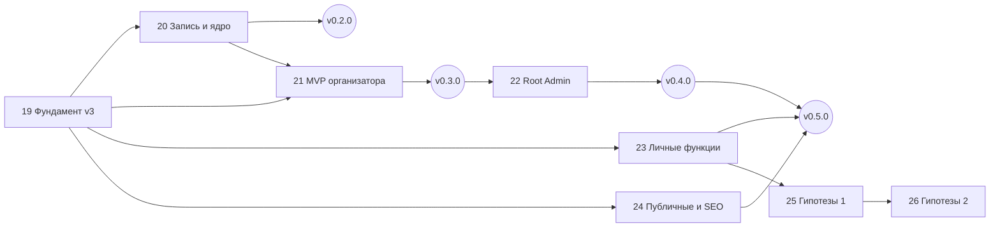

# 🗺 Roadmap

> **Last updated:** 2026-10-12 — перепланирование по референсу v3 ([19.0.1](tasks/19-0-1-reference-v3-replan.md)).
> Главный тактический документ — что делаем, в каком порядке и почему именно так.
> Актуальный план — раздел «Референс v3». Разделы фаз 3–18 ниже — история и backlog; их статусы сведены в таблицу «Судьба прежних фаз».

## Референс v3: фазы 19–26

Цель: привести продукт к референсу v3 ([docs/design/reference-v3](design/reference-v3/README.md)) — сначала MVP для Mini App и десктопа организатора, затем Root Admin, затем публичные страницы и гипотезы. Каждая задача референса (P/M/W/R) стала карточкой проекта с моделью реализации и ревью; правила — [ORCHESTRATION](ORCHESTRATION.md).

| Фаза                                                       | Релиз    | Референс      | Задач | Что даёт                                                                                     |
| ---------------------------------------------------------- | -------- | ------------- | ----: | -------------------------------------------------------------------------------------------- |
| [19](phases/19-foundation-v3.md) Фундамент v3              | `v0.2.0` | Ф0            |    11 | токены и атомы v3, статусная модель, ADR домена, настройки, уровни, права                    |
| [20](phases/20-booking-core-v3.md) Запись и ядро           | `v0.2.0` | Ф1            |    27 | места, цена, баланс событий, серии, планировщик, уведомления, Mini App игрока, ядро кабинета |
| [21](phases/21-organizer-mvp-v3.md) MVP организатора       | `v0.3.0` | Ф2 без root   |    16 | Mini App организатора, сборы, касса, отчёты, баланс, все разделы кабинета                    |
| [22](phases/22-root-admin.md) Root Admin                   | `v0.4.0` | Ф2 root, R-08 |     9 | админка платформы                                                                            |
| [23](phases/23-player-features-calendar.md) Личные функции | `v0.5.0` | Ф3            |     5 | флаги функций, «Лента дня», общий календарь                                                  |
| [24](phases/24-public-seo.md) Публичные страницы           | `v0.5.0` | Ф4 + лендинг  |     5 | SEO-страница группы, модерация, лендинг v3                                                   |
| [25](phases/25-hypotheses-wave-1.md) Гипотезы 1            | `v0.6.0` | Ф5            |     5 | разминка, самооценка, прогресс, серии                                                        |
| [26](phases/26-hypotheses-wave-2.md) Гипотезы 2            | `v0.7.0` | Ф6            |     6 | MVP игры, составы, AI-тренер, итоги сезона                                                   |

Решения владельца [D-01…D-11](operations/decisions/2026-10-12-reference-v3-decisions.md) приняты 2026-10-12 (задача 19.0.3 `done`); ADR 19.2.1 может стартовать.

### Волны исполнения

Внутри волны задачи независимы и идут параллельно (не больше трёх исполнителей, миграции — по одной). Номер волны — длина цепочки зависимостей внутри релиза. Фазы перекрываются: задача стартует, когда закрыты её `depends_on`.

| Релиз    | Волна | Задачи                                                                                 |
| -------- | ----- | -------------------------------------------------------------------------------------- |
| `v0.2.0` | 1     | 19.0.1, 19.0.3, 19.1.1                                                                 |
|          | 2     | 19.1.2, 19.1.3, 19.1.4, 19.2.1                                                         |
|          | 3     | 19.0.2, 19.2.2, 19.2.3, 19.3.1, 20.2.1, 20.4.3, 20.5.4                                 |
|          | 4     | 20.1.1, 20.1.2, 20.1.3, 20.2.2, 20.4.1, 20.4.2, 20.4.10, 20.5.1, 20.5.2, 20.5.7        |
|          | 5     | 20.3.1, 20.4.4, 20.4.5, 20.4.7, 20.4.8, 20.5.3, 20.5.5, 20.5.6, 20.6.1                 |
|          | 6     | 20.3.2, 20.4.6                                                                         |
|          | 7     | 20.3.3, 20.4.9                                                                         |
|          | 8     | 20.7.1 — QA, Promote, приёмка                                                          |
| `v0.3.0` | 1     | 21.1.4, 21.2.3 (могут стартовать уже в волнах v0.2.0)                                  |
|          | 2     | 21.2.1, 21.2.2, 21.2.4, 21.2.6, 21.2.7, 21.2.8                                         |
|          | 3     | 21.1.1, 21.1.3, 21.1.6, 21.2.5                                                         |
|          | 4     | 21.1.2                                                                                 |
|          | 5     | 21.1.5, 21.2.9                                                                         |
|          | 6     | 21.3.1 — QA, Promote, приёмка                                                          |
| `v0.4.0` | 1–4   | 22.1.1 → 22.1.2, 22.1.3 → 22.1.4, 22.2.1, 22.2.2, 22.3.1 → 22.2.3; затем 22.3.2        |
| `v0.5.0` | 1–3   | 23.1.1, 24.1.1 → 23.1.2, 23.2.2, 23.2.3, 24.1.2, 24.1.4 → 23.2.1, 24.1.3; затем 24.1.5 |
| `v0.6.0` | 1–3   | 25.1.4 → 25.1.1, 25.1.2 → 25.1.3; затем 25.1.5                                         |
| `v0.7.0` | 1–3   | 26.1.1, 26.1.3 → 26.1.4, 26.1.5 → 26.1.2; затем 26.1.6                                 |

### Критический путь

`19.0.3` решения → `19.2.1` ADR домена → `19.2.2` настройки группы → `20.1.1` цена → `20.3.1` планировщик → `20.3.2` уведомления → `20.3.3` бот → `20.7.1` релиз v0.2.0 → `21.3.1` релиз v0.3.0 → `22.3.2` релиз v0.4.0.

Задержка решений владельца сдвигает всё: 19.0.3 — первая задача пути.



### Судьба прежних фаз

| Фаза  | Было                      | Стало                                                                                                                |
| ----- | ------------------------- | -------------------------------------------------------------------------------------------------------------------- |
| 3–6   | MVP foundation … ledger   | `done` (статусы сверены по карточкам 2026-10-12)                                                                     |
| 7     | Event credits             | `superseded`: 20.2.1 баланс событий, 21.2.8 покупка, 22.2.1–22.2.2 root                                              |
| 8     | Telegram Bot + Mini App   | `in_progress`: открыты только ручные QA-карточки 8.7.2 и 8.8.11                                                      |
| 9     | Production deploy         | `in_progress`: Sentry/мониторинг (9.6), S3-бэкап (9.7), webhook (9.5), DNS (9.4) — операционный долг; CI/CD — 9.8.17 |
| 10    | Private beta              | 10.3 поглощён 22.1.1; остальное — после v0.4.0 по решению владельца                                                  |
| 11    | Contributions             | `superseded`: 21.2.4–21.2.5, 21.1.5–21.1.6                                                                           |
| 12–13 | Online payments           | backlog; от них зависит полный объём 22.2.3 (D-07)                                                                   |
| 14    | Reports & export          | `superseded` в объёме макетов: 21.2.7, 21.1.3; налоговый экспорт — backlog                                           |
| 15    | Reminders & automation    | `superseded`: 20.3.1, 20.3.2; карточки 15.x — входные материалы                                                      |
| 16–18 | Matches, tournaments, CRM | backlog без изменений                                                                                                |

---

---

## Общий обзор

```
Phase 1-2 ✅ — Python-прототип (legacy, для domain knowledge)

═══ NEW STACK: Nuxt 4 + Drizzle + PostgreSQL + better-auth + grammY ═══

Phase 3:  Foundation (монорепозиторий, инфраструктура)
Phase 4:  Organizations + Members + Invites
Phase 5:  Events + Bookings + Subscriptions
Phase 6:  Manual Payments + Ledger
Phase 7:  Event Credits (платформенная монетизация)
Phase 8:  Telegram Bot + Mini App                  ← MVP RELEASE
Phase 9:  Production Deploy (minimal)
Phase 10: Private Beta                             ← ГЕЙТ ГИПОТЕЗ

═══ Расширение — только после подтверждения гипотез ═══

Phase 11: Contributions (сборы)
Phase 12: Online Payments — own organization
Phase 13: Online Payments — organizer add-on
Phase 14: Reports & Export
Phase 15: Reminders & Automation

═══ Турниры — после запроса от клубов ═══

Phase 16: Matches + Live Scoreboard + Stats (порт Volley Time)
Phase 17: Tournament Mode

═══ CRM — после явного запроса крупных клубов ═══

Phase 18: CRM Pro
```

| Phase | Название                                        | Статус  |     Часы |
| ----: | ----------------------------------------------- | :-----: | -------: |
|     1 | MVP-каркас (Python legacy)                      | ✅ done |        — |
|     2 | Subscriptions + Manual Payments (Python legacy) | ✅ done |        — |
|     3 | Foundation (новый стек)                         | ⚪ todo |    30-40 |
|     4 | Organizations + Members + Invites               | ⚪ todo |    40-50 |
|     5 | Events + Bookings + Subscriptions               | ⚪ todo |    50-70 |
|     6 | Manual Payments + Ledger                        | ⚪ todo |    20-30 |
|     7 | Event Credits (монетизация)                     | ⚪ todo |    20-30 |
|     8 | Telegram Bot + Mini App                         | ⚪ todo |    60-80 |
|     9 | Production Deploy                               | ⚪ todo |    15-25 |
|    10 | Private Beta                                    | ⚪ todo | по факту |
|    11 | Contributions                                   | ⚪ todo |    25-35 |
|    12 | Online Payments (own org)                       | ⚪ todo |    30-40 |
|    13 | Online Payments (organizer add-on)              | ⚪ todo |    25-35 |
|    14 | Reports & Export                                | ⚪ todo |    25-35 |
|    15 | Reminders & Automation                          | ⚪ todo |    20-30 |
|    16 | Matches + Live Scoreboard + Stats (port)        | ⚪ todo |    60-80 |
|    17 | Tournament Mode                                 | ⚪ todo |    50-70 |
|    18 | CRM Pro                                         | ⚪ todo |   80-120 |

**Критический путь к MVP-релизу:** Phase 3 → 4 → 5 → 6 → 8 → 9 = **~220-300 часов** (≈ 3-4 месяца full-time соло). Монетизация (Phase 7) — после гейта беты (Phase 10), не входит в путь к первому релизу.

---

## Последовательность реализации (≠ нумерация)

> **Важно:** номер фазы — это ID (на него завязаны эпики, задачи, depends_on, кросс-ссылки), а НЕ порядок выполнения. Реализуем в порядке ниже, номера не меняем.

```
3 → 4 → 5 → 6 → 8 → 9 → 10 → 7 → 15 → 11 → 12 → 13 → 14 → 16 → 17 → 18
└──────────── ЯДРО + MVP + бета ──────────┘ └ ЯДРО ┘ └──── МОДУЛИ СВЕРХУ ────┘
```

**Логика:** 3-6 фундамент+ядро; 8 Telegram MVP, 9 деплой, 10 бета (гейт); 7 монетизация после гейта; 15 завершает ядро (reminders/automation, работает внутри событий/броней); 11-18 — модули-надстройки.

**Почему 15 перед 11:** reminders/automation работают внутри ядра (события, брони, waitlist), завершают базовый функционал. Contributions и далее — отдельные домены сверху. Бонус: job runner из 15 — инфраструктура для вебхуков/ретраев Phase 12-13.

**Расписаны детально (карточки):** 9 фаз (3-10 + 7 + 15) — 72 эпика, 181 задача. Фазы 11-14, 16-18 — phase-card скелеты (детализация по факту работающего продукта и обратной связи беты).

**Релиз-план:** привязка фаз к релизам, точка MVP и этапы — в [RELEASES.md](./RELEASES.md). Ведение в GitHub — [GITHUB_SETUP.md](./GITHUB_SETUP.md).

---

## Phase 3: Foundation

**Цель.** Заложить технический фундамент: монорепозиторий, dev-environment, Drizzle schema, better-auth, базовая структура apps/web и apps/bot.

**Артефакты:**

- Монорепо (pnpm workspaces)
- `apps/web` — Nuxt 4 проект-скелет
- `apps/bot` — grammY проект-скелет
- `packages/db` — Drizzle schema + миграции
- `packages/shared` — общие типы
- `docker-compose.yml` для dev (PostgreSQL + Redis)
- better-auth настроен с email-code + Telegram identity
- Vitest + базовые smoke-тесты
- `.env.example` со всеми переменными

**DoD:**

- `pnpm dev` поднимает Nuxt + bot + Postgres
- `pnpm test` запускает тесты
- Можно зарегистрироваться по email и получить код
- Можно войти из Telegram-бота и связать аккаунты

**Эпики (предварительно):** инфраструктура монорепо, Drizzle setup, better-auth setup, базовый Nuxt, базовый grammY, Docker dev, тестовая инфраструктура.

---

## Phase 4: Organizations + Members + Invites

**Цель.** Multi-tenancy с первого дня. Любой пользователь может создать организацию, пригласить других, управлять составом.

**Артефакты:**

- Модели: `Organization`, `OrganizationMember`, `InviteLink`
- API endpoints: `/api/organizations/*`, `/api/invites/*`
- UI: создание организации, страница «Моя организация», управление членами
- Invite flow в Telegram:
  - `t.me/<bot>?start=org_<token>` → подтверждение → вступление
  - `t.me/<bot>?start=event_<token>` (для Phase 5)
- Роли: owner / organizer / assistant / player
- Статусы: pending / active / guest / blocked / left / rejected
- Audit log для всех операций над членами

**DoD:**

- Пользователь создаёт организацию, становится owner
- Owner генерирует invite link, отправляет в Telegram
- Получатель открывает ссылку, вступает (или подаёт заявку)
- Owner принимает заявку или отклоняет
- Owner назначает другому пользователю роль organizer
- Owner блокирует и разблокирует пользователя

**Эпики:** Organization CRUD, OrganizationMember management, InviteLink CRUD + Telegram deeplinks, Roles & Permissions, Audit Log.

---

## Phase 5: Events + Bookings + Subscriptions

**Цель.** Ядро функциональности: создание тренировок, запись игроков, абонементы, waitlist. Порт основной логики из Python-прототипа.

**Артефакты:**

- Модели: `Event`, `Booking`, `Subscription`, `SubscriptionPlan`, `Venue`
- Все scoped by `organization_id`
- Логика slot distribution: capacity + waitlist (main/rotation — ~~отложено~~, см. решение 2026-09-17)
- Атомарное списание сессий абонемента (Drizzle transaction + WHERE-condition)
- FIFO выбор абонемента по `expires_at`
- Промоушн из waitlist при отмене
- ~~Окно закрытия записи (`booking_closes_hours_before`)~~ — отложено в Phase 15 (авто-закрытие, 15.4.1)
- API endpoints: `/api/events/*`, `/api/bookings/*`, `/api/subscriptions/*`
- UI: список событий, страница события, создание/редактирование, мои записи, мои абонементы
- CRUD планов абонементов внутри организации

**DoD:**

- Owner создаёт событие
- Игроки записываются через UI — попадают в состав (capacity) или в waitlist
- При отмене кого-то — первый из waitlist уведомляется (Phase 4 invite-flow используется для уведомления)
- Игрок покупает абонемент (пока pending, без подтверждения оплаты)
- Игрок записывается с абонемента — сессия списывается атомарно
- При отмене брони с абонементом — сессия возвращается

**Эпики:** Events CRUD, Bookings + Waitlist, Subscriptions + Plans CRUD, Venues, UX для игроков, UX для организаторов.

> **Решение 2026-09-17 (ревью v0.1.0, находка 5 P2#15 → Task 5.13.15):** ротация (основа/ротация) в MVP не реализуется — ротация — это организационный момент внутри тренировки, а не категория записи (см. phase card 5). Окно закрытия записи до старта переносится в Phase 15 (авто-закрытие по расписанию). В MVP запись закрывается в момент начала события, отмена — по `cancellation_deadline_hours`. UI не показывает ротацию.

---

## Phase 6: Manual Payments + Ledger

**Цель.** Финансовый контур: ручная фиксация оплат, касса с балансом.

**Артефакты:**

- Модели: `Payment`, `LedgerEntry`
- Цикл: pending → succeeded / failed / refunded
- Категории: training_fee / subscription / rent / balls / refund / other
- API endpoints: `/api/payments/*`, `/api/ledger/*`
- UI: список pending-платежей для админа, подтверждение/отклонение, касса с балансом, добавление расхода
- Уведомление организатору о новой pending-оплате

**DoD:**

- Игрок при записи выбирает: «с абонемента» или «наличными»
- Если наличные — Booking в pending_payment, Payment в pending
- Организатор видит pending в админ-меню, подтверждает кнопкой
- Подтверждение: Booking → confirmed, Payment → succeeded, LedgerEntry создана
- Организатор вводит расход (rent / balls / etc.)
- Касса показывает баланс и историю

**Эпики:** Payments service, Ledger service, UX подтверждения, UX кассы.

---

## Phase 7: Event Credits (платформенная монетизация)

**Цель.** Организатор покупает у платформы право создавать события. Без credits — нельзя создать событие.

**Артефакты:**

- Модели: `EventCreditAccount`, `EventCreditTransaction`
- Типы транзакций: purchase / spend / refund / grant / correction
- Списание 1 credit при создании события
- Возврат credit при отмене события **до** открытия записи
- Платформенные настройки: цены пакетов
- Платформенный admin (root) — отдельный layer прав
- API endpoints: `/api/billing/credits/*`
- UI: страница «Баланс credits» в админ-меню организации
- Demo-квота для новых организаций (например, 5 free credits на старте)

**DoD:**

- Новая организация получает 5 demo credits
- Owner создаёт событие → -1 credit
- Owner отменяет событие до записей → +1 credit
- Owner видит баланс и историю транзакций
- Root-admin платформы может вручную выдать `grant` для конкретной организации

**Эпики:** EventCreditAccount + Transactions, Спец-проверка при создании Event, Platform admin (root), Demo quota.

---

## Phase 8: Telegram Bot + Mini App — **MVP RELEASE**

**Цель.** Основной интерфейс продукта — Telegram. Bot для invite-flow и уведомлений, Mini App для всех операций.

**Артефакты:**

- grammY bot:
  - `/start` с deeplink-routing
  - Базовые команды: `/start`, `/help`, `/menu`
  - Inline-кнопки: «Открыть приложение» (deeplink на Mini App)
  - Webhook уведомления: новая бронь, подтверждение оплаты, отмена тренировки
- Mini App (Nuxt routes под `/m/*`):
  - Адаптивный UI (mobile-first)
  - Telegram WebApp API integration: `tg.expand()`, `tg.MainButton`, тема цветов
  - Auth через `initData` → создание/связывание User в better-auth
  - Список событий организации
  - Запись на событие
  - Мои абонементы, мои записи
  - Покупка абонемента
  - Админ-функции для owner/organizer
- Web-приложение (десктоп) — те же страницы без Telegram-обёртки

**DoD:**

- Любая Phase 4-7 функциональность доступна через Mini App
- UI выглядит хорошо в Telegram (mobile WebApp)
- Уведомления приходят в чат с ботом
- Игрок может зайти в Mini App, записаться, оплатить (cash), посмотреть свои записи
- Организатор может создать тренировку, видеть состав, подтверждать платежи

**Эпики:** grammY bot setup, Mini App layout, Telegram identity link, Notifications, Mini App pages (events, bookings, subscriptions, admin).

---

## Phase 9: Production Deploy (минимальный)

**Цель.** Бот и Mini App работают 24/7 на собственном домене.

**Артефакты:**

- Dockerfile для apps/web и apps/bot
- docker-compose.yml для production
- Caddy reverse-proxy с HTTPS (Let's Encrypt)
- PostgreSQL + Redis в Docker
- Ежедневный бэкап БД через cron
- Sentry интеграция (free tier)
- UptimeRobot пинг `/health`
- Telegram webhook вместо long-polling
- `.env.production` без секретов в Git

**DoD:**

- Бот доступен 24/7 по адресу `t.me/volleytime_bot`
- Mini App доступен по `https://app.volleytime.by`
- Здоровье системы видно через UptimeRobot
- При исключении приходит alert в Sentry
- Бэкап создаётся и проверен восстановлением

**Эпики:** Dockerfile, docker-compose, Caddy + TLS, Backup, Monitoring (Sentry + UptimeRobot), Webhook mode.

---

## Phase 10: Private Beta — **ГЕЙТ ГИПОТЕЗ**

**Цель.** Запустить платформу для 2-5 внешних организаторов. Собрать обратную связь. Принять решение о дальнейшем развитии.

**Артефакты:**

- Onboarding-guide для нового организатора (Markdown, потом видео)
- Welcome-flow в Mini App для первого входа
- Канал обратной связи (Telegram-чат с командой Volley Time)
- Метрики:
  - количество созданных событий
  - количество записей
  - частота использования Mini App vs веб
  - количество ручных платежей через ledger
  - удовлетворённость организаторов (мини-опросы)

**Это не разработка**, а полевая фаза. Заранее не расписывается на эпики и задачи.

**Гейт-критерии для перехода в Phase 11+:**

- ≥ 2 организатора активно используют платформу ≥ 1 месяц
- ≥ 50 событий создано суммарно
- ≥ 200 бронирований сделано
- ≥ 1 организатор готов платить за event credits (валидируется через прямой вопрос)
- ≥ 80% операций выполняется без обращения в поддержку

**Если гейт не пройден** — итерация Phase 5-8, не Phase 11.

---

## Phase 11: Contributions (сборы)

**Цель.** Прозрачный учёт сборов: на мяч, на турнир, на форму, на аренду, на судью.

**Артефакты:**

- Модели: `ContributionCampaign`, `Contribution`
- Цикл вклада: pledged → received_cash / received_transfer / received_online / cancelled / refunded
- Видимость: members_only / public_link
- UI: список кампаний организации, страница кампании с прогресс-баром, список вкладов
- Mini App + веб
- Уведомление членам организации о новой кампании

**DoD:**

- Owner создаёт кампанию «Новый мяч, цель 250 BYN»
- Игроки видят кампанию, обещают N BYN (pledged)
- Owner отмечает кого получил наличными (received_cash) → прогресс растёт
- Public link даёт share-ссылку, чтобы делиться вне Telegram

**Эпики:** Campaign CRUD, Contribution CRUD, UX кампаний, Уведомления.

---

## Phase 12: Online Payments — own organization

**Цель.** Подключить bePaid для **своей** организации (как proof of concept). Игрок может оплатить тренировку или абонемент картой/ЕРИП.

**Артефакты:**

- BePaidClient: создание checkout, refund, ЕРИП
- Webhook handler `/webhooks/bepaid`
- Идемпотентность по `bepaid_uid`
- RSA-проверка подписи (hard fail без ключа)
- Log redaction чувствительных данных
- UI: кнопки «Оплатить картой» / «ЕРИП» в Mini App
- Deeplink на bePaid checkout page
- Уведомление пользователю при успешной оплате

**DoD:**

- В тестовом режиме bePaid: запись → оплата картой → webhook → подтверждение брони автоматическое
- Refund при отмене тренировки через bePaid API
- Дублирующиеся webhook не создают двойную запись

**Эпики:** BePaidClient, Webhook security & idempotency, Payment UX, Refund flow.

---

## Phase 13: Online Payments — organizer add-on

**Цель.** Превратить bePaid-интеграцию из Phase 12 в **подключаемый модуль** для любого организатора. Каждая организация подключает свой bePaid-аккаунт.

**Артефакты:**

- Поле `Organization.bepaid_credentials` (encrypted в БД)
- UI настроек организации: «Подключить bePaid»
- Feature entitlement: `online_payments` (вкл/выкл per organization)
- Документация для организатора: как подключить bePaid

**DoD:**

- Новая организация подключает свои bePaid creds через UI
- Платежи в этой организации идут через её bePaid, не через bePaid платформы
- Платформа никогда не видит сумм платежей в своих логах (только uid и status)

**Эпики:** Encrypted credentials, Per-org BePaidClient, Feature entitlement check.

---

## Phase 14: Reports & Export

**Цель.** Аналитика для организатора + экспорт CSV для НПД-декларации и Excel-анализа.

**Артефакты:**

- Отчёт «кто должен»: список pending-платежей с возрастом
- Отчёт «баланс кассы за период»
- Отчёт «статистика посещаемости»
- CSV экспорт кассы за период (UTF-8 BOM, разделитель «;»)
- CSV экспорт посещаемости
- Группировка событий по неделям/месяцам

**DoD:**

- Owner выгружает CSV кассы за месяц для НПД
- Owner видит топ-должников
- Owner видит % посещаемости каждого игрока

**Эпики:** Reports queries, CSV export, UI отчётов.

---

## Phase 15: Reminders & Automation

**Цель.** Бот сам напоминает за 24 ч и за 2 ч до тренировки, закрывает запись, продвигает waitlist с TTL подтверждения.

**Артефакты:**

- Job runner (BullMQ или агентский scheduler через PostgreSQL — выбрать на Phase 15)
- Напоминания за 24 ч (через Telegram-бот)
- Напоминания за 2 ч + закрытие записи
- TTL pending_payment 15 мин
- TTL waitlist promotion 30 мин (с inline-кнопкой «Подтвердить»)
- Авто-finished для прошедших тренировок

**DoD:**

- Игроки получают напоминания
- Pending-брони отменяются через 15 мин
- Waitlist продвижение с TTL

**Эпики:** Job runner setup, Reminder jobs, Status transitions, Tests.

---

## Phase 16: Matches + Live Scoreboard + Stats (порт Volley Time)

**Цель.** Перенести из Laravel Level Volley логику матчей, live scoring и статистики. Это шаг к Tournament Mode.

**Артефакты:**

- Модели: `Match`, `MatchSet`, `MatchScoreAction`, `MatchTimeline`, `Standings`
- Append-only Match Timeline с `is_reverted`
- Optimistic locking через поле `version`
- Live Scoreboard endpoint (auto-refresh каждые 5 сек)
- MVP-голосование
- Standings с настраиваемой `tiebreak_order`
- Системы очков: standard (3/2/1/0) и sum_points
- Event Staff (judge, event_admin) с фигур из Phase 4
- Role hierarchy: player → judge → organizer → admin (расширяем существующие роли)

**DoD:**

- На события можно назначить судью (event_staff)
- Судья открывает матч, ведёт счёт через мобильный UI
- Кнопка undo работает
- Завершение сета и матча автоматическое
- Live scoreboard выводится на проектор
- Стандингс обновляется
- MVP голосование работает

**Эпики:** Matches CRUD, Live Scoring, Match Timeline (append-only), Standings, MVP Voting, Event Staff (расширение Phase 4), Scoreboard UI.

---

## Phase 17: Tournament Mode

**Цель.** Объединить Events и Matches под турнирные сетки. Создание турнира с командами, расписанием, round-robin / playoff.

**Артефакты:**

- Модели: `Tournament`, `TournamentTeam`, `TournamentRound`
- Алгоритмы генерации:
  - Team generation: random / balanced (по рейтингу — из Volley Time)
  - Schedule generation: round-robin
- UI: создание турнира, страница турнира с табами (Обзор / Команды / Матчи / Статистика)
- Drag-and-drop игроков между командами
- Назначение капитанов
- Цвета команд
- Публичная страница турнира с QR-кодом

**DoD:**

- Owner создаёт турнир, импортирует список email
- Owner генерирует команды (balanced)
- Owner генерирует расписание (round-robin)
- Назначает судью на каждый матч
- Матчи играются, scoreboard, standings, MVP

**Эпики:** Tournament CRUD, Team Generation, Schedule Generation, Tournament UI, Public Page.

---

## Phase 18: CRM Pro

**Цель.** Расширенная работа с базой игроков: заметки, теги, сегменты, no-show analytics, рассылки.

**Артефакты:**

- Модели: `PlayerProfile`, `PlayerNote`, `PlayerTag`, `PlayerSegment`
- Карточка игрока с расширенной информацией:
  - Контакты, заметки организатора
  - Уровень игрока
  - Игровые роли (доигровщик, связующий, либеро)
  - Теги
  - История no-show
  - Частые отмены
  - Чёрный список
- Сегменты: «новички», «активные», «должники», custom
- Рассылки по сегментам (через Telegram-бот)
- Feature entitlement: `crm_pro` (платный add-on)

**Доступно только после явного запроса крупных клубов** (см. PLATFORM_VISION → Этап 6).

**Эпики:** PlayerProfile + Notes, Tags + Segments, Mass messaging, Analytics dashboard.

---

## Зависимости между фазами

```
Phase 3 (Foundation)
   │
   ├──► Phase 4 (Organizations) ──► Phase 5 (Events) ──► Phase 6 (Payments)
   │                                                          │
   │                                                          ▼
   │                                                  Phase 7 (Credits)
   │                                                          │
   │                                                          ▼
   │                                                  Phase 8 (Bot + Mini App)  ◄── MVP
   │                                                          │
   │                                                          ▼
   │                                                  Phase 9 (Deploy)
   │                                                          │
   │                                                          ▼
   │                                                  Phase 10 (Private Beta) ◄── ГЕЙТ
   │                                                          │
   │                                          ┌───────────────┼──────────────┐
   │                                          ▼               ▼              ▼
   │                                  Phase 11        Phase 12-13      Phase 14
   │                                  (Contributions)  (bePaid)        (Reports)
   │                                                                          │
   │                                                                          ▼
   │                                                                   Phase 15
   │                                                                   (Reminders)
   │                                                                          │
   │                                                                          ▼
   │                                                                   Phase 16-17 ◄── ГЕЙТ
   │                                                                   (Tournaments)
   │                                                                          │
   │                                                                          ▼
   │                                                                   Phase 18 ◄── ГЕЙТ
   │                                                                   (CRM Pro)
```

**Параллельные треки:**

- Phase 11-15 могут идти в любом порядке между собой (после Phase 10).
- Phase 16-17 — отдельный модуль, минимально зависит от 11-15.
- Phase 18 — отдельный модуль, может идти после любого из 11-17.

---

## Чекпоинты

| ID   | Чекпоинт                  | Когда                   | Что проверяем                                              |
| ---- | ------------------------- | ----------------------- | ---------------------------------------------------------- |
| CP-A | Python-прототип в группе  | Параллельно с Phase 3-7 | Реальный UX-фидбэк от 5-10 игроков, 4+ тренировки в неделю |
| CP-B | Foundation готов          | После Phase 3           | Stack работает, можно регаться, БД с миграциями            |
| CP-C | Multi-tenancy готов       | После Phase 4           | Можно создать организацию и пригласить людей               |
| CP-D | Ядро готов                | После Phase 6           | Можно проводить тренировки с ручной оплатой                |
| CP-E | **MVP готов**             | После Phase 8           | Telegram Mini App доступен, всё работает в Telegram        |
| CP-F | **Продакшен**             | После Phase 9           | 24/7 доступность, домен, HTTPS, бэкапы                     |
| CP-G | **Private Beta запущена** | Phase 10 старт          | 2-5 организаторов на закрытом тесте                        |
| CP-H | **Гипотеза подтверждена** | Phase 10 финиш          | См. гейт-критерии Phase 10                                 |

---

## Связанные документы

- [README.md](../README.md) — обзор
- [PLATFORM_VISION.md](./PLATFORM_VISION.md) — общее видение
- [MIGRATION_STRATEGY.md](./MIGRATION_STRATEGY.md) — миграция со старых проектов
- [DOMAIN.md](./DOMAIN.md) — модель данных
- [architecture/ARCHITECTURE.md](./architecture/ARCHITECTURE.md) — техническая архитектура
- [architecture/MODULITH_ARCHITECTURE.md](./architecture/MODULITH_ARCHITECTURE.md) — modulith
- [strategy/SAAS_STRATEGY.md](./strategy/SAAS_STRATEGY.md) — стратегия SaaS
- [operations/status/current-state.md](./operations/status/current-state.md) — снимок состояния
