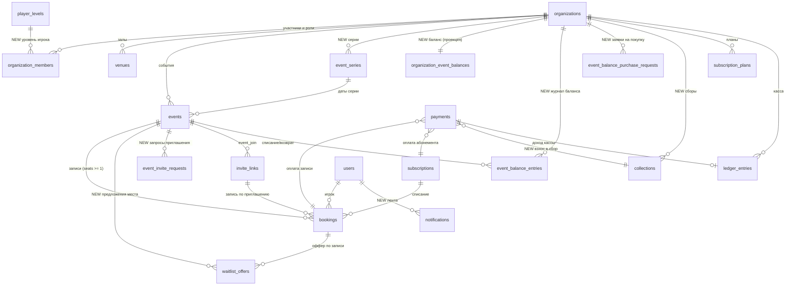
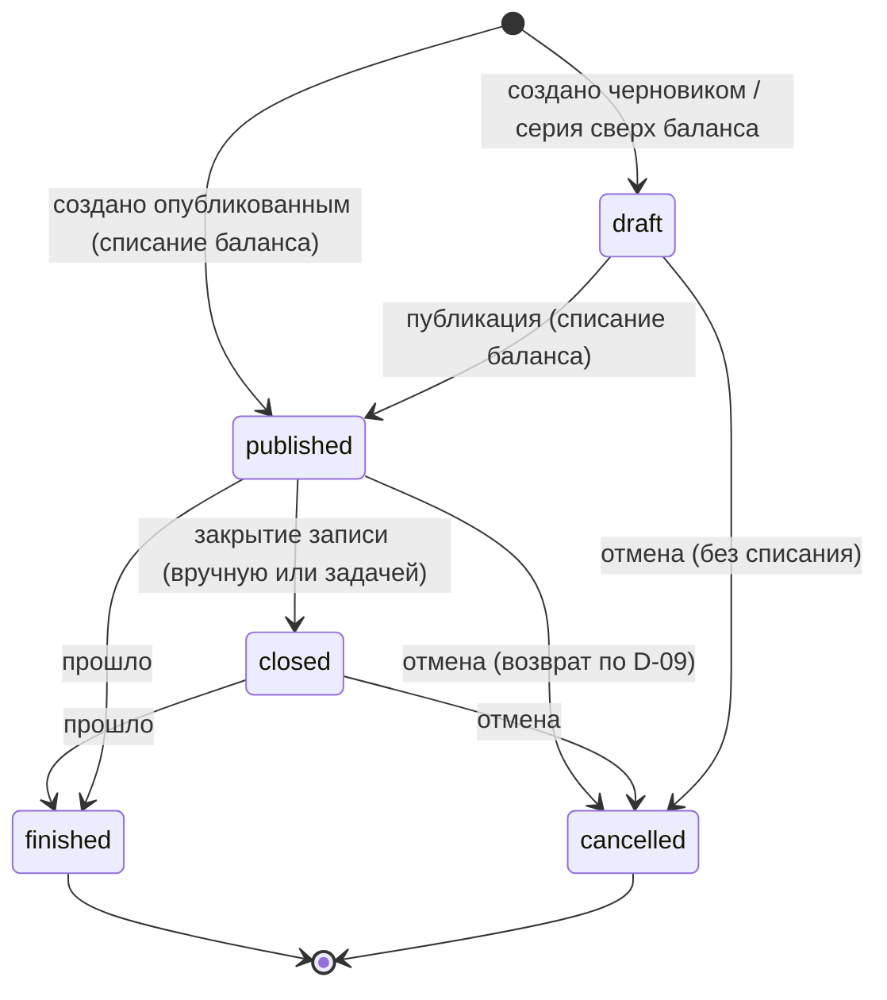
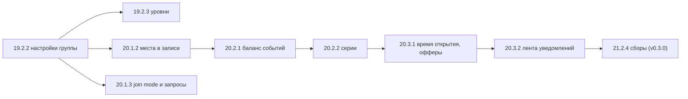

# ADR v3 · Доменная модель и контракт API референса v3

- **Статус:** принято (задача [19.2.1](../tasks/19-2-1-domain-model.md), `P-01`), 2026-10-13.
- **Решения владельца:** [D-01…D-11](../operations/decisions/2026-10-12-reference-v3-decisions.md) — все приняты; ADR их не пересматривает.
- **Область:** целевая схема данных для фаз 19–22 (релизы v0.2.0–v0.4.0), владельцы сущностей, порядок миграций по карточкам, правила совместимости, соответствие статусов референса enum-ам, соглашения API для новых ресурсов.
- **Не область:** сами миграции (их создают карточки-владельцы, см. [порядок](#порядок-миграций)), UI, гипотезы фаз 23–26.

## Контекст

На `main` (R0.7, 21 миграция `0000…0020`) уже работают: организации, участники и роли, приглашения в организацию, залы, события `fixed`/`split` с точным распределением копеек, записи (одна запись = одно место, лист ожидания статусом `waitlisted` с автопродвижением), планы абонементов и абонементы, платежи, касса (`ledger_entries`, append-only), журнал аудита. API — Nuxt server routes `/api/organizations/{orgId}/…`, ошибки через `defineApiHandler` + `handleServiceError` (4.9.11).

Референс v3 добавляет: места в записи, предложение места из очереди с TTL, режим записи по приглашению, настройки группы со снимком в событие, серии и черновики, баланс событий, сборы, хранимую ленту уведомлений, уровни В1–В4+, время открытия записи. Карточка 19.2.1 фиксирует **одну** целевую модель, чтобы каждая карточка-владелец добавила свою часть отдельной forward-compatible миграцией (запрет «одной миграции на всё»).

## Принципы (наследуются из [DOMAIN](../DOMAIN.md) и R0.7)

1. **Не переписывать работающие таблицы ради имён макета.** «Группа» в UI = `organizations`; «Иду» = `confirmed`; «сбор суммой» = `price_mode = 'split'`. Переименований таблиц, колонок и значений enum нет.
2. **Деньги** — `integer` в минимальных единицах + `currency` (как в R0.7; не `numeric`). Точное распределение копеек split сохраняется (D-01).
3. **Время** — `timestamptz` в UTC; календарные даты серии (`date`) — в часовом поясе группы (`organizations.default_timezone`).
4. **Tenant** — каждая операционная строка несёт `organization_id`; доступ — через `tenant` middleware и `permissions` из `packages/core`.
5. **Append-only** для денег и баланса: `ledger_entries`, `event_balance_entries`, `audit_log`. Исправление — новой записью.
6. **Снимок вместо ссылки на настройку.** Событие при создании копирует значения группы (D-02); изменение настройки не трогает созданные события.
7. **Инварианты — в БД.** CHECK, частичные UNIQUE и FK — вторая линия защиты после сервисов (как 5.13.13); гонки — блокировкой строки события / счёта в транзакции.

## Целевая модель

Связи с пометкой `NEW` ведут к новым таблицам; остальные таблицы есть на `main` и получают только новые колонки.



### Сущности и владельцы

Владелец сущности — модуль `packages/core/src/<module>` (правило modulith: чужие таблицы только через public service) и карточка, которая вводит её схему.

| Сущность (референс)        | Таблица / колонки                                                  | Модуль-владелец         | Карточка схемы | Состояние                          |
| -------------------------- | ------------------------------------------------------------------ | ----------------------- | -------------- | ---------------------------------- |
| Организация (группа)       | `organizations`                                                    | `organizations`         | —              | есть                               |
| Настройки группы           | колонки `organizations.*` (см. ниже)                               | `organizations`         | 19.2.2         | новые колонки                      |
| История настроек           | `audit_log` (`organization.settings_updated`, old/new)             | `audit`                 | 19.2.2         | без новой таблицы                  |
| Участник и роль            | `organization_members`                                             | `members`               | —              | есть                               |
| Уровень В1–В4+             | `player_levels` + `organization_members.level`, `…levels[]`        | `levels` (новый)        | 19.2.3         | новая таблица-справочник + колонки |
| Зал                        | `venues`                                                           | `venues`                | —              | есть                               |
| Событие                    | `events`                                                           | `events`                | —              | есть, новые колонки по карточкам   |
| Серия                      | `event_series` + `events.series_id`, `events.series_date`          | `events` (series)       | 20.2.2         | новая                              |
| Запись                     | `bookings`                                                         | `bookings`              | —              | есть                               |
| Место в записи             | `bookings.seats`, `bookings.waitlist_seats`                        | `bookings`              | 20.1.2         | новые колонки                      |
| Лист ожидания              | `bookings` (`waitlisted` / `waitlist_seats > 0`)                   | `bookings`              | —              | есть                               |
| Предложение места (TTL)    | `waitlist_offers`                                                  | `bookings`              | 20.3.1         | новая                              |
| Приглашение на событие     | `invite_links` (`type = 'event_join'`) + `bookings.invite_id`      | `invites`               | 20.1.3         | есть таблица, новые FK/колонки     |
| Запрос приглашения         | `event_invite_requests`                                            | `invites`               | 20.1.3         | новая                              |
| План абонемента, абонемент | `subscription_plans`, `subscriptions`                              | `subscriptions`         | —              | есть                               |
| Сбор                       | `collections`                                                      | `collections` (новый)   | 21.2.4         | новая                              |
| Взнос в сбор               | `payments` с `collection_id`                                       | `payments`              | 21.2.4         | новая колонка                      |
| Операция кассы             | `ledger_entries`                                                   | `ledger`                | —              | есть                               |
| Баланс событий             | `organization_event_balances` (проекция) + `event_balance_entries` | `event-balance` (новый) | 20.2.1         | новые                              |
| Заявка на покупку баланса  | `event_balance_purchase_requests`                                  | `event-balance`         | 20.2.1         | новая (UI 21.2.8, реестр 22.2.3)   |
| Уведомление                | `notifications`                                                    | `notifier`              | 20.3.2         | новая                              |
| Время открытия записи      | `events.booking_opens_at`                                          | `events`                | 20.3.1         | новая колонка                      |
| Фоновые задачи             | схема `pgboss` (создаёт pg-boss)                                   | `scheduler`             | 20.3.1         | вне Drizzle-миграций               |

### Настройки группы и снимок в событие (19.2.2, D-02)

Колонки `organizations` (все с DEFAULT, существующие строки получают значения без отдельного backfill):

| Колонка                       | Тип                            | Default   | Ограничение                     | Референс                 |
| ----------------------------- | ------------------------------ | --------- | ------------------------------- | ------------------------ |
| `subscriptions_enabled`       | boolean                        | `true`    | есть (5.13.21)                  | `subsOn`                 |
| `max_seats_per_booking`       | smallint                       | `3`       | `CHECK 1..10`                   | `maxSeats`               |
| `default_price_mode`          | `event_price_mode`             | `'fixed'` | enum есть                       | `priceMode` по умолчанию |
| `default_join_mode`           | `event_join_mode` (новый enum) | `'open'`  | `('open','invite')`             | `joinMode` по умолчанию  |
| `cancellation_allowed`        | boolean                        | `true`    |                                 | политика: разрешена ли   |
| `cancellation_deadline_hours` | integer NULL                   | `NULL`    | `CHECK >= 0`; NULL = до начала  | политика: крайний срок   |
| `seo_index`                   | boolean                        | `false`   | не связан с `default_join_mode` | `seoIndex`               |
| `district`                    | text NULL                      |           | `city` уже есть                 | город, район             |

Снимок в `events` при создании (сервис `events.create` копирует значения группы, если клиент не передал своё):

- `events.cancellation_deadline_hours` — **есть**; семантика не меняется, существующие события сохраняют свои значения.
- `events.cancellation_allowed boolean NOT NULL DEFAULT true` — **новая** (19.2.2); существующие события получают `true`, то есть прежнее поведение.
- `events.price_mode` — есть; значение группы подставляет сервис, не DEFAULT БД.
- `events.join_mode event_join_mode NOT NULL DEFAULT 'open'` — добавляет 20.1.3 (enum создаёт 19.2.2).

Лимит мест на игрока **не** снимается в событие: это ограничение ввода в момент записи, а не условие уже созданной записи; уменьшение лимита не трогает существующие записи.

История изменений — `audit_log` с `action = 'organization.settings_updated'`, `old_value`/`new_value` = изменённые поля. Отдельной таблицы истории нет: в `audit_log` уже есть кто, когда, было и стало.

### Уровни В1–В4+ (19.2.3)

- Enum `player_level`: `'v1','v2','v3','v4','v4_plus'` (код латиницей; подпись «В1…В4+» и описание — в справочнике).
- Справочник `player_levels(code player_level PK, sort_order smallint UNIQUE, title text, description text)` заполняется той же миграцией (`INSERT … ON CONFLICT DO NOTHING`); `GET /api/levels` читает его.
- `organization_members.level player_level NULL` — уровень игрока в группе.
- `organizations.levels player_level[] NOT NULL DEFAULT '{}'` — уровни группы (несколько).
- `events.level player_level NULL` — уровень события.
- `organization_members.rating_in_org` **не удаляется** в v0.2.0. Код его не читает и не пишет (проверено поиском по `apps/` и `packages/` на `b056806`), A/B/C есть только в макетах v2, поэтому «миграция A/B/C» данных не переносит: уровень остаётся NULL до назначения организатором. Удаление колонки — отдельный contract-шаг не раньше v0.3.0.

### Места в записи и лист ожидания (20.1.2, D-03)

Запись остаётся одной строкой на пару `(event_id, user_id)` — `bookings_event_user_unique` сохраняется. Это одновременно идемпотентность повторного нажатия и «одна строка, несколько мест, чип +N».

| Колонка                   | Тип     | Default | Ограничение                                                                 |
| ------------------------- | ------- | ------- | --------------------------------------------------------------------------- |
| `bookings.seats`          | integer | `1`     | `CHECK seats >= 1` — места, которые запись держит в своём статусе           |
| `bookings.waitlist_seats` | integer | `0`     | `CHECK waitlist_seats >= 0`; `> 0` только при `confirmed`/`pending_payment` |

- `waitlisted` + `seats = N` — вся запись в очереди на N мест.
- `confirmed`/`pending_payment` + `seats = K` + `waitlist_seats = M` — K мест в основе и ещё M в очереди («часть в основу, часть в очередь» с явным выбором игрока). Отдельной таблицы мест нет.
- Занято мест = `SUM(seats)` по `pending_payment`, `confirmed`, `attended`, `no_show`; «игроков» = `COUNT(*)` тех же строк. Это разные величины (handoff `buildRoster`).
- Позиция в очереди — порядок `(booked_at, id)` среди записей с `status = 'waitlisted' OR waitlist_seats > 0` (индекс `bookings_waitlist_order_idx` уже есть). Хранимой позиции нет.
- Конкурентность — прежняя блокировка строки события `SELECT … FOR UPDATE` (5.3.5, 5.13.7); проверки `SUM(seats) + новые <= capacity` и `seats + waitlist_seats <= organizations.max_seats_per_booking` выполняются внутри неё.
- Split делит сумму на фактическое число **мест**, а не записей. `events.pricing_participant_count` сохраняет имя, но после 20.1.2 хранит число мест на момент фиксации. Для событий R0.7 все `seats = 1`, значения совпадают, рассчитанные доли не меняются (D-01, «Не делать» 20.1.1).
- Абонемент списывает одно занятие за место — правило вводит 20.1.2; к `split` абонемент не применяется (P-03).

`waitlist_offers` (20.3.1) — предложение освободившихся мест с TTL:

| Колонка                                           | Тип / ограничение                                                                       |
| ------------------------------------------------- | --------------------------------------------------------------------------------------- |
| `id`, `organization_id`, `event_id`, `booking_id` | FK, `ON DELETE CASCADE`                                                                 |
| `seats`                                           | integer `CHECK >= 1` — сколько мест предложено                                          |
| `status`                                          | enum `waitlist_offer_status`: `offered`, `accepted`, `declined`, `expired`, `revoked`   |
| `offered_at`, `expires_at`                        | timestamptz; `expires_at = offered_at + 30 мин` (D-03), `CHECK expires_at > offered_at` |
| `responded_at`                                    | timestamptz NULL                                                                        |

`UNIQUE (booking_id) WHERE status = 'offered'` — не больше одного активного оффера на запись. Истечение — задача pg-boss с singleton-ключом `waitlist-offer:<id>`; переход разрешён только из `offered`, поэтому повтор безопасен. Места под активным оффером считаются занятыми при подсчёте свободных. Без планировщика (флаг выключен) сервис использует прежнее автопродвижение 5.6.2, офферы не создаются (D-03).

### Режим записи и приглашения на событие (20.1.3)

- `events.join_mode event_join_mode NOT NULL DEFAULT 'open'`; при создании подставляется `organizations.default_join_mode`, событие может переопределить.
- Приглашение на событие — существующая `invite_links` с `type = 'event_join'`. 20.1.3 добавляет FK `invite_links.event_id → events.id ON DELETE CASCADE` (колонка есть с фазы 4, FK отложен) и `CHECK ((type = 'event_join') = (event_id IS NOT NULL))` как `NOT VALID` с последующим `VALIDATE`. Однократность — `max_uses = 1`, срок — `expires_at`, startapp-параметр — `event_<token>`.
- `bookings.invite_id integer NULL REFERENCES invite_links(id) ON DELETE SET NULL` — по какому приглашению создана запись. Запись на событие `invite` без валидного приглашения отклоняет сервис (`booking.invite_required`, 403) — проверка в API, а не только в UI.
- `event_invite_requests`: `id`, `organization_id`, `event_id`, `user_id`, `status` enum `invite_request_status` (`pending`, `approved`, `declined`, `cancelled`), `message text NULL`, `decided_by_user_id`, `decided_at`, `invite_id` (выданное приглашение при `approved`), `created_at`. `UNIQUE (event_id, user_id) WHERE status = 'pending'`.

### Баланс событий (20.2.1, D-09, D-10)

Термин — «баланс событий», единица — «событие» (D-10). Имена в коде — `event_balance_*`, без `credit`.

`event_balance_entries` — журнал, append-only (UPDATE/DELETE сервис не делает; исправление — запись `correction`):

| Колонка                 | Тип / ограничение                                                                               |
| ----------------------- | ----------------------------------------------------------------------------------------------- |
| `id`, `organization_id` | FK `ON DELETE CASCADE`                                                                          |
| `delta`                 | integer `CHECK delta <> 0` — `+` начисление, `−` списание                                       |
| `reason`                | enum `event_balance_reason`: `demo_grant`, `purchase`, `grant`, `spend`, `refund`, `correction` |
| `balance_after`         | integer `CHECK balance_after >= 0` — остаток после операции                                     |
| `event_id`              | FK NULL `ON DELETE SET NULL` — для `spend`/`refund`                                             |
| `purchase_request_id`   | FK NULL — для `purchase`                                                                        |
| `created_by_user_id`    | FK NULL — автор; NULL только для системных `refund` (планировщик) и `demo_grant`                |
| `comment`               | text NULL; обязателен для `grant` и `correction` (CHECK)                                        |
| `created_at`            | timestamptz                                                                                     |

`organization_event_balances(organization_id PK, balance integer NOT NULL CHECK balance >= 0, updated_at)` — проекция журнала для блокировки и быстрого чтения. Каждое изменение — одна транзакция: `UPDATE organization_event_balances SET balance = balance + :delta WHERE organization_id = :org AND balance + :delta >= 0 RETURNING balance`, затем INSERT в журнал с этим `balance_after`. Ноль строк — `event_balance.insufficient`. Инвариант `balance = SUM(delta)` проверяется тестом и сверочным запросом; «баланс как сумма» (P-08) — журнал остаётся источником истины.

Идемпотентность (повторная задача или повторное нажатие не списывают дважды):

- `UNIQUE (event_id) WHERE reason = 'spend'` — одно списание на событие;
- `UNIQUE (event_id) WHERE reason = 'refund'` — один возврат на событие;
- `UNIQUE (organization_id) WHERE reason = 'demo_grant'` — одна demo-квота;
- `UNIQUE (purchase_request_id) WHERE reason = 'purchase'` — одна выдача по заявке.

Правила:

- Списание — при **публикации** события (создание сразу опубликованным или перевод `draft → published`); черновик баланс не тратит (нужно для D-04).
- Возврат (D-09) — при отмене события, если `booking_opens_at IS NOT NULL AND now() < booking_opens_at` **или** в событии нет ни одной активной записи (`pending_payment`, `confirmed`, `waitlisted`). До 20.3.1 колонки `booking_opens_at` нет, и действует только вторая ветка — это совпадает с D-09, потому что без времени открытия запись открыта сразу при публикации.
- Demo-квота — 5 событий (handoff) при создании организации.

`event_balance_purchase_requests` — заявка организатора на покупку пакета (D-07: без онлайн-оплаты):

| Колонка                                                | Тип / ограничение                                                              |
| ------------------------------------------------------ | ------------------------------------------------------------------------------ |
| `id`, `organization_id`, `requested_by_user_id`        | FK                                                                             |
| `units`                                                | integer `CHECK > 0` — снимок пакета                                            |
| `amount`, `currency`                                   | integer `CHECK >= 0`, minor units — снимок цены                                |
| `status`                                               | enum `purchase_request_status`: `pending`, `approved`, `rejected`, `cancelled` |
| `decided_by_user_id`, `decided_at`, `decision_comment` | NULL до решения                                                                |
| `created_at`                                           | timestamptz                                                                    |

Подтверждение root (операторская команда 20.2.1, затем UI 22.2.2/22.2.3) в одной транзакции переводит заявку `pending → approved` условным UPDATE и пишет `purchase`-запись. Каталог пакетов до 22.2.1 — конфигурация приложения; заявка хранит снимок, поэтому смена цен не меняет старые заявки.

### Время открытия записи (20.3.1, D-09)

`events.booking_opens_at timestamptz NULL` — NULL значит «запись открыта с публикации» (поведение R0.7). `CHECK booking_opens_at IS NULL OR booking_opens_at < starts_at`. Задача pg-boss открывает запись и рассылает «запись открыта»; до этого момента сервис записи отвечает `booking.not_open_yet` (422). Отдельного значения enum для «скоро откроется» нет — см. [статусы](#статусы-референса--enum).

### Серии и черновики (20.2.2, D-04)

`event_series`:

| Колонка                                       | Тип / ограничение                                                                                                                     |
| --------------------------------------------- | ------------------------------------------------------------------------------------------------------------------------------------- |
| `id`, `organization_id`, `created_by_user_id` | FK                                                                                                                                    |
| `rule`                                        | jsonb — `{ freq: 'once'\|'weekly'\|'biweekly', weekdays: [1..7], startDate, until?: date, count?: int }`; валидирует zod-схема в core |
| `exceptions`                                  | `date[] NOT NULL DEFAULT '{}'` — исключённые даты                                                                                     |
| `template`                                    | jsonb — поля события (название, зал, время начала, длительность, вместимость, цена, режимы, уровень)                                  |
| `timezone`                                    | varchar — снимок `organizations.default_timezone`                                                                                     |
| `status`                                      | enum `event_series_status`: `active`, `ended`                                                                                         |
| `created_at`, `updated_at`                    | timestamptz                                                                                                                           |

`events.series_id integer NULL REFERENCES event_series(id) ON DELETE SET NULL` и `events.series_date date NULL`; `UNIQUE (series_id, series_date)` — повторное создание той же даты невозможно. Каждая дата — обычная строка `events`: календари, запись и цена читают события, не серию.

Создание (D-04) — одна транзакция: вставить серию и **все** даты; блокировать `organization_event_balances`; первые `min(N, balance)` дат по возрастанию получают `published` и `spend`-запись, остальные — `draft`; даты с конфликтом зала — `draft` независимо от баланса. Сбой на любом шаге откатывает всё. Предпросмотр (`POST …/series/preview`) ничего не пишет и возвращает даты, число публикуемых и число черновиков. Лимит — 53 даты в серии (год еженедельно); больше — `series.too_many_dates` (422). Правка «это и последующие» меняет строки `events` с `series_id = :id AND series_date >= :date` и не трогает прошедшие и отменённые.

### Сборы (21.2.4)

`collections`: `id`, `organization_id`, `title`, `description NULL`, `icon` (`ball`, `trophy`, `shirt`, `arena`, `party`, `bus`), `target_amount integer NULL CHECK > 0` (NULL — сбор без цели), `currency`, `status` enum `collection_status` (`draft`, `active`, `completed`, `cancelled`), `deadline_at NULL`, `created_by_user_id`, `created_at`, `updated_at`, `closed_at NULL`.

Взнос — **платёж**: `payments.collection_id integer NULL REFERENCES collections(id) ON DELETE RESTRICT`. Так взнос получает готовый жизненный цикл `pending → succeeded | cancelled | refunded`, защиту от гонки подтверждения (5.13/6.8) и ровно одну запись кассы через существующий `ledger_income_payment_uniq`. Подтверждённый взнос пишет `ledger_entries` с `category = 'contribution'` и `payment_id`. Добавляется `CHECK num_nonnulls(booking_id, subscription_id, collection_id) <= 1` (`NOT VALID` + `VALIDATE`). Сумма подтверждённых взносов по сбору = сумма income-записей кассы по его платежам — критерий 21.2.4. Офлайн-взнос от человека без аккаунта в v0.3.0 не моделируется (`payments.user_id NOT NULL` сохраняется).

### Лента уведомлений (20.3.2)

`notifications` — один источник для бота, ленты Mini App и ленты кабинета:

| Колонка                                  | Тип / ограничение                                                                                                                                                                                                                 |
| ---------------------------------------- | --------------------------------------------------------------------------------------------------------------------------------------------------------------------------------------------------------------------------------- |
| `id`, `recipient_user_id`                | FK `users` `ON DELETE CASCADE`                                                                                                                                                                                                    |
| `organization_id`, `event_id`            | FK NULL                                                                                                                                                                                                                           |
| `type`                                   | enum `notification_type`: `booking_opened`, `waitlist_offer`, `reminder_24h`, `reminder_2h`, `split_settled`, `payment_confirmed`, `payment_rejected`, `lineup_ready`, `mvp_vote`, `event_cancelled`, `organizer_action_required` |
| `dedup_key`                              | text NOT NULL; `UNIQUE (recipient_user_id, dedup_key)` — «не больше одного уведомления одного типа на событие» (`<type>:event:<id>`)                                                                                              |
| `payload`                                | jsonb — данные шаблона (без секретов и initData)                                                                                                                                                                                  |
| `read_at`                                | timestamptz NULL                                                                                                                                                                                                                  |
| `delivery_status`                        | enum `notification_delivery_status`: `pending`, `sent`, `failed`, `skipped`                                                                                                                                                       |
| `delivered_at`, `attempts`, `last_error` | доставка в Telegram очередью pg-boss с учётом лимитов Bot API                                                                                                                                                                     |
| `created_at`                             | timestamptz; индекс `(recipient_user_id, created_at DESC, id DESC)` для ленты                                                                                                                                                     |

Тихие часы — `users.quiet_hours_start smallint NULL`, `users.quiet_hours_end smallint NULL` (минуты от полуночи в часовом поясе группы-источника, `CHECK 0..1439`). Отключение типов игроком — P-12 (23.1.1), не в v0.2.0. Текущий немедленный notifier 8.4 остаётся рабочим путём, пока 20.3.2 не переключит отправку на ленту.

## Статусы референса ↔ enum

Значения enum не переименовываются. Подписи из референса — производные, их считает один набор функций (`participationOf`, `eventStateOf`, задача 19.1.2).

### Событие (`event_status`)



| Референс (P-01 / handoff) | Значение и условие                                                             |
| ------------------------- | ------------------------------------------------------------------------------ |
| черновик                  | `draft`                                                                        |
| запись скоро откроется    | `published` и `booking_opens_at > now()` (после 20.3.1)                        |
| запись открыта / `open`   | `published` и (`booking_opens_at IS NULL OR booking_opens_at <= now()`)        |
| мест нет / `full`         | `published` и занято мест `>= capacity` — производное, не статус               |
| запись закрыта / `closed` | `closed`                                                                       |
| прошло / прошла / `past`  | `finished`, а также `published`/`closed` с `ends_at < now()` до автозавершения |
| отменено / `cancelled`    | `cancelled`                                                                    |

### Запись (`booking_status`) — ось «Моё участие»

| Референс                  | Значение                                                                        |
| ------------------------- | ------------------------------------------------------------------------------- |
| «Иду»                     | `confirmed`, `pending_payment`, `attended` — оплата показывается отдельной осью |
| «В очереди · N-й»         | `waitlisted` или `waitlist_seats > 0`; N — позиция по `(booked_at, id)`         |
| место предложено (30 мин) | активный `waitlist_offers.status = 'offered'` по записи                         |
| отменена                  | `cancelled`                                                                     |
| не пришёл                 | `no_show`                                                                       |

Ось «Оплата»: `pending_payment` или платёж `pending` → «ждёт оплаты» (amber); `confirmed` с `succeeded`-платежом, абонементом или `free` → «в порядке» (grass). Для `split` до фиксации — «прогноз», после — точная доля `allocated_amount`.

## Порядок миграций

Миграции сериализуются (ORCHESTRATION: одна задача со схемой в работе). Каждая карточка добавляет **одну** миграцию через `pnpm db:generate` (или ручной SQL, если Drizzle не выражает `NOT VALID`/данные), файл отката `packages/db/rollback/<tag>.sql` и интеграционный тест «применяется и откатывается на пустой и на заполненной базе» (заполненная — `pnpm db:seed:demo`, см. ниже). Номер берётся после rebase на `main`.



| #   | Карточка | Релиз  | Что добавляет миграция                                                                                                                                                                                                  | Совместимость с предыдущим runtime                                                       |
| --- | -------- | ------ | ----------------------------------------------------------------------------------------------------------------------------------------------------------------------------------------------------------------------- | ---------------------------------------------------------------------------------------- |
| 1   | 19.2.2   | v0.2.0 | enum `event_join_mode`; `organizations.max_seats_per_booking`, `default_price_mode`, `default_join_mode`, `cancellation_allowed`, `cancellation_deadline_hours`, `seo_index`, `district`; `events.cancellation_allowed` | только колонки с DEFAULT/NULL — старый runtime их не видит                               |
| 2   | 19.2.3   | v0.2.0 | enum `player_level`; таблица `player_levels` с данными; `organization_members.level`, `organizations.levels`, `events.level`                                                                                            | аддитивно; `rating_in_org` остаётся                                                      |
| 3   | 20.1.2   | v0.2.0 | `bookings.seats` (DEFAULT 1), `bookings.waitlist_seats` (DEFAULT 0), CHECK                                                                                                                                              | схема совместима; **данные** `seats > 1` несовместимы со старым подсчётом — флаг и guard |
| 4   | 20.1.3   | v0.2.0 | `events.join_mode`; FK `invite_links.event_id`; CHECK `event_join` (NOT VALID → VALIDATE); `bookings.invite_id`; enum и таблица `event_invite_requests`                                                                 | старый runtime не проверяет `join_mode` — флаг и guard на `join_mode = 'invite'`         |
| 5   | 20.2.1   | v0.2.0 | enums `event_balance_reason`, `purchase_request_status`; `organization_event_balances`, `event_balance_entries`, `event_balance_purchase_requests`; backfill счетов и demo-квоты существующим организациям              | старый runtime создаёт события без списания — см. правило 5                              |
| 6   | 20.2.2   | v0.2.0 | enum `event_series_status`; `event_series`; `events.series_id`, `events.series_date`, UNIQUE                                                                                                                            | аддитивно; старый runtime видит даты серии как обычные события                           |
| 7   | 20.3.1   | v0.2.0 | `events.booking_opens_at` + CHECK; enum `waitlist_offer_status`; `waitlist_offers`. Схема `pgboss` создаётся pg-boss при старте воркера, не Drizzle                                                                     | старый runtime игнорирует `booking_opens_at` — guard на будущие `booking_opens_at`       |
| 8   | 20.3.2   | v0.2.0 | enums `notification_type`, `notification_delivery_status`; `notifications`; `users.quiet_hours_start/end`                                                                                                               | аддитивно                                                                                |
| 9   | 21.2.4   | v0.3.0 | enum `collection_status`; `collections`; `payments.collection_id`; CHECK `num_nonnulls(...) <= 1` (NOT VALID → VALIDATE)                                                                                                | старый runtime не пишет `collection_id`; платежи-взносы ему видны как платежи без цели   |

Порядок 3 → 5: баланс зависит только от 19.2.1, но серия (6) опирается и на места, и на баланс, поэтому 20.1.2 идёт раньше, чтобы ветки не перегенерировали миграции дважды. Если оркестратор запускает 20.2.1 раньше 20.1.2, порядок 3 и 5 можно поменять: миграции не зависят друг от друга по схеме.

После v0.2.0 (contract-шаги, отдельными карточками, не раньше чем через релиз): удалить `organization_members.rating_in_org`; удалить ветку автопродвижения после стабилизации планировщика (только по решению владельца, D-03 её сохраняет).

## Правила совместимости

Требование [deploy runbook](../operations/runbooks/deploy.md#exact-application-rollback): миграции не откатываются автоматически, production-миграции forward-compatible и обратно совместимы с **предыдущим** приложением. Для v3 это означает:

1. **Expand → enable → contract.** Миграция только добавляет: таблицы, колонки `NULL` или с `DEFAULT`, enum-типы, индексы, FK/CHECK на новые колонки. Переименование, удаление, смена типа, `NOT NULL` без DEFAULT на существующей колонке, удаление значения enum — запрещены в том же релизе; contract — отдельной карточкой минимум через релиз.
2. **Новые значения существующих enum** (`booking_status`, `event_status`, `payment_status`, `ledger_category`) в v0.2.0 не добавляются: модель выше обходится без них. Если понадобится — новое значение не пишется, пока в production есть runtime, который его не знает.
3. **CHECK и FK на существующих данных** — `ADD CONSTRAINT … NOT VALID`, затем `VALIDATE CONSTRAINT` в той же миграции после проверки данных запросом в тесте на заполненной базе; длинные блокировки на `events`/`bookings` недопустимы.
4. **Новая семантика данных за флагом.** Где старый runtime неверно понимает новые данные (места `> 1`, `join_mode = 'invite'`, будущее `booking_opens_at`, офферы), запись таких данных включается nonsecret-переменной (`EVENT_MULTI_SEAT_ENABLED`, `EVENT_INVITE_MODE_ENABLED`, `SCHEDULER_ENABLED`) только после выкладки полного релиза — по образцу `EVENT_SPLIT_PRICING_ENABLED` (R0.7). Откат на runtime без поддержки проходит через quiescent-guard runbook, расширенный запросом «нет таких данных» (`EXISTS bookings WHERE seats > 1 OR waitlist_seats > 0`, `EXISTS events WHERE join_mode = 'invite' AND status IN ('published','closed')`, …); image несёт capability-label. Расширение guard — часть карточки-владельца.
5. **Баланс при откате.** Runtime без баланса создаёт события без `spend`. Это не портит данные, но оставляет события без списания; после roll-forward сверочный запрос `events без spend-записи, созданные после включения баланса` показывает расхождение, исправление — `correction` с автором. Поэтому выключатель списания (`EVENT_BALANCE_ENFORCED`) включается после выкладки, а backfill demo-квоты идемпотентен (`ON CONFLICT DO NOTHING` по частичному UNIQUE).
6. **Откат миграции** — `packages/db/rollback/<tag>.sql` к каждой новой миграции (с 0012 так уже принято); откат удаляет только то, что добавила миграция, и не трогает данные R0.7. Значения enum PostgreSQL не удаляются — откат оставляет их неиспользуемыми (как 0018).
7. **Проверка** — интеграционный тест карточки: применить миграцию на пустой базе и на базе после `db:seed:demo`, прогнать откат и повторное применение; плюс существующие тесты R0.7 без изменений (доказательство, что старый путь работает на новой схеме).

## Соглашения API для новых ресурсов

### Пути и именование

- Ресурсы группы — под существующим tenant-префиксом `/api/organizations/{orgId}/…` (middleware `tenant` разрешает организацию и участника, `permissions` проверяет роль). Пути референса переводятся так:

| Референс                                   | Путь в проекте                                                                                                           | Карточка |
| ------------------------------------------ | ------------------------------------------------------------------------------------------------------------------------ | -------- |
| `GET/PATCH /groups/{id}/settings`          | `GET/PATCH /api/organizations/{orgId}/settings`                                                                          | 19.2.2   |
| `GET /levels`                              | `GET /api/levels` (глобальный справочник, без tenant)                                                                    | 19.2.3   |
| `GET /events/{id}/price?seats=N`           | `GET /api/organizations/{orgId}/events/{eventId}/price?seats=N`                                                          | 20.1.1   |
| `POST /events/{id}/bookings {seats}`       | существующий `POST …/events/{eventId}/bookings` + поле `seats`                                                           | 20.1.2   |
| `PATCH /bookings/{id} {seats}`             | `PATCH /api/organizations/{orgId}/bookings/{bookingId}`                                                                  | 20.1.2   |
| `POST /events/{id}/invites`                | `POST /api/organizations/{orgId}/events/{eventId}/invites`                                                               | 20.1.3   |
| `POST /events/{id}/invite-requests`        | `POST /api/organizations/{orgId}/events/{eventId}/invite-requests` (+ `GET`, `POST …/{requestId}/approve` и `…/decline`) | 20.1.3   |
| `POST /balance/purchase`                   | `GET /api/organizations/{orgId}/event-balance`, `GET …/event-balance/entries`, `POST …/event-balance/purchase-requests`  | 20.2.1   |
| `POST /series`, `GET /series/{id}/preview` | `POST /api/organizations/{orgId}/series/preview` (без записи), `POST …/series`, `GET …/series/{seriesId}`                | 20.2.2   |
| `PATCH /series/{id}?scope=following`       | `PATCH /api/organizations/{orgId}/series/{seriesId}?scope=following&from=YYYY-MM-DD`                                     | 20.2.2   |
| лента уведомлений                          | `GET /api/notifications` (лента пользователя по всем группам, фильтр `organizationId`), `POST /api/notifications/read`   | 20.3.2   |
| сборы                                      | `/api/organizations/{orgId}/collections`, `…/collections/{id}/contributions`                                             | 21.2.4   |
| Root Admin                                 | `/api/platform/…` (только `users.is_root_admin`)                                                                         | 22.x     |

- Сегменты пути — kebab-case во множественном числе; действие, не сводимое к CRUD, — `POST …/{id}/<verb>` (как существующие `cancel`, `settle`, `approve`).
- JSON — camelCase; БД — snake_case (Drizzle). Идентификаторы — integer; публичные токены — строки (`invite_links.token`).
- Деньги — integer в минимальных единицах + `currency` рядом (`{ amount: 1500, currency: 'BYN' }`); дроби и строки-суммы не используются.
- Время — ISO-8601 UTC (`2026-10-13T17:00:00.000Z`); календарная дата серии — `YYYY-MM-DD` в часовом поясе группы.
- Значения enum — как в БД (`waitlisted`, `split`, `v4_plus`); человекочитаемую подпись делает клиент.
- Ответ — объект с именованным ключом (`{ booking }`, `{ settings }`, `{ entries, nextCursor }`), а не голый массив: поле можно добавить без ломки.

### Формат ошибок (как реализовано в 4.9.11)

Все новые обработчики оборачиваются в `defineApiHandler`; сервисы бросают доменные ошибки с кодом `<домен>.<причина>` (snake_case), статус задаёт таблица `CODE_STATUS` в `apps/web/server/utils/handle-errors.ts`. Тело — сериализация h3 `createError`:

```json
{
  "statusCode": 409,
  "statusMessage": "Недостаточно баланса событий",
  "data": { "code": "event_balance.insufficient" }
}
```

- Валидация zod → 422, `data: { code: 'validation_failed', issues: [{ path, message }] }` без значений и схемы.
- Неизвестная ошибка → 500, `data: { code: 'internal_error' }`, детали только в серверном логе.
- Статусы: 403 — нет права (`forbidden.*`), 404 — нет ресурса **или** он в чужой группе (IDOR не раскрывает существование), 409 — конфликт состояния, 410 — истекло (`invite.expired`, `waitlist_offer.expired`), 422 — нарушено правило ввода.
- Новые классы ошибок добавляются в `handleServiceError`, коды — в `CODE_STATUS` той же карточкой. Коды, которые вводят карточки v0.2.0: `organization.invalid_settings` (422), `booking.seats_over_limit` (422), `booking.not_enough_seats` (409), `booking.invite_required` (403), `booking.not_open_yet` (422), `waitlist_offer.expired` (410), `waitlist_offer.not_found` (404), `invite_request.already_pending` (409), `event_balance.insufficient` (409), `purchase_request.not_pending` (409), `series.too_many_dates` (422), `series.invalid_rule` (422), `notification.not_found` (404); v0.3.0: `collection.not_found` (404), `collection.not_active` (409).

### Пагинация

- Новые списки — keyset-курсор, как `payments/history` (6.x): `?limit=1..100` (по умолчанию 50) и `?cursor=<непрозрачная base64url-строка>`; ответ `{ <items>, nextCursor: string | null }`. Курсор кодирует ключ сортировки и `id` (`{ createdAt, id }`), порядок всегда детерминирован (`ORDER BY key DESC, id DESC`).
- Невалидный `limit`/`cursor` → 422 `validation_failed` (zod). Существующий `payments/history` с ответом 400 и `bookings/my` с `offset` не меняются (не ломать работающие клиенты).
- Ограниченные по смыслу списки (состав события, планы, залы, справочник уровней, предпросмотр серии) пагинацию не требуют.

### Версионирование

- Клиенты API — Mini App, кабинет и бот — собираются и выкладываются вместе с сервером одним образом, внешних потребителей нет. Поэтому версия **не** в URL (`/api/v1` не вводится).
- Совместимость — по тем же правилам expand/contract, что и схема: поля добавляются, существующие не переименовываются и не удаляются в том же релизе; удаление — через релиз после того, как ни один клиент поля не читает. Это нужно, потому что Telegram-клиент может держать открытым Mini App старой версии во время выкладки.
- Если появится внешний потребитель (публичный API, интеграции), новый контракт вводится префиксом `/api/v2/…` отдельным решением.

### OpenAPI

- Описание новых ресурсов — через встроенный в Nitro OpenAPI (`nitro.experimental.openAPI`) и `defineRouteMeta({ openAPI: … })` в каждом новом обработчике, без новой зависимости. Первая карточка с новым эндпоинтом (19.2.2) включает генерацию; каждая следующая описывает свои пути, тела и коды ошибок. Существующие эндпоинты R0.7 описываются при изменении (не отдельной массовой правкой).

## Демо-данные

`pnpm db:seed:demo` (`packages/db/src/seed-demo.ts`, задача 19.2.1) создаёт на **текущей** схеме данные макетов: организации «VolleyTime Минск», «МинскВолей · Воскресные», «СпайкКлуб», их залы, участников с ролями, события `fixed` и `split` (открытые, закрытое с фиксированными долями, полное с листом ожидания, прошедшие, отменённое), записи, планы абонементов и абонементы, платежи и записи кассы.

- Идемпотентность: данные помечены доменом `@demo.volleytime.local` и slug-ами `demo-*`; повторный запуск находит существующие строки по естественным ключам и не создаёт дублей (тест запускает сид дважды и сравнивает количества).
- Отказ при `NODE_ENV=production` — до подключения к БД.
- Каждая карточка-владелец миграции расширяет сид своими данными (места, баланс, серии, сборы, уведомления) в той же PR, чтобы харнесс 19.0.2 и тест «миграция на заполненной базе» видели актуальную модель.

## Последствия

- Новые таблицы: 9 (`player_levels`, `waitlist_offers`, `event_invite_requests`, `organization_event_balances`, `event_balance_entries`, `event_balance_purchase_requests`, `event_series`, `notifications`, `collections`); остальное — колонки существующих таблиц. Таблиц-костылей для мест, сбора суммой и серий нет (критерий P-01).
- Подсчёт занятости меняется с `COUNT(*)` на `SUM(seats)` во всех местах, где он есть (bookings, events, dashboard, notifier, публичная страница) — ответственность 20.1.2; поиск по `capacity` обязателен в её ревью.
- Откат приложения через флаги и guard усложняет выкладку v0.2.0, но повторяет уже проверенный путь split R0.7.
- Баланс хранится дважды (журнал и проекция) ради блокировки без `SUM` под нагрузкой; рассинхрон ловит сверочный тест.

## Рассмотренные альтернативы

- **Отдельная таблица мест `booking_seats`.** Отклонено: место не имеет собственной идентичности и жизненного цикла, а частичная отмена — это уменьшение числа; таблица удвоила бы блокировки и подсчёт.
- **Отдельная таблица `waitlist` вместо статуса.** Отклонено: «Не переписывать работающие таблицы R0.7»; очередь уже моделируется статусом и порядком `booked_at`.
- **Баланс только как `SUM(delta)` без проекции.** Отклонено: «никогда не уходит в минус» под конкурентной публикацией требует сериализации; блокировка строки проекции проще и дешевле advisory-lock-ов.
- **Отдельная таблица `contributions` вне `payments`.** Отклонено: дублировала бы подтверждение, отказ, возврат и защиту от двойной записи в кассу, уже проверенные гонками 6.x.
- **Отдельная таблица истории настроек.** Отклонено: `audit_log` уже хранит автора, время, было и стало.
- **`/api/v1` в URL.** Отклонено: нет внешних потребителей; клиенты выкладываются вместе с сервером.
