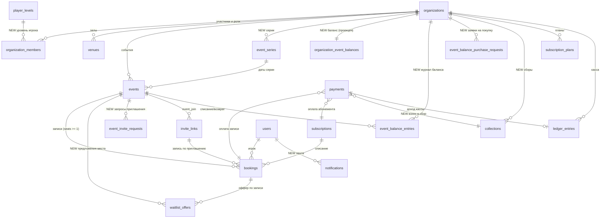
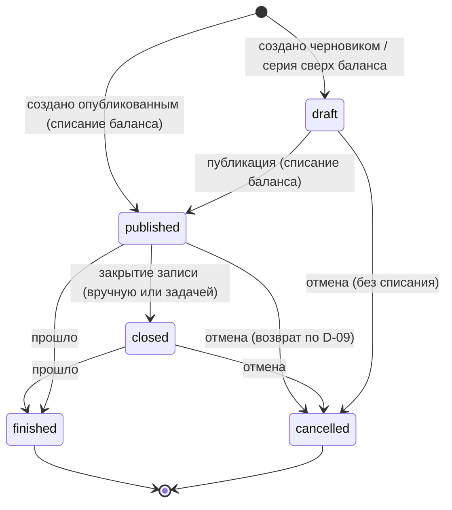

# ADR v3 · Доменная модель и контракт API референса v3

- **Статус:** принято (задача [19.2.1](../tasks/19-2-1-domain-model.md), `P-01`), 2026-10-13.
- **Решения владельца:** [D-01…D-14](../operations/decisions/2026-10-12-reference-v3-decisions.md) — все приняты (D-12…D-14 — 2026-10-13); ADR их не пересматривает.
- **Область:** целевая схема данных для фаз 19–22 (релизы v0.2.0–v0.4.0), владельцы сущностей, порядок миграций по карточкам, правила совместимости, соответствие статусов референса enum-ам, соглашения API для новых ресурсов.
- **Не область:** сами миграции (их создают карточки-владельцы, см. [порядок](#порядок-миграций)), UI, гипотезы фаз 23–26.

## Контекст

На `main` (R0.7, 21 миграция `0000…0020`) уже работают: организации, участники и роли, приглашения в организацию, залы, события `fixed`/`split` с точным распределением копеек, записи (одна запись = одно место, лист ожидания статусом `waitlisted` с автопродвижением), планы абонементов и абонементы, платежи, касса (`ledger_entries`, append-only), журнал аудита. API — Nuxt server routes `/api/organizations/{orgId}/…`, ошибки через `defineApiHandler` + `handleServiceError` (4.9.11).

Референс v3 добавляет: места в записи, предложение места из очереди с TTL, режим записи по приглашению, настройки группы со снимком в событие, серии и черновики, баланс событий, сборы, хранимую ленту уведомлений, уровни В1–В4+, время открытия записи. Карточка 19.2.1 фиксирует **одну** целевую модель, чтобы каждая карточка-владелец добавила свою часть отдельной forward-compatible миграцией (запрет «одной миграции на всё»).

## Принципы (наследуются из [DOMAIN](../DOMAIN.md) и R0.7)

1. **Не переписывать работающие таблицы ради имён макета.** «Группа» в UI = `organizations`; «Иду» = `confirmed`; «сбор суммой» = `price_mode = 'split'`. Переименований таблиц, колонок и значений enum нет.
2. **Деньги** — `integer` в минимальных единицах + `currency` (как в R0.7; не `numeric`). Точное распределение копеек split сохраняется (D-01).
3. **Время** — `timestamptz` в UTC; календарные даты серии (`date`) — в часовом поясе группы (`organizations.default_timezone`).
4. **Tenant** — каждая операционная строка несёт `organization_id`; доступ — через `tenant` middleware и `permissions` из `packages/core`.
5. **Append-only** для денег и баланса: `ledger_entries`, `event_balance_entries`, `audit_log`. Исправление — новой записью.
6. **Снимок вместо ссылки на настройку.** Событие при создании копирует значения группы (D-02); изменение настройки не трогает созданные события.
7. **Инварианты — в БД.** CHECK, частичные UNIQUE и FK — вторая линия защиты после сервисов (как 5.13.13). Гонки сериализуются в транзакции: каждый путь, меняющий состав или места события, берёт `pg_advisory_xact_lock(event_id)` (как сейчас `bookings.book`/`cancel` и `events.cancel`, 5.13.7, 6.8.2); операции баланса блокируют строку `organization_event_balances`. **Порядок блокировок:** сначала advisory-lock события (если операция касается события), затем строка `organization_event_balances`, затем строки `payments`/`subscriptions`. Обратный порядок запрещён — иначе возможен deadlock между отменой события и публикацией серии.

## Целевая модель

Связи с пометкой `NEW` ведут к новым таблицам; остальные таблицы есть на `main` и получают только новые колонки.



### Сущности и владельцы

Владелец сущности — модуль `packages/core/src/<module>` (правило modulith: чужие таблицы только через public service) и карточка, которая вводит её схему.

| Сущность (референс)        | Таблица / колонки                                                  | Модуль-владелец         | Карточка схемы | Состояние                          |
| -------------------------- | ------------------------------------------------------------------ | ----------------------- | -------------- | ---------------------------------- |
| Организация (группа)       | `organizations`                                                    | `organizations`         | —              | есть                               |
| Настройки группы           | колонки `organizations.*` (см. ниже)                               | `organizations`         | 19.2.2         | новые колонки                      |
| История настроек           | `audit_log` (`organization.settings_updated`, old/new)             | `audit`                 | 19.2.2         | без новой таблицы                  |
| Участник и роль            | `organization_members`                                             | `members`               | —              | есть                               |
| Уровень В1–В4+             | `player_levels` + `organization_members.level`, `…levels[]`        | `levels` (новый)        | 19.2.3         | новая таблица-справочник + колонки |
| Зал                        | `venues`                                                           | `venues`                | —              | есть                               |
| Событие                    | `events`                                                           | `events`                | —              | есть, новые колонки по карточкам   |
| Серия                      | `event_series` + `events.series_id`, `events.series_date`          | `events` (series)       | 20.2.2         | новая                              |
| Запись                     | `bookings`                                                         | `bookings`              | —              | есть                               |
| Место в записи             | `bookings.seats`, `bookings.waitlist_seats`                        | `bookings`              | 20.1.2         | новые колонки                      |
| Лист ожидания              | `bookings` (`waitlisted` / `waitlist_seats > 0`)                   | `bookings`              | —              | есть                               |
| Предложение места (TTL)    | `waitlist_offers`                                                  | `bookings`              | 20.3.1         | новая                              |
| Приглашение на событие     | `invite_links` (`type = 'event_join'`) + `bookings.invite_id`      | `invites`               | 20.1.3         | есть таблица, новые FK/колонки     |
| Запрос приглашения         | `event_invite_requests`                                            | `invites`               | 20.1.3         | новая                              |
| План абонемента, абонемент | `subscription_plans`, `subscriptions`                              | `subscriptions`         | —              | есть                               |
| Сбор                       | `collections`                                                      | `collections` (новый)   | 21.2.4         | новая                              |
| Взнос в сбор               | `payments` с `collection_id`                                       | `payments`              | 21.2.4         | новая колонка                      |
| Операция кассы             | `ledger_entries`                                                   | `ledger`                | —              | есть                               |
| Баланс событий             | `organization_event_balances` (проекция) + `event_balance_entries` | `event-balance` (новый) | 20.2.1         | новые                              |
| Заявка на покупку баланса  | `event_balance_purchase_requests`                                  | `event-balance`         | 20.2.1         | новая (UI 21.2.8, реестр 22.2.3)   |
| Уведомление                | `notifications`                                                    | `notifier`              | 20.3.2         | новая                              |
| Время открытия записи      | `events.booking_opens_at`                                          | `events`                | 20.3.1         | новая колонка                      |
| Фоновые задачи (журнал)    | `scheduled_jobs`                                                   | `scheduler`             | 20.3.1         | новая (вместо pg-boss, 2026-10-16) |

### Настройки группы и снимок в событие (19.2.2, D-02)

Колонки `organizations` (все с DEFAULT, существующие строки получают значения без backfill, кроме срока отмены: решение оркестратора, сохраняющее поведение R0.7 — миграция `0022_group_cancellation_default` ставит `cancellation_deadline_hours` DEFAULT 6 (прежний дефолт формы события) и заполняет группы с NULL самым частым ненулевым сроком их событий, а без таких событий — 6; иначе форма, которая больше не передаёт срок, создавала бы события «отмена до начала». Миграция 0021 при этом остаётся в том виде, в каком смёржена):

| Колонка                       | Тип                            | Default   | Ограничение                     | Референс                 |
| ----------------------------- | ------------------------------ | --------- | ------------------------------- | ------------------------ |
| `subscriptions_enabled`       | boolean                        | `true`    | есть (5.13.21)                  | `subsOn`                 |
| `max_seats_per_booking`       | smallint                       | `3`       | `CHECK 1..10`                   | `maxSeats`               |
| `default_price_mode`          | `event_price_mode`             | `'fixed'` | enum есть                       | `priceMode` по умолчанию |
| `default_join_mode`           | `event_join_mode` (новый enum) | `'open'`  | `('open','invite')`             | `joinMode` по умолчанию  |
| `cancellation_allowed`        | boolean                        | `true`    |                                 | политика: разрешена ли   |
| `cancellation_deadline_hours` | integer NULL                   | `6`       | `CHECK >= 0`; NULL = до начала  | политика: крайний срок   |
| `seo_index`                   | boolean                        | `false`   | не связан с `default_join_mode` | `seoIndex`               |
| `district`                    | text NULL                      |           | `city` уже есть                 | город, район             |

Снимок в `events` при создании (D-02). Два вида полей:

- **Только снимок, без переопределения в событии** — политика отмены. Сервис `events.create` всегда копирует значения группы и игнорирует их во входе; этих полей нет во входных схемах создания и PATCH события. Редактируются только в настройках группы и действуют на события, созданные после изменения.
  - `events.cancellation_deadline_hours` — **есть**; семантика не меняется, существующие события сохраняют свои значения.
  - `events.cancellation_allowed boolean NOT NULL DEFAULT true` — **новая** (19.2.2); существующие события получают `true`, то есть прежнее поведение.
- **Значение по умолчанию, которое событие может переопределить** — только режим оплаты и режим записи (P-03, P-07):
  - `events.price_mode` — есть; если клиент не передал, сервис подставляет `organizations.default_price_mode` (не DEFAULT БД).
  - `events.join_mode event_join_mode NOT NULL DEFAULT 'open'` — добавляет 20.1.3 (enum создаёт 19.2.2); если клиент не передал, сервис подставляет `organizations.default_join_mode`.

Лимит мест на игрока **не** снимается в событие: это ограничение ввода в момент записи, а не условие уже созданной записи; уменьшение лимита не трогает существующие записи.

История изменений — `audit_log` с `action = 'organization.settings_updated'`, `old_value`/`new_value` = изменённые поля. Отдельной таблицы истории нет: в `audit_log` уже есть кто, когда, было и стало.

### Уровни В1–В4+ (19.2.3)

- Enum `player_level`: `'v1','v2','v3','v4','v4_plus'` (код латиницей; подпись «В1…В4+» и описание — в справочнике).
- Справочник `player_levels(code player_level PK, sort_order smallint UNIQUE, title text, description text)` заполняется той же миграцией (`INSERT … ON CONFLICT DO NOTHING`); `GET /api/levels` читает его.
- `organization_members.level player_level NULL` — уровень игрока в группе.
- `organizations.levels player_level[] NOT NULL DEFAULT '{}'` — уровни группы (несколько).
- `events.level player_level NULL` — уровень события.
- `organization_members.rating_in_org` **не удаляется** в v0.2.0. Код его не читает и не пишет (проверено поиском по `apps/` и `packages/` на `b056806`), A/B/C есть только в макетах v2, поэтому «миграция A/B/C» данных не переносит: уровень остаётся NULL до назначения организатором. Удаление колонки — отдельный contract-шаг не раньше v0.3.0.

### Места в записи и лист ожидания (20.1.2, D-03)

Запись остаётся одной строкой на пару `(event_id, user_id)` — `bookings_event_user_unique` сохраняется. Это одновременно идемпотентность повторного нажатия и «одна строка, несколько мест, чип +N».

| Колонка                   | Тип     | Default | Ограничение                                                                 |
| ------------------------- | ------- | ------- | --------------------------------------------------------------------------- |
| `bookings.seats`          | integer | `1`     | `CHECK seats >= 1` — места, которые запись держит в своём статусе           |
| `bookings.waitlist_seats` | integer | `0`     | `CHECK waitlist_seats >= 0`; `> 0` только при `confirmed`/`pending_payment` |

- `waitlisted` + `seats = N` — вся запись в очереди на N мест.
- `confirmed`/`pending_payment` + `seats = K` + `waitlist_seats = M` — K мест в основе и ещё M в очереди («часть в основу, часть в очередь» с явным выбором игрока). Отдельной таблицы мест нет.
- Занято мест = `SUM(seats)` по `pending_payment`, `confirmed`, `attended`, `no_show`; «игроков» = `COUNT(*)` тех же строк. Это разные величины (handoff `buildRoster`).
- Позиция в очереди — порядок `(booked_at, id)` среди записей с `status = 'waitlisted' OR waitlist_seats > 0` (индекс `bookings_waitlist_order_idx` уже есть). Хранимой позиции нет.
- Конкурентность — как в R0.7 (`packages/core/src/bookings/service.ts`): каждый путь, меняющий места события (запись, добавление и частичная отмена мест, отмена записи, продвижение из очереди, принятие и истечение оффера, отмена события, фиксация split), первым действием в транзакции берёт `pg_advisory_xact_lock(event_id)` и перечитывает запись и событие после лока. Проверки `SUM(seats) + новые <= capacity` и `seats + waitlist_seats <= organizations.max_seats_per_booking` выполняются под этим локом. Порядок блокировок — см. [принципы](#принципы-наследуются-из-domain-и-r07), п. 7.

#### Денежная модель нескольких мест

Цель — точность до копейки (D-01) и совместимость с существующими инвариантами платежей: `ledger_income_payment_uniq` (один доход на платёж), `ledger_refund_payment_uniq` (один возврат на платёж, возврат — всего платежа), условные переходы `pending → succeeded | cancelled`, `succeeded → refunded`.

**Fixed, `cash`/`transfer` — один платёж на место.** Запись на K мест создаёт K платежей `payments(booking_id = запись, amount = events.price)`; добавление d мест — ещё d платежей; частичная отмена d мест снимает сначала неоплаченные места: их `pending`-платежи (самые поздние по `created_at, id`) → `cancelled`. Если неоплаченных мест не хватает, освобождаются оплаченные — начиная с самого позднего `succeeded`-платежа (`created_at DESC, id DESC`). Оплаченное место при отмене или частичной отмене игроком автоматически **не** возвращается ([D-14](../operations/decisions/2026-10-12-reference-v3-decisions.md#d-14), правило R0.7 6.8.6): платёж остаётся `succeeded`, касса не меняется, а платёж отсоединяется от живого набора записи — `payments.seat_released_at = now()` (см. «Освобождённые оплаченные места» ниже). Инвариант: число живых платежей записи в статусах `pending`/`succeeded` = `seats` (для записей с платным методом вне очереди). Обоснование выбора:

- возврат части денег без частичных возвратов: каждый возврат — целый платёж, поэтому `ledger_refund_payment_uniq` и защита от двойного возврата 6.8.1 работают без изменений;
- сумма точна по построению (K × цена, без деления);
- альтернатива «один платёж на изменение количества» (seat-delta) требует частичного возврата платежа, то есть ломает «один возврат на платёж» или вводит отдельную таблицу долей; альтернатива «один платёж на запись с перерасчётом» меняет сумму уже подтверждённого платежа — нарушает append-only денег.

Связь «запись ↔ платежи» — существующая `payments.booking_id` (не уникальна, индекс `payments_booking_idx` есть); новая таблица связи не нужна. `bookings.payment_id` сохраняется как ссылка на **первый** живой платёж записи — для читателей R0.7; новый код читает платежи записи по `payments.booking_id` с учётом воплощения.

**Живые платежи и воплощение записи.** Отменённая запись реактивируется той же строкой (`bookings_event_user_unique`), поэтому платежи прошлых воплощений несут тот же `booking_id`. Выбрано явное **число воплощений**, а не сравнение времени (`payments.created_at >= booked_at` смешивает часы приложения и БД и неоднозначно внутри одной транзакции):

- `bookings.incarnation integer NOT NULL DEFAULT 1` — увеличивается на 1 при каждой реактивации отменённой записи;
- `payments.booking_incarnation integer NULL` — копия `bookings.incarnation` в момент создания платежа записи; `CHECK (booking_id IS NULL OR booking_incarnation IS NOT NULL)` после backfill (уточнено в 20.1.2: в одну сторону, потому что `ON DELETE SET NULL` по `booking_id` оставляет воплощение как историю; платёж прежнего runtime без воплощения получает текущее триггером БД, а воплощение записи увеличивает триггер при реактивации);
- `payments.seat_released_at timestamptz NULL` — момент, когда оплаченное место этого платежа освобождено игроком (D-14); `CHECK (seat_released_at IS NULL OR status IN ('succeeded','refunded'))`;
- **живые платежи записи** = `payments.booking_id = b.id AND payments.booking_incarnation = b.incarnation AND payments.seat_released_at IS NULL AND status IN ('pending','succeeded')`;
- backfill в миграции 20.1.2: всем записям `incarnation = 1`; платёж, на который указывает `bookings.payment_id`, получает `booking_incarnation = 1`, остальные платежи R0.7 с тем же `booking_id` (прошлые воплощения) — `0`. Так у каждой записи R0.7 ровно один живой платёж — тот же, что сейчас считает код 6.8.5.
- `pending`-платежи прошлых воплощений (`booking_incarnation = 0`) та же миграция переводит в `cancelled` — они не остаются «висеть» в «ждут оплаты» без записи, которую можно подтвердить. Для каждого такого платежа пишется `audit_log` (`action = 'payment.cancelled_stale_incarnation'`, `entity_type = 'payment'`, `old_value`/`new_value` со статусом, `source` миграции в `new_value`, `user_id` NULL). `succeeded`- и `refunded`-платежи прошлых воплощений не меняются: деньги и касса append-only.

**Статус записи — производная от платежей мест.** Запись fixed с оплатой `cash`/`transfer` имеет статус `confirmed` тогда и только тогда, когда **все** её живые платежи `succeeded`; иначе — `pending_payment`. Статус пересчитывается в той же транзакции после любого изменения платежей записи (подтверждение, отклонение, добавление или снятие мест).

**Подтверждение и отклонение — операции над записью, а не над отдельным платежом.** Под `pg_advisory_xact_lock(event_id)`:

- _подтвердить_ — все `pending`-живые платежи записи переводятся в `succeeded` одной операцией (каждый условным UPDATE, доход кассы — по платежу, `ledger_income_payment_uniq` не меняется); затем статус записи → `confirmed`. Повтор операции идемпотентен: `pending`-платежей не осталось — ничего не меняется;
- _отклонить_ — все `pending`-живые платежи записи → `cancelled`. Если у записи есть `succeeded`-места, отклоняется только неоплаченная часть: `seats` уменьшается на число отклонённых платежей, запись становится `confirmed`, освободившиеся места предлагаются очереди по D-03 (оффер или автопродвижение). Если оплаченных мест нет — запись отменяется целиком через `bookingService.cancel` (как сейчас 6.8.4, с продвижением очереди);
- снять одно место — только через частичную отмену (`PATCH …/bookings/{id} {seats}`), не через отклонение платежа.

Защиту 6.8.5 («старый платёж не трогает новую бронь») обеспечивает условие воплощения вместо сравнения `bookings.payment_id = payment.id`.

**Освобождённые оплаченные места (D-14).** Механизм — одна колонка `payments.seat_released_at`, без новых статусов платежа и без новой таблицы:

- платёж остаётся `succeeded`, доход кассы не меняется; `booking_id` и `booking_incarnation` сохраняются, поэтому история записи видна полностью;
- из живого набора платёж выводит `seat_released_at IS NOT NULL` — инвариант «живые `pending` + `succeeded` = `seats`» сохраняется, подсчёт мест и пересчёт статуса записи его не видят;
- порядок освобождения при частичной отмене: сначала неоплаченные места (`pending` → `cancelled`), затем самый поздний `succeeded`-платёж (`created_at DESC, id DESC`);
- возврат остаётся явным действием организатора — существующей операцией возврата платежа (`succeeded → refunded`, `ledger_refund_payment_uniq`); она доступна и для освобождённого платежа, `seat_released_at` при возврате не меняется;
- история платежей и состав события показывают такой платёж как «оплачено, место освобождено» (`succeeded` + `seat_released_at`), после возврата — «возвращено»;
- отчёты и касса считают деньги по `succeeded`-платежам и записям кассы независимо от `seat_released_at`: освобождение места не уменьшает выручку, уменьшает её только возврат;
- backfill миграции 20.1.2:
  - `succeeded`-платежам текущего воплощения у записей R0.7 в статусе `cancelled` ставится `seat_released_at = COALESCE(bookings.cancelled_at, bookings.updated_at)` — это ровно случай 6.8.6 («оплачено, отменено игроком, без возврата»);
  - `succeeded`-платежам прошлых воплощений (`booking_incarnation = 0`) ставится `seat_released_at = COALESCE(payments.confirmed_at, payments.created_at)` (у `payments` нет `updated_at`; точный момент отмены прошлого воплощения не хранится), чтобы история показывала их как «оплачено, место освобождено», а не как живые.
- исключение для отмены события: зафиксированные доли split возвращаются `events.cancel` и при освобождённом месте (см. список ниже) — так R0.7 поступает с отменёнными записями, у которых есть `allocated_amount`.

**Что 20.1.2 обязана перевести на живые платежи записи** (сейчас идут через `bookings.payment_id`):

- `paymentService.confirm` и `paymentService.cancel`/reject — проверки 6.8.5 заменяются условием воплощения, побочные эффекты на запись — правилами выше, API подтверждения/отклонения работает по записи;
- `listPending` и `notifyOrganizersAboutPending` — группировка по записи (одна строка «ждут оплаты» на запись с числом мест и суммой), а не по платежу;
- уведомление `payment_confirmed` / `payment_rejected` — одно на операцию над записью, а не K сообщений (ключ дедупликации — см. [ленту](#лента-уведомлений-2032));
- `bookingService.cancel` (отмена игроком) — отменяет **все** `pending`-живые платежи записи, ставит `seat_released_at` всем `succeeded`-живым платежам (без возврата, D-14) и восстанавливает занятия абонемента по правилу срока отмены. - `events.cancel` (массовая отмена организатором) сохраняет выборку R0.7 (`packages/core/src/events/service.ts`, 6.4):
  - **fixed** — возвращаются все `succeeded`-живые платежи неотменённых записей. Места, освобождённые ранее игроком (`seat_released_at IS NOT NULL`), как и отменённые записи в R0.7, автоматически не возвращаются — организатор может вернуть их операцией возврата;
  - **split** — дополнительно, как в R0.7 для отменённых записей с `allocated_amount IS NOT NULL`, возвращаются `succeeded`-платежи текущего воплощения с `seat_released_at IS NOT NULL` у записей с `allocated_amount IS NOT NULL`: зафиксированная доля сбора при отмене события возвращается всегда, даже если место было освобождено. Утверждение «освобождённые места не возвращаются автоматически» верно только для fixed;
- история платежей, дашборд и счётчик «ждут оплаты».

**Абонемент — одно занятие на место.** Запись на K мест атомарно списывает K занятий с **одного** абонемента: `UPDATE subscriptions SET used_sessions = used_sessions + :k WHERE id = :id AND used_sessions + :k <= total_sessions` (FIFO по `expires_at` выбирает первый абонемент, где хватает K); если ни в одном нет K занятий — `subscription.not_enough_sessions` (409), без дробления по нескольким абонементам (у записи один `subscription_id`). Добавление d мест списывает ещё d с того же абонемента; частичная отмена в срок политики возвращает d занятий, после срока — не возвращает (как отмена записи сейчас).

**Split — доли считаются по единицам-местам.** При фиксации каждая активная запись разворачивается в `seats` единиц; `allocateSplitAmount` (`packages/shared`) распределяет сумму по единицам в порядке `(booked_at, booking_id, номер единицы)`; `bookings.allocated_amount` = сумма долей её единиц. Сумма по записям равна цели до копейки, потому что равна сумме по единицам (D-01). `event.split_target_too_small` сравнивает цель с **суммой мест**, а не с числом записей. Один платёж на запись на `allocated_amount` (как R0.7): после фиксации доли окончательны, изменение мест после фиксации запрещено (`booking.not_cancellable`, как сейчас «split allocation is final»), поэтому частичных возвратов split не бывает. До фиксации изменение мест денег не касается. `events.pricing_participant_count` сохраняет имя, но после 20.1.2 хранит число **мест** на момент фиксации. Для событий R0.7 все `seats = 1` — значения и рассчитанные доли не меняются («Не делать» 20.1.1).

К `split` абонемент не применяется (P-03).

`waitlist_offers` (20.3.1) — предложение освободившихся мест с TTL:

| Колонка                                           | Тип / ограничение                                                                       |
| ------------------------------------------------- | --------------------------------------------------------------------------------------- |
| `id`, `organization_id`, `event_id`, `booking_id` | FK, `ON DELETE CASCADE`                                                                 |
| `seats`                                           | integer `CHECK >= 1` — сколько мест предложено                                          |
| `status`                                          | enum `waitlist_offer_status`: `offered`, `accepted`, `declined`, `expired`, `revoked`   |
| `offered_at`, `expires_at`                        | timestamptz; `expires_at = offered_at + 30 мин` (D-03), `CHECK expires_at > offered_at` |
| `responded_at`                                    | timestamptz NULL                                                                        |

`UNIQUE (booking_id) WHERE status = 'offered'` — не больше одного активного оффера на запись. Истечение — проход планировщика (20.3.1, журнал `scheduled_jobs` вместо pg-boss — решение координатора 2026-10-16): оффер с наступившим `expires_at` переводится в `expired` под advisory-lock события, переход разрешён только из `offered`, поэтому повтор и параллельные экземпляры безопасны. Не подтвердивший игрок покидает очередь: запись `waitlisted` отменяется целиком, даже если оффер покрывал часть её мест; у записи в основе снимаются все места в очереди ([D-03, уточнение 2026-10-16](../operations/decisions/2026-10-12-reference-v3-decisions.md#d-03)). Места под действующим оффером (`offered` и `expires_at > now()`) считаются занятыми при подсчёте свободных; истёкший, но не обработанный оффер места не держит и закрывается лениво при следующем освобождении места. Без планировщика (флаг выключен) сервис использует прежнее автопродвижение 5.6.2, офферы не создаются, запись с действующим оффером не продвигается (D-03).

### Режим записи и приглашения на событие (20.1.3)

- `events.join_mode event_join_mode NOT NULL DEFAULT 'open'`; при создании подставляется `organizations.default_join_mode`, событие может переопределить.
- Приглашение на событие — существующая `invite_links` с `type = 'event_join'`. 20.1.3 добавляет FK `invite_links.event_id → events.id ON DELETE CASCADE` (колонка есть с фазы 4, FK отложен) и `CHECK ((type = 'event_join') = (event_id IS NOT NULL))` (обычный `ADD CONSTRAINT`, см. правило совместимости 3). Однократность — `max_uses = 1`, срок — `expires_at`, startapp-параметр — `event_<eventId>_<token>` (уточнено в 20.1.3: существующий `event_<id>` уже открывает событие, токен добавляется к нему, Mini App открывает событие без отдельного запроса разбора токена). Запись режима `invite` — за флагом `EVENT_INVITE_MODE_ENABLED` (п. 4 «Правил совместимости»). Ссылка — однократный bearer-токен: не привязана к игроку, первый участник группы, записавшийся по ней, расходует её; `default_member_status = 'pending'`, чтобы прежний runtime при ошибочном redeem создал не более чем заявку. Владелец и организатор записывают себя без приглашения; повторная запись после своей отмены — по сохранённому приглашению (D-06, уточнение 2026-10-15).
- `bookings.invite_id integer NULL REFERENCES invite_links(id) ON DELETE SET NULL` — по какому приглашению создана запись. Запись на событие `invite` без валидного приглашения отклоняет сервис (`booking.invite_required`, 403) — проверка в API, а не только в UI.
- `event_invite_requests`: `id`, `organization_id`, `event_id`, `user_id`, `status` enum `invite_request_status` (`pending`, `approved`, `declined`, `cancelled`), `message text NULL`, `decided_by_user_id`, `decided_at`, `invite_id` (выданное приглашение при `approved`), `created_at`. `UNIQUE (event_id, user_id) WHERE status = 'pending'`.

### Баланс событий (20.2.1, D-09, D-10)

Термин — «баланс событий», единица — «событие» (D-10). Имена в коде — `event_balance_*`, без `credit`.

`event_balance_entries` — журнал, append-only (UPDATE/DELETE сервис не делает; исправление — запись `correction`):

| Колонка                 | Тип / ограничение                                                                                              |
| ----------------------- | -------------------------------------------------------------------------------------------------------------- |
| `id`, `organization_id` | FK `ON DELETE CASCADE`                                                                                         |
| `delta`                 | integer `CHECK delta <> 0` — `+` начисление, `−` списание                                                      |
| `reason`                | enum `event_balance_reason`: `demo_grant`, `pilot_grant`, `purchase`, `grant`, `spend`, `refund`, `correction` |
| `balance_after`         | integer `CHECK balance_after >= 0` — остаток после операции                                                    |
| `event_id`              | FK NULL `ON DELETE SET NULL` — для `spend`/`refund`                                                            |
| `purchase_request_id`   | FK NULL — для `purchase`                                                                                       |
| `actor_kind`            | enum `event_balance_actor`: `user`, `system` — автор есть у каждой строки                                      |
| `created_by_user_id`    | FK `users` NULL; `CHECK (actor_kind = 'user') = (created_by_user_id IS NOT NULL)`                              |
| `source`                | text NULL; для `system` обязателен (CHECK): `scheduler:<job>`, `migration:<tag>`, `org-create`, `pilot_grant`  |
| `comment`               | text NULL; обязателен для `grant`, `correction` и любых `system`-строк (CHECK)                                 |
| `created_at`            | timestamptz                                                                                                    |

`organization_event_balances(organization_id PK, balance integer NOT NULL CHECK balance >= 0, updated_at)` — проекция журнала для блокировки и быстрого чтения; «баланс как сумма» (P-08) — журнал остаётся источником истины, инвариант `balance = SUM(delta)` проверяется тестом и сверочным запросом.

Каждое изменение баланса — одна транзакция в строгом порядке:

1. Если операция касается события — `pg_advisory_xact_lock(event_id)` (тот же ключ, что у записи и отмены).
2. Заблокировать строку проекции: `SELECT … FROM organization_event_balances WHERE organization_id = :org FOR UPDATE`. Строки нет (организация создана runtime без баланса) — лениво создать её `INSERT … ON CONFLICT (organization_id) DO NOTHING` с `balance = 0` и повторить SELECT FOR UPDATE; это единственное место, где допустим `ON CONFLICT DO NOTHING`, и оно не трогает журнал.
3. Под этой блокировкой проверить предусловия по журналу (например, есть ли уже `spend`/`refund` этого события) и решить: выполнить, вернуть прежний результат (идемпотентный повтор) или отказать.
4. `UPDATE organization_event_balances SET balance = balance + :delta WHERE organization_id = :org AND balance + :delta >= 0 RETURNING balance`; ноль строк — `event_balance.insufficient`.
5. `INSERT` в журнал с этим `balance_after`.

Частичные UNIQUE — последняя линия защиты, а не механизм идемпотентности: нарушение на денежной строке — ошибка и откат транзакции, **никогда** не `ON CONFLICT DO NOTHING` и не перехват с продолжением (иначе проекция изменится без записи журнала):

- `UNIQUE (event_id) WHERE reason = 'spend'` — одно списание на событие;
- `UNIQUE (event_id) WHERE reason = 'refund'` — один возврат на событие;
- `UNIQUE (organization_id) WHERE reason = 'demo_grant'` — одна demo-квота;
- `UNIQUE (organization_id) WHERE reason = 'pilot_grant'` — один стартовый баланс пилота (D-12);
- `UNIQUE (purchase_request_id) WHERE reason = 'purchase'` — одна выдача по заявке.

Правила:

- Списание — при **публикации** события (создание сразу опубликованным или перевод `draft → published`); черновик баланс не тратит (D-04). Это уточняет пункт 1 карточки 20.2.1 («при создании события») — карточка приведена к D-04.
- Возврат (D-09) — только при отмене события и только если выполнены **все** условия:
  1. по этому `event_id` в журнале есть `spend` и ещё нет `refund` — возврат никогда не «чеканит» баланс для событий, за которые не списывали (события пилота R0.7, события, созданные при выключенном списании или runtime без баланса);
  2. `booking_opens_at IS NOT NULL AND now() < booking_opens_at` **или** в событии нет ни одной активной записи, где активная — **любая** запись со статусом, отличным от `cancelled` (`pending_payment`, `confirmed`, `waitlisted`, `attended`, `no_show`) — [D-13](../operations/decisions/2026-10-12-reference-v3-decisions.md#d-13).
- Проверка «нет активных записей» выполняется на заблокированном состоянии **до** цикла отмены записей в `events.cancel` (`packages/core/src/events/service.ts`, сразу после `pg_advisory_xact_lock` и `SELECT … FOR UPDATE` события): после цикла все записи уже `cancelled`, и проверка всегда давала бы «нет записей». Решение о возврате вычисляется и **проводится** (блокировка строки проекции, UPDATE, INSERT `refund`) до цикла по записям и платежам, в той же транзакции; так порядок блокировок остаётся событие → баланс → платежи/абонементы (принцип 7).
- До 20.3.1 колонки `booking_opens_at` нет, и действует только ветка «нет активных записей» — это совпадает с D-09: без времени открытия запись открыта сразу при публикации.
- Demo-квота — 5 событий (handoff) при создании организации (`actor_kind = 'system'`, `source = 'org-create'`).
- Существующие (пилотные) организации — стартовый баланс **48 событий** ([D-12](../operations/decisions/2026-10-12-reference-v3-decisions.md#d-12)) отдельной причиной `pilot_grant` (`actor_kind = 'system'`, `source = 'pilot_grant'`, комментарий со ссылкой на D-12), а не `demo_grant`: так стартовый баланс пилота отличим от demo-квоты в журнале и отчётах. Миграция 20.2.1 создаёт строку проекции и `pilot_grant` каждой организации, существующей на момент миграции, одним идемпотентным запросом `INSERT … SELECT … WHERE NOT EXISTS`; идемпотентность по организации гарантирует `UNIQUE (organization_id) WHERE reason = 'pilot_grant'`. Пилотная организация `demo_grant` не получает; уже созданные события не списываются задним числом (и не дают возврата — у них нет `spend`). Организации, созданные runtime без баланса после миграции (окно отката), — новые: строка проекции создаётся лениво (шаг 2), demo-квота 5 — сверочным скриптом 20.2.1 (`demo_grant` с автором-оператором) только организациям без `demo_grant` и без `pilot_grant` (правило совместимости 5).

`event_balance_purchase_requests` — заявка организатора на покупку пакета (D-07: без онлайн-оплаты):

| Колонка                                                | Тип / ограничение                                                              |
| ------------------------------------------------------ | ------------------------------------------------------------------------------ |
| `id`, `organization_id`, `requested_by_user_id`        | FK                                                                             |
| `units`                                                | integer `CHECK > 0` — снимок пакета                                            |
| `amount`, `currency`                                   | integer `CHECK >= 0`, minor units — снимок цены                                |
| `status`                                               | enum `purchase_request_status`: `pending`, `approved`, `rejected`, `cancelled` |
| `decided_by_user_id`, `decided_at`, `decision_comment` | NULL до решения                                                                |
| `created_at`                                           | timestamptz                                                                    |

Подтверждение root (операторская команда 20.2.1, затем UI 22.2.2/22.2.3) в одной транзакции переводит заявку `pending → approved` условным UPDATE и пишет `purchase`-запись. Каталог пакетов до 22.2.1 — конфигурация приложения; заявка хранит снимок, поэтому смена цен не меняет старые заявки.

### Время открытия записи (20.3.1, D-09)

`events.booking_opens_at timestamptz NULL` — NULL значит «запись открыта с публикации» (поведение R0.7). `CHECK booking_opens_at IS NULL OR booking_opens_at < starts_at`; сервис требует открытие не позже момента закрытия (422 `event.booking_opens_after_close`). До открытия сервис записи отвечает `booking.not_open_yet` (422); в момент открытия планировщик рассылает «запись открыта» участникам группы (событиям `invite` — нет). Отдельного значения enum для «скоро откроется» нет — см. [статусы](#статусы-референса--enum).

`events.close_before_minutes smallint NOT NULL DEFAULT 120`, `CHECK IN (60, 120, 360, 1440)` — срок закрытия записи до начала ([D-09, уточнение 2026-10-16](../operations/decisions/2026-10-12-reference-v3-decisions.md#d-09)); поле события и шаблона серии. В момент закрытия (`starts_at − close_before_minutes`) планировщик переводит `published → closed` — только события, опубликованные и открытые до этого момента (последнее изменение события раньше него); split с участниками фиксирует доли тем же путём, что ручная фиксация, split без участников к этому моменту закрывается без фиксации. С момента закрытия запись таких событий отклоняется, не дожидаясь прохода.

### Серии и черновики (20.2.2, D-04)

`event_series`:

| Колонка                                       | Тип / ограничение                                                                                                                     |
| --------------------------------------------- | ------------------------------------------------------------------------------------------------------------------------------------- |
| `id`, `organization_id`, `created_by_user_id` | FK                                                                                                                                    |
| `rule`                                        | jsonb — `{ freq: 'once'\|'weekly'\|'biweekly', weekdays: [1..7], startDate, until?: date, count?: int }`; валидирует zod-схема в core |
| `exceptions`                                  | `date[] NOT NULL DEFAULT '{}'` — исключённые даты                                                                                     |
| `template`                                    | jsonb — поля события (название, зал, время начала, длительность, вместимость, цена, режимы, уровень)                                  |
| `timezone`                                    | varchar — снимок `organizations.default_timezone`                                                                                     |
| `status`                                      | enum `event_series_status`: `active`, `ended`                                                                                         |
| `created_at`, `updated_at`                    | timestamptz                                                                                                                           |

`events.series_id integer NULL REFERENCES event_series(id) ON DELETE SET NULL` и `events.series_date date NULL`; `UNIQUE (series_id, series_date)` — повторное создание той же даты невозможно. Каждая дата — обычная строка `events`: календари, запись и цена читают события, не серию.

Создание (D-04) — одна транзакция: вставить серию и **все** даты; заблокировать строку `organization_event_balances` (порядок блокировок — принцип 7; новые события ещё никому не видны, advisory-lock по ним не нужен); первые `min(N, balance)` дат по возрастанию получают `published` и `spend`-запись, остальные — `draft`; даты с конфликтом зала — `draft` независимо от баланса. Сбой на любом шаге откатывает всё. Предпросмотр (`POST …/series/preview`) ничего не пишет и возвращает даты, число публикуемых и число черновиков. Лимит — 366 дат в серии: покрывает самый длинный срок референса (год) при любом наборе дней недели, в том числе «пн + ср весь год» (104 даты) и ежедневно (366); больше — `series.too_many_dates` (422). Пакетная вставка 366 строк в одной транзакции укладывается в критерий «52 события одной операцией» с запасом. Правка «это и последующие» меняет строки `events` с `series_id = :id AND series_date >= :date` и не трогает прошедшие и отменённые.

Реализация 20.2.2 (уточнения владельца и координатора 2026-10-15, [D-04](../operations/decisions/2026-10-12-reference-v3-decisions.md#d-04)):

- **Правило** разворачивает `expandSeriesRule` (`packages/shared`): ISO-дни недели (1 — понедельник), «раз в 2 недели» считается от понедельника недели `startDate`; ровно одно из `until` (включительно) или `count`; `count` («N раз») считает повторения до исключений, как календари (COUNT/EXDATE в RFC 5545; решение владельца D-04 (D)). Периоды «месяц/квартал/год» клиент переводит в `until`. Шаблон хранит `startTime` (`HH:MM` по часам группы) и `durationMinutes` (15–1440); начало каждой даты считается отдельно в `timezone` серии, поэтому переход на летнее/зимнее время местное время не сдвигает. Нарушение правила — `series.invalid_rule` (422), больше 366 дат — `series.too_many_dates` (422), первая дата в прошлом — `event.starts_in_past` (422).
- **Конфликт зала (координатор):** дата конфликтует, если у неё есть `venue_id` и интервал `[starts_at, ends_at)` пересекается с неотменённым событием той же организации в том же зале, включая более ранние даты этой же серии; без зала конфликта нет. Это подсказка при создании, а не инвариант БД: параллельное одиночное создание в тот же зал не блокируется.
- **Предпросмотр (координатор):** `POST …/series/preview` принимает то же тело, что создание, ничего не пишет и возвращает `{ timezone, dates[{date, startsAt, endsAt, status, draftReason: null | 'balance' | 'venue_conflict'}], excluded, total, published, drafts, venueConflicts, balanceEnforced, balanceBefore, balanceAfter }`. Создание возвращает `{ series, events, total, published, drafts, venueConflicts, balanceAfter, replayed }`; на том же состоянии числа совпадают (контракт 21.1.7).
- **Атомарность и идемпотентность:** создание — одна транзакция: настройки группы (`FOR SHARE`) → строка `organization_event_balances` (`FOR UPDATE`; она же сериализует параллельные серии группы) → строка серии и все даты через общий путь одиночного создания (`insertEvent`; списание — только `eventBalanceService.spendOnPublish`). `idempotencyKey` в `POST …/series` обязателен (решение координатора 2026-10-15; без него — 422 `validation_failed`, в предпросмотре необязателен), хранится в `event_series.idempotency_key` (`UNIQUE (organization_id, idempotency_key)`): повтор с тем же ключом под той же блокировкой возвращает созданную серию (`replayed = true`) без нового списания; тот же ключ с другим запросом — `series.idempotency_conflict` (409).
- **Порядок блокировок для нескольких событий:** правка и отмена серии берут строку `event_series` (`FOR UPDATE`), затем `pg_advisory_xact_lock` всех затронутых событий в порядке `(series_date, id)`, и только потом баланс и платежи (внутри `eventService.update`/`cancel`). Так принцип 7 (событие → баланс → платежи/абонементы) выполняется и для пакета событий.
- **Правка** `PATCH …/series/{id}?scope=single|following&from=YYYY-MM-DD` меняет события через `eventService.update` (те же правила цены, вместимости, режима записи); ошибка на любой дате откатывает всю правку; `following` обновляет и шаблон серии; новый шаблон проверяется схемой создания и на зал своей группы даже без оставшихся дат, «нет зала/описания» хранится отсутствием ключа, а не `null`. Календарный день события серии меняется только правкой серии: `PATCH …/events/{id}` с `startsAt` другого дня в часовом поясе серии — `event.series_date_locked` (409), время в тот же день меняется свободно. Статус правкой серии не меняется: черновик публикуется `PATCH …/events/{id}` со списанием.
- **Отмена «это и последующие» (владелец):** `POST …/series/{id}/cancel {from}` в одной транзакции отменяет даты `>= from`, кроме отменённых, завершённых и уже начавшихся (`starts_at > now()`); `from` раньше сегодняшнего дня группы — `series.from_in_past` (422). После блокировок цели перечитываются тем же предикатом, каждая отменяется через `eventService.cancel` (возврат по D-09/D-13, платежи по R0.7/20.1.2, уведомления после коммита); повтор ничего не меняет; серия, в которой по тому же предикату отменять больше нечего, получает `ended`. Отмена одной даты — существующий `POST …/events/{id}/cancel`.
- **Совместимость:** прежний runtime видит даты как обычные события — флага записи нет (правило 4 не требует guard отката приложения). Откат миграции 0027 отказывает, пока есть строки `event_series` (правило 6; проверка — 20.7.1, п. 8).

### Сборы (21.2.4)

`collections`: `id`, `organization_id`, `title`, `description NULL`, `icon` (`ball`, `trophy`, `shirt`, `arena`, `party`, `bus`), `target_amount integer NULL CHECK > 0` (NULL — сбор без цели), `currency`, `status` enum `collection_status` (`draft`, `active`, `completed`, `cancelled`), `deadline_at NULL`, `created_by_user_id`, `created_at`, `updated_at`, `closed_at NULL`.

Взнос — **платёж**: `payments.collection_id integer NULL REFERENCES collections(id) ON DELETE RESTRICT`. Так взнос получает готовый жизненный цикл `pending → succeeded | cancelled | refunded`, защиту от гонки подтверждения (5.13/6.8) и ровно одну запись кассы через существующий `ledger_income_payment_uniq`. Подтверждённый взнос пишет `ledger_entries` с `category = 'contribution'` и `payment_id`. Добавляется `CHECK num_nonnulls(booking_id, subscription_id, collection_id) <= 1` (обычный `ADD CONSTRAINT`, правило совместимости 3). Сумма подтверждённых взносов по сбору = сумма income-записей кассы по его платежам — критерий 21.2.4. Офлайн-взнос от человека без аккаунта в v0.3.0 не моделируется (`payments.user_id NOT NULL` сохраняется).

### Лента уведомлений (20.3.2)

`notifications` — один источник для бота, ленты Mini App и ленты кабинета:

| Колонка                                  | Тип / ограничение                                                                                                                                                                                                                                                                                                                                                                                                                                                                                                                                                                                                                               |
| ---------------------------------------- | ----------------------------------------------------------------------------------------------------------------------------------------------------------------------------------------------------------------------------------------------------------------------------------------------------------------------------------------------------------------------------------------------------------------------------------------------------------------------------------------------------------------------------------------------------------------------------------------------------------------------------------------------- |
| `id`, `recipient_user_id`                | FK `users` `ON DELETE CASCADE`                                                                                                                                                                                                                                                                                                                                                                                                                                                                                                                                                                                                                  |
| `organization_id`, `event_id`            | FK NULL                                                                                                                                                                                                                                                                                                                                                                                                                                                                                                                                                                                                                                         |
| `type`                                   | enum `notification_type`: `booking_opened`, `waitlist_offer`, `reminder_24h`, `reminder_2h`, `split_settled`, `payment_confirmed`, `payment_rejected`, `lineup_ready`, `mvp_vote`, `event_cancelled`, `organizer_action_required`                                                                                                                                                                                                                                                                                                                                                                                                               |
| `dedup_key`                              | text NOT NULL; `UNIQUE (recipient_user_id, dedup_key)` — «не больше одного уведомления одного типа на событие». Ключ: `<type>:event:<event_id>` для типов события (`booking_opened`, `reminder_24h`, `reminder_2h`, `split_settled`, `lineup_ready`, `mvp_vote`, `event_cancelled`); `waitlist_offer:offer:<offer_id>` (новый оффер после истечения предыдущего — новое уведомление); `payment_confirmed:booking:<booking_id>:<incarnation>:<min_payment_id>` и `payment_rejected:booking:<booking_id>:<incarnation>:<min_payment_id>` — одно уведомление на операцию над записью (оплата по местам); `organizer_action_required:<entity>:<id>` |
| `payload`                                | jsonb — данные шаблона (без секретов и initData)                                                                                                                                                                                                                                                                                                                                                                                                                                                                                                                                                                                                |
| `read_at`                                | timestamptz NULL                                                                                                                                                                                                                                                                                                                                                                                                                                                                                                                                                                                                                                |
| `delivery_status`                        | enum `notification_delivery_status`: `pending`, `sent`, `failed`, `skipped`                                                                                                                                                                                                                                                                                                                                                                                                                                                                                                                                                                     |
| `delivered_at`, `attempts`, `last_error` | доставка в Telegram через журнал `scheduled_jobs` (20.3.1) с учётом лимитов Bot API                                                                                                                                                                                                                                                                                                                                                                                                                                                                                                                                                             |
| `created_at`                             | timestamptz; индекс `(recipient_user_id, id DESC)` для ленты (порядок и курсор — по `id`: записи одной транзакции делят `created_at`)                                                                                                                                                                                                                                                                                                                                                                                                                                                                                                           |

Подтверждение или отклонение записи (все `pending`-платежи её мест одной операцией) создаёт **одно** уведомление. Ключ — запись, её воплощение и наименьший `payment_id`, затронутый операцией: повтор той же операции даёт тот же ключ и не дублирует уведомление, а следующая операция над той же записью (например, подтверждение добавленных позже мест) затрагивает другие платежи и получает новый ключ.

Тихие часы — `users.quiet_hours_start smallint NULL`, `users.quiet_hours_end smallint NULL` (минуты от полуночи в часовом поясе группы-источника, `CHECK 0..1439`). Отключение типов игроком — P-12 (23.1.1), не в v0.2.0.

Реализация 20.3.2 (миграция `0029_notifications_feed`):

- Enum `notification_type` дополнен значением `waitlist_offer_expired` (игрок не подтвердил место за 30 мин, решение владельца 2026-10-16, A): отдельный тип нужен ленте и шаблону. `users.bot_blocked_at timestamptz NULL` — признак недоступности бота (блокировка, удалённый аккаунт, чат не найден): некритичная доставка пропускается 7 суток, затем одна попытка; критичные уведомления признаку не подчиняются (всегда одна попытка); успешная доставка снимает признак, снятие по входящим обновлениям бота (`/start`, `my_chat_member`) — 20.3.3.
- Доставка — тот же журнал `scheduled_jobs`: запись ленты и задача создаются вместе (`enqueueNotifications`), `payload.notificationId` связывает их; итог (`sent`/`failed`/`skipped`, `delivered_at`, `attempts`, `last_error`) пишется в ленту. Второго отправителя нет: `dispatchNotifications` ставит типы ленты в журнал и сразу запускает проход доставки, остальные шаблоны 8.4 (мгновенные ответы на собственное действие игрока) уходят прямой отправкой и в ленту не пишутся.
- Соответствие шаблонов типам ленты: `split_price_settled` и `split_settled_organizer` → `split_settled` (ключ организатора с суффиксом `:organizer`), `payment_pending_organizer` → `organizer_action_required` (ключ `payment:<payment_id>`), остальные — одноимённые. Типы `lineup_ready` и `mvp_vote` в enum есть, источников у них пока нет (составы и MVP — фазы 25–26).
- Критичные (`waitlist_offer`, `payment_confirmed`, `payment_rejected`, `event_cancelled`) не откладываются тихими часами и не отключаются ни игроком, ни настройкой группы ([21.2.14](../tasks/21-2-14-settings-group-notifications.md)); прочие в тихие часы откладываются до конца окна (настенное время зоны группы, переход на летнее время учтён) без расхода попытки; напоминание, которое окно задержало бы до начала игры или позже, уходит сразу.
- Лимиты Bot API: пауза 40 мс между отправками (≤ 25/с); ответ 429 откладывает задачу на `retry_after` без расхода попытки и останавливает отправку до этого момента; блокировка бота (403 / «chat not found») не повторяется. Пауза между отправками и пауза после 429 — состояние процесса: в v0.2.0 web работает одним экземпляром (SKIP LOCKED защищает от двойной обработки, но не делит лимит бота между экземплярами); при масштабировании общий лимит нужно хранить в БД.

## Статусы референса ↔ enum

Значения enum не переименовываются. Подписи из референса — производные, их считает один набор функций (`participationOf`, `eventStateOf`, задача 19.1.2).

### Событие (`event_status`)



| Референс (P-01 / handoff) | Значение и условие                                                             |
| ------------------------- | ------------------------------------------------------------------------------ |
| черновик                  | `draft`                                                                        |
| запись скоро откроется    | `published` и `booking_opens_at > now()` (после 20.3.1)                        |
| запись открыта / `open`   | `published` и (`booking_opens_at IS NULL OR booking_opens_at <= now()`)        |
| мест нет / `full`         | `published` и занято мест `>= capacity` — производное, не статус               |
| запись закрыта / `closed` | `closed`                                                                       |
| прошло / прошла / `past`  | `finished`, а также `published`/`closed` с `ends_at < now()` до автозавершения |
| отменено / `cancelled`    | `cancelled`                                                                    |

### Запись (`booking_status`) — ось «Моё участие»

| Референс                  | Значение                                                                        |
| ------------------------- | ------------------------------------------------------------------------------- |
| «Иду»                     | `confirmed`, `pending_payment`, `attended` — оплата показывается отдельной осью |
| «В очереди · N-й»         | `waitlisted` или `waitlist_seats > 0`; N — позиция по `(booked_at, id)`         |
| место предложено (30 мин) | активный `waitlist_offers.status = 'offered'` по записи                         |
| отменена                  | `cancelled`                                                                     |
| не пришёл                 | `no_show`                                                                       |

Ось «Оплата»: `pending_payment` или платёж `pending` → «ждёт оплаты» (amber); `confirmed` с `succeeded`-платежом, абонементом или `free` → «в порядке» (grass). Для `split` до фиксации — «прогноз», после — точная доля `allocated_amount`.

## Порядок миграций

Миграции сериализуются (ORCHESTRATION: одна задача со схемой в работе). Каждая карточка добавляет **одну** миграцию через `pnpm db:generate` (или ручной SQL для backfill данных), файл отката `packages/db/rollback/<tag>.sql` и интеграционный тест «применяется и откатывается на пустой и на заполненной базе» (заполненная — `pnpm db:seed:demo`, см. ниже). Номер берётся после rebase на `main`.

Диаграмма — **порядок сериализации миграций** (какая миграция получает номер раньше), а не граф зависимостей карточек. Зависимости — в колонке `depends_on` таблицы ниже; они совпадают с frontmatter карточек.

```mermaid
flowchart LR
  M1["1 · 19.2.2 настройки группы"] -->|затем| M2["2 · 19.2.3 уровни"]
  M2 -->|затем| M3["3 · 20.1.2 места в записи"]
  M3 -->|затем| M4["4 · 20.1.3 join mode и запросы"]
  M4 -->|затем| M5["5 · 20.2.1 баланс событий"]
  M5 -->|затем| M6["6 · 20.2.2 серии"]
  M6 -->|затем| M7["7 · 20.3.1 время открытия, офферы"]
  M7 -->|затем| M8["8 · 20.3.2 лента уведомлений"]
  M8 -->|затем| M9["9 · 21.2.4 сборы, v0.3.0"]
```



Схемные зависимости (миграция ссылается на объект другой миграции): 19.2.2 → 20.1.3 (enum `event_join_mode`), 20.1.2 → 20.3.1 (`waitlist_offers.seats` и учёт мест), 20.2.1 → 20.2.2 (списание за даты серии). Ради второй 20.3.1 получает `depends_on: '20.1.2'` (карточка обновлена в этой задаче).

| #   | Карточка ← `depends_on`       | Релиз  | Что добавляет миграция                                                                                                                                                                                                                                  | Совместимость с предыдущим runtime                                                                   |
| --- | ----------------------------- | ------ | ------------------------------------------------------------------------------------------------------------------------------------------------------------------------------------------------------------------------------------------------------- | ---------------------------------------------------------------------------------------------------- |
| 1   | 19.2.2 ← 19.2.1               | v0.2.0 | enum `event_join_mode`; `organizations.max_seats_per_booking`, `default_price_mode`, `default_join_mode`, `cancellation_allowed`, `cancellation_deadline_hours`, `seo_index`, `district`; `events.cancellation_allowed`                                 | только колонки с DEFAULT/NULL — старый runtime их не видит                                           |
| 2   | 19.2.3 ← 19.2.1               | v0.2.0 | enum `player_level`; таблица `player_levels` с данными; `organization_members.level`, `organizations.levels`, `events.level`                                                                                                                            | аддитивно; `rating_in_org` остаётся                                                                  |
| 3   | 20.1.2 ← 19.2.1, 19.2.2       | v0.2.0 | `bookings.seats` (DEFAULT 1), `bookings.waitlist_seats` (DEFAULT 0), `bookings.incarnation` (DEFAULT 1), `payments.booking_incarnation` + backfill по `bookings.payment_id`, `payments.seat_released_at` + backfill по отменённым записям (D-14), CHECK | схема совместима; **данные** `seats > 1` несовместимы со старым подсчётом — флаг и guard             |
| 4   | 20.1.3 ← 19.2.2               | v0.2.0 | `events.join_mode`; FK `invite_links.event_id`; CHECK `event_join`; `bookings.invite_id`; enum и таблица `event_invite_requests`                                                                                                                        | старый runtime не проверяет `join_mode` — флаг и guard на `join_mode = 'invite'`                     |
| 5   | 20.2.1 ← 19.2.1               | v0.2.0 | enums `event_balance_reason`, `purchase_request_status`; `organization_event_balances`, `event_balance_entries`, `event_balance_purchase_requests`; backfill строки проекции и `pilot_grant` 48 событий существующим организациям (D-12)                | старый runtime создаёт события без списания — см. правило 5                                          |
| 6   | 20.2.2 ← 19.2.1, 20.2.1       | v0.2.0 | enum `event_series_status`; `event_series`; `events.series_id`, `events.series_date`, UNIQUE                                                                                                                                                            | аддитивно; старый runtime видит даты серии как обычные события                                       |
| 7   | 20.3.1 ← 20.1.1, 20.1.2, 15.x | v0.2.0 | `events.booking_opens_at` + CHECK; `events.close_before_minutes` + CHECK; enum `waitlist_offer_status`; `waitlist_offers`; enum `scheduled_job_status`; журнал `scheduled_jobs` (вместо схемы pg-boss)                                                  | старый runtime игнорирует `booking_opens_at` — guard на будущие `booking_opens_at` и активные офферы |
| 8   | 20.3.2 ← 20.3.1               | v0.2.0 | enums `notification_type`, `notification_delivery_status`; `notifications`; `users.quiet_hours_start/end`, `users.bot_blocked_at`                                                                                                                       | аддитивно                                                                                            |
| 9   | 21.2.4 ← 19.2.1, 19.3.1       | v0.3.0 | enum `collection_status`; `collections`; `payments.collection_id`; CHECK `num_nonnulls(...) <= 1`                                                                                                                                                       | старый runtime не пишет `collection_id`; платежи-взносы ему видны как платежи без цели               |

Порядок 2–5 — выбор сериализации, а не зависимость: миграции 19.2.3, 20.1.2, 20.1.3 и 20.2.1 не ссылаются друг на друга, поэтому оркестратор может менять их местами по готовности карточек. Жёсткие ограничения только схемные (см. выше): 19.2.2 раньше 20.1.3, 20.1.2 раньше 20.3.1, 20.2.1 раньше 20.2.2. Ветка, которая не первая в очереди, перегенерирует номер миграции после rebase на `main`.

После v0.2.0 (contract-шаги, отдельными карточками, не раньше чем через релиз): удалить `organization_members.rating_in_org`; удалить ветку автопродвижения после стабилизации планировщика (только по решению владельца, D-03 её сохраняет).

## Правила совместимости

Требование [deploy runbook](../operations/runbooks/deploy.md#exact-application-rollback): миграции не откатываются автоматически, production-миграции forward-compatible и обратно совместимы с **предыдущим** приложением. Для v3 это означает:

1. **Expand → enable → contract.** Миграция только добавляет: таблицы, колонки `NULL` или с `DEFAULT`, enum-типы, индексы, FK/CHECK на новые колонки. Переименование, удаление, смена типа, `NOT NULL` без DEFAULT на существующей колонке, удаление значения enum — запрещены в том же релизе; contract — отдельной карточкой минимум через релиз.
2. **Новые значения существующих enum** (`booking_status`, `event_status`, `payment_status`, `ledger_category`) в v0.2.0 не добавляются: модель выше обходится без них. Если понадобится — новое значение не пишется, пока в production есть runtime, который его не знает.
3. **CHECK и FK на существующих данных.** Drizzle применяет миграцию одной транзакцией, поэтому `NOT VALID` и `VALIDATE CONSTRAINT` в одном файле не уменьшают блокировку: `ACCESS EXCLUSIVE` от `ADD CONSTRAINT` держится до конца транзакции, включая проверку. Для таблиц пилотного размера (сотни–тысячи строк в `events`, `bookings`, `payments`, `invite_links`) это допустимо: проверка занимает миллисекунды в окне выкладки, где writers и так перезапускаются. Поэтому в v0.2.0–v0.3.0 ограничение добавляется обычным `ADD CONSTRAINT` (с проверкой данных тестом на заполненной базе), а `NOT VALID` в той же миграции не используется. Если таблица вырастет до размера, где проверка заметна (ориентир — > 1 млн строк), `ADD CONSTRAINT … NOT VALID` идёт в одной миграции, а `VALIDATE CONSTRAINT` — в следующей, отдельной миграции.
4. **Новая семантика данных за флагом.** Где старый runtime неверно понимает новые данные (места `> 1`, `join_mode = 'invite'`, будущее `booking_opens_at`, офферы), запись таких данных включается nonsecret-переменной (`EVENT_MULTI_SEAT_ENABLED`, `EVENT_INVITE_MODE_ENABLED`, `SCHEDULER_ENABLED`) только после выкладки полного релиза — по образцу `EVENT_SPLIT_PRICING_ENABLED` (R0.7). Откат на runtime без поддержки проходит через quiescent-guard runbook, расширенный запросом «нет таких данных» (`EXISTS bookings WHERE seats > 1 OR waitlist_seats > 0`, `EXISTS events WHERE join_mode = 'invite' AND status IN ('published','closed')`, …); image несёт capability-label. Расширение guard — часть карточки-владельца; серии событий (20.2.2) новой семантики для прежнего runtime не вводят — флага, guard отката приложения и capability-label нет (решение владельца, [D-04 (C)](../operations/decisions/2026-10-12-reference-v3-decisions.md#d-04)), проверка на кандидате — 20.7.1, п. 8 ([D-04, уточнение 2026-10-15](../operations/decisions/2026-10-12-reference-v3-decisions.md#d-04)); исключения — режим записи по приглашению (20.1.3): guard, capability-label и проведение `EVENT_INVITE_MODE_ENABLED` перенесены в релизную 20.7.1, п. 7 ([D-06, уточнение 2026-10-15](../operations/decisions/2026-10-12-reference-v3-decisions.md#d-06)); и места в записи (20.1.2): guard и проведение `EVENT_MULTI_SEAT_ENABLED` перенесены в релизную 20.7.1, п. 6 ([D-03, уточнение 2026-10-14](../operations/decisions/2026-10-12-reference-v3-decisions.md#d-03)).
5. **Баланс при откате.** Runtime без баланса создаёт события без `spend`. Это не портит данные, но оставляет события без списания; после roll-forward сверочный запрос `events без spend-записи, созданные после включения баланса` показывает расхождение, исправление — `correction` с автором; такие события не получают возврата при отмене, потому что возврат требует существующего `spend`. Поэтому выключатель списания (`EVENT_BALANCE_ENFORCED`) включается после выкладки. Организации, созданные таким runtime, не имеют строки проекции и demo-квоты: строка создаётся лениво при первой операции баланса (см. [баланс](#баланс-событий-2021-d-09-d-10), шаг 2), квоту выдаёт сверочный скрипт 20.2.1: `INSERT … SELECT … WHERE NOT EXISTS` по организациям, у которых нет **ни** `demo_grant`, **ни** `pilot_grant` (автор — оператор). `pilot_grant` служит маркером «организация существовала на момент миграции» (D-12): его получает каждая такая организация, поэтому пилот не получит demo-квоту сверху (48, а не 53). Отдельная колонка-маркер не нужна. Backfill в миграции использует тот же `WHERE NOT EXISTS`, а не `ON CONFLICT DO NOTHING` на денежной строке.
6. **Откат миграции** — `packages/db/rollback/<tag>.sql` к каждой новой миграции (с 0012 так уже принято); откат удаляет только то, что добавила миграция, и не трогает данные R0.7. Значения enum PostgreSQL не удаляются — откат оставляет их неиспользуемыми (как 0018). Принятое исключение — откат 0026 (20.1.3) удаляет строки `invite_links` с `type = 'event_join'`: прежний `redeem` не различает тип; откат отказывает, пока есть действующие события `invite` или живые токены приглашений на событие. Откат 0027 (20.2.2) отказывает, пока есть строки `event_series`.
7. **Проверка** — интеграционный тест карточки: применить миграцию на пустой базе и на базе после `db:seed:demo`, прогнать откат и повторное применение; плюс существующие тесты R0.7 без изменений (доказательство, что старый путь работает на новой схеме).

## Соглашения API для новых ресурсов

### Пути и именование

- Ресурсы группы — под существующим tenant-префиксом `/api/organizations/{orgId}/…` (middleware `tenant` разрешает организацию и участника, `permissions` проверяет роль). Пути референса переводятся так:

| Референс                                   | Путь в проекте                                                                                                           | Карточка |
| ------------------------------------------ | ------------------------------------------------------------------------------------------------------------------------ | -------- |
| `GET/PATCH /groups/{id}/settings`          | `GET/PATCH /api/organizations/{orgId}/settings`                                                                          | 19.2.2   |
| `GET /levels`                              | `GET /api/levels` (глобальный справочник, без tenant)                                                                    | 19.2.3   |
| `GET /events/{id}/price?seats=N`           | `GET /api/organizations/{orgId}/events/{eventId}/price?seats=N`                                                          | 20.1.1   |
| `POST /events/{id}/bookings {seats}`       | существующий `POST …/events/{eventId}/bookings` + поле `seats`                                                           | 20.1.2   |
| `PATCH /bookings/{id} {seats}`             | `PATCH /api/organizations/{orgId}/bookings/{bookingId}`                                                                  | 20.1.2   |
| `POST /events/{id}/invites`                | `POST /api/organizations/{orgId}/events/{eventId}/invites`                                                               | 20.1.3   |
| `POST /events/{id}/invite-requests`        | `POST /api/organizations/{orgId}/events/{eventId}/invite-requests` (+ `GET`, `POST …/{requestId}/approve` и `…/decline`) | 20.1.3   |
| `POST /balance/purchase`                   | `GET /api/organizations/{orgId}/event-balance`, `GET …/event-balance/entries`, `POST …/event-balance/purchase-requests`  | 20.2.1   |
| `POST /series`, `GET /series/{id}/preview` | `POST /api/organizations/{orgId}/series/preview` (без записи), `POST …/series`, `GET …/series/{seriesId}`                | 20.2.2   |
| `PATCH /series/{id}?scope=following`       | `PATCH /api/organizations/{orgId}/series/{seriesId}?scope=single\|following&from=YYYY-MM-DD`                             | 20.2.2   |
| отмена «это и последующие»                 | `POST /api/organizations/{orgId}/series/{seriesId}/cancel` `{from}`                                                      | 20.2.2   |
| лента уведомлений                          | `GET /api/notifications` (лента пользователя по всем группам, фильтр `organizationId`), `POST /api/notifications/read`   | 20.3.2   |
| сборы                                      | `/api/organizations/{orgId}/collections`, `…/collections/{id}/contributions`                                             | 21.2.4   |
| Root Admin                                 | `/api/platform/…` (только `users.is_root_admin`)                                                                         | 22.x     |

- Сегменты пути — kebab-case во множественном числе; действие, не сводимое к CRUD, — `POST …/{id}/<verb>` (как существующие `cancel`, `settle`, `approve`).
- JSON — camelCase; БД — snake_case (Drizzle). Идентификаторы — integer; публичные токены — строки (`invite_links.token`).
- Деньги — integer в минимальных единицах + `currency` рядом (`{ amount: 1500, currency: 'BYN' }`); дроби и строки-суммы не используются.
- Время — ISO-8601 UTC (`2026-10-13T17:00:00.000Z`); календарная дата серии — `YYYY-MM-DD` в часовом поясе группы.
- Значения enum — как в БД (`waitlisted`, `split`, `v4_plus`); человекочитаемую подпись делает клиент.
- Ответ — объект с именованным ключом (`{ booking }`, `{ settings }`, `{ entries, nextCursor }`), а не голый массив: поле можно добавить без ломки.

### Формат ошибок (как реализовано в 4.9.11)

Все новые обработчики оборачиваются в `defineApiHandler`; сервисы бросают доменные ошибки с кодом `<домен>.<причина>` (snake_case), статус задаёт таблица `CODE_STATUS` в `apps/web/server/utils/handle-errors.ts`. Тело — сериализация h3 `createError`:

```json
{
  "statusCode": 409,
  "statusMessage": "Недостаточно баланса событий",
  "data": { "code": "event_balance.insufficient" }
}
```

- Валидация zod → 422, `data: { code: 'validation_failed', issues: [{ path, message }] }` без значений и схемы.
- Неизвестная ошибка → 500, `data: { code: 'internal_error' }`, детали только в серверном логе.
- Статусы: 403 — нет права (`forbidden.*`), 404 — нет ресурса **или** он в чужой группе (IDOR не раскрывает существование), 409 — конфликт состояния, 410 — истекло (`invite.expired`, `waitlist_offer.expired`), 422 — нарушено правило ввода.
- Новые классы ошибок добавляются в `handleServiceError`, коды — в `CODE_STATUS` той же карточкой. Коды, которые вводят карточки v0.2.0: `organization.invalid_settings` (422), `booking.seats_over_limit` (422), `subscription.not_enough_sessions` (409), `booking.not_enough_seats` (409), `booking.invite_required` (403), `booking.not_open_yet` (422), `waitlist_offer.expired` (410), `waitlist_offer.not_found` (404), `invite_request.already_pending` (409), `event_balance.insufficient` (409), `purchase_request.not_pending` (409), `series.too_many_dates` (422), `series.invalid_rule` (422), `notification.not_found` (404); v0.3.0: `collection.not_found` (404), `collection.not_active` (409).

### Пагинация

- Новые списки — keyset-курсор, как `payments/history` (6.x): `?limit=1..100` (по умолчанию 50) и `?cursor=<непрозрачная base64url-строка>`; ответ `{ <items>, nextCursor: string | null }`. Курсор кодирует ключ сортировки и `id` (`{ createdAt, id }`), порядок всегда детерминирован (`ORDER BY key DESC, id DESC`).
- Невалидный `limit`/`cursor` → 422 `validation_failed` (zod). Существующий `payments/history` с ответом 400 и `bookings/my` с `offset` не меняются (не ломать работающие клиенты).
- Ограниченные по смыслу списки (состав события, планы, залы, справочник уровней, предпросмотр серии) пагинацию не требуют.

### Версионирование

- Клиенты API — Mini App, кабинет и бот — собираются и выкладываются вместе с сервером одним образом, внешних потребителей нет. Поэтому версия **не** в URL (`/api/v1` не вводится).
- Совместимость — по тем же правилам expand/contract, что и схема: поля добавляются, существующие не переименовываются и не удаляются в том же релизе; удаление — через релиз после того, как ни один клиент поля не читает. Это нужно, потому что Telegram-клиент может держать открытым Mini App старой версии во время выкладки.
- Если появится внешний потребитель (публичный API, интеграции), новый контракт вводится префиксом `/api/v2/…` отдельным решением.

### OpenAPI

- Описание новых ресурсов — через встроенный в Nitro OpenAPI (`nitro.experimental.openAPI`) и `defineRouteMeta({ openAPI: … })` в каждом новом обработчике, без новой зависимости. Первая карточка с новым эндпоинтом (19.2.2) включает генерацию; каждая следующая описывает свои пути, тела и коды ошибок. Существующие эндпоинты R0.7 описываются при изменении (не отдельной массовой правкой).

## Демо-данные

`pnpm db:seed:demo` (`packages/db/src/seed-demo.ts`, задача 19.2.1) создаёт на **текущей** схеме данные макетов: организации «VolleyTime Минск», «МинскВолей · Воскресные», «СпайкКлуб», их залы, участников с ролями, события `fixed` и `split` (открытые, закрытое с фиксированными долями, полное с листом ожидания, прошедшие, отменённое), записи, планы абонементов и абонементы, платежи и записи кассы.

- Идемпотентность: данные помечены доменом `@demo.volleytime.local` и slug-ами `demo-*`; повторный запуск находит существующие строки по естественным ключам и не создаёт дублей (тест запускает сид дважды и сравнивает количества).
- Отказ при `NODE_ENV=production` — до подключения к БД; файлы `seed-demo*` исключены из Docker-контекста (`.dockerignore`), поэтому в образы, включая образ миграций, не попадают.
- Безопасность повторов: сид работает в одной транзакции под `pg_advisory_xact_lock(19021, 1)` (параллельные запуски ждут друг друга) и отказывается писать в организацию с demo-slug, владелец которой не demo-пользователь.
- Даты считаются от `organizations.created_at` и со временем «стареют» (ближайшие события уходят в прошлое со статусом `published`). Перед прогоном харнесса 19.0.2 базу пересоздают: `pnpm dev:db:reset`, миграции, `pnpm db:seed:demo`.
- Каждая карточка-владелец миграции расширяет сид своими данными (места, баланс, серии, сборы, уведомления) в той же PR, чтобы харнесс 19.0.2 и тест «миграция на заполненной базе» видели актуальную модель.

## Последствия

- Новые таблицы: 10 (`player_levels`, `waitlist_offers`, `scheduled_jobs`, `event_invite_requests`, `organization_event_balances`, `event_balance_entries`, `event_balance_purchase_requests`, `event_series`, `notifications`, `collections`); остальное — колонки существующих таблиц. Таблиц-костылей для мест, сбора суммой и серий нет (критерий P-01).
- Подсчёт занятости меняется с `COUNT(*)` на `SUM(seats)` во всех местах, где он есть (bookings, events, dashboard, notifier, публичная страница) — ответственность 20.1.2; поиск по `capacity` обязателен в её ревью.
- Оплата fixed по местам создаёт до 10 платежей на запись; подтверждение и возврат работают пакетом по записи, а читатели `bookings.payment_id` (одна ссылка) переводятся на `payments.booking_id` в 20.1.2.
- Откат приложения через флаги и guard усложняет выкладку v0.2.0, но повторяет уже проверенный путь split R0.7.
- Баланс хранится дважды (журнал и проекция) ради блокировки без `SUM` под нагрузкой; рассинхрон ловит сверочный тест.

## Рассмотренные альтернативы

- **Отдельная таблица мест `booking_seats`.** Отклонено: место не имеет собственной идентичности и жизненного цикла, а частичная отмена — это уменьшение числа; таблица удвоила бы блокировки и подсчёт.
- **Отдельная таблица `waitlist` вместо статуса.** Отклонено: «Не переписывать работающие таблицы R0.7»; очередь уже моделируется статусом и порядком `booked_at`.
- **Баланс только как `SUM(delta)` без проекции.** Отклонено: «никогда не уходит в минус» под конкурентной публикацией требует сериализации; блокировка строки проекции проще и дешевле advisory-lock-ов.
- **Отдельная таблица `contributions` вне `payments`.** Отклонено: дублировала бы подтверждение, отказ, возврат и защиту от двойной записи в кассу, уже проверенные гонками 6.x.
- **Отдельная таблица истории настроек.** Отклонено: `audit_log` уже хранит автора, время, было и стало.
- **`/api/v1` в URL.** Отклонено: нет внешних потребителей; клиенты выкладываются вместе с сервером.
