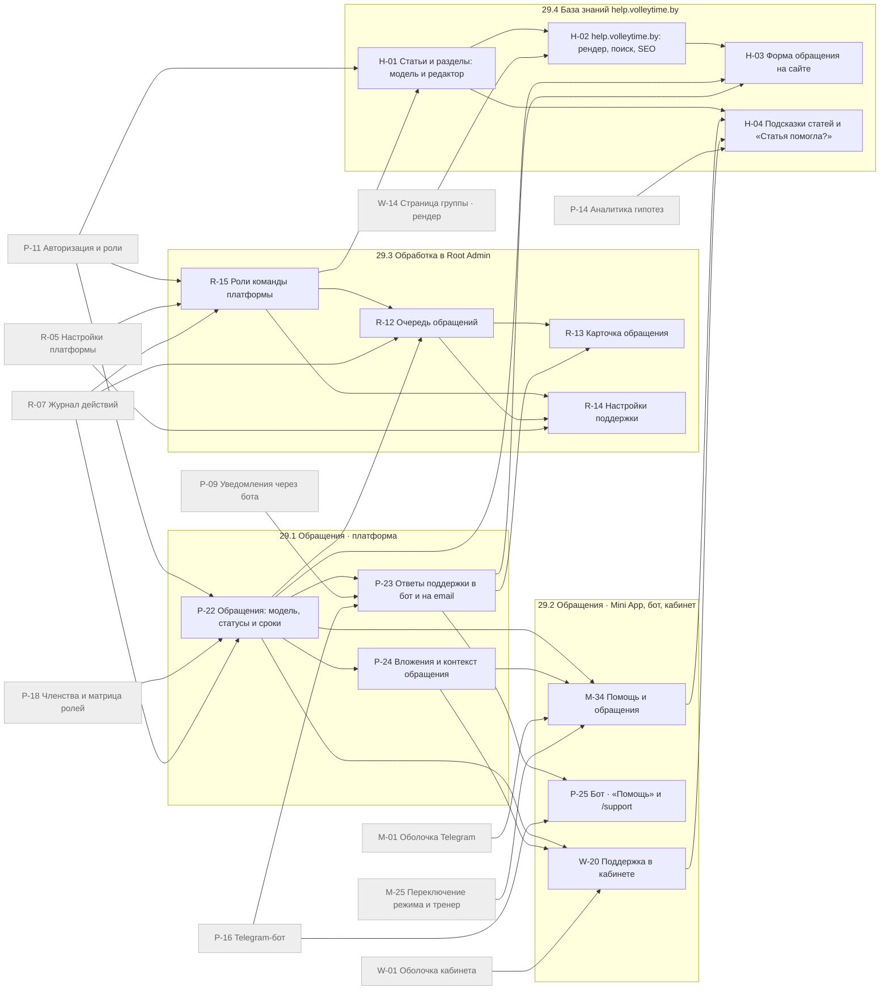

# Фаза 29 · Техподдержка и база знаний

Игроки, тренеры и организаторы пишут в поддержку из Mini App, бота, кабинета или с сайта help.volleytime.by. Команда платформы отвечает в Root Admin → «Поддержка», ответ приходит в бот (или на email) и остаётся в «Моих обращениях». База знаний закрывает частые вопросы до обращения.

Задач: 14 · XL 2 · L 4 · M 7 · S 1

## Решения, принятые для фазы

- Обращения разбираются в Root Admin, не во внешнем хелпдеске.
- Ответ — в бот и в историю в приложении; email — только для обращений с сайта без входа через Telegram.
- База знаний — отдельный сайт help.volleytime.by с разделами по ролям.
- Первый ответ — в течение 4 рабочих часов; часы работы пн–пт 9:00–20:00, сб–вс 10:00–18:00; автозакрытие через 3 дня без ответа пользователя. Значения настраиваются в R-14.
- Жалобы на организатора и игрока (M-33, R-10) остаются отдельным процессом.
- Фаза 29 поглощает карточки проекта 27.10.3 и 10.2.1–10.2.2 «обратная связь в Telegram» (решение владельца 2026-11-24).
- Кнопки баннера модерации «Запросить проверку» и «Ответить модератору» (R-06) — бэклог: идут как обращение в поддержку с темой «Модерация страницы» после 29.3.
- Работать с обращениями может только команда с ролью Support, Admin или Owner — роли команды платформы [R-15](../04-root-admin/R-15-platform-team-roles.md) входят в эпик 29.3 первой задачей.

## Эпики

### 29.1 · Обращения · платформа

Модель обращения, статусы и сроки, вложения и контекст, доставка ответов в бот и на email. Без этого эпика интерфейсы не начинаются.

Задач: 3 · XL 1 · L 0 · M 2 · S 0

| № | ID | Задача | Сложн. | Модель | Зависит от |
|---|---|---|---|---|---|
| 29.1.1 | [P-22](../01-platform/P-22-support-tickets.md) | Обращения: модель, статусы и сроки | XL | Opus | P-11, P-18, R-07 |
| 29.1.2 | [P-23](../01-platform/P-23-support-delivery.md) | Ответы поддержки в бот и на email | M | Sonnet | P-22, P-09, P-16 |
| 29.1.3 | [P-24](../01-platform/P-24-support-attachments.md) | Вложения и контекст обращения | M | Sonnet | P-22 |

### 29.2 · Обращения · Mini App, бот, кабинет

Игрок, тренер и организатор создают обращение там, где работают, и видят переписку в «Моих обращениях».

Задач: 3 · XL 0 · L 1 · M 1 · S 1

| № | ID | Задача | Сложн. | Модель | Зависит от |
|---|---|---|---|---|---|
| 29.2.1 | [M-34](../02-mini-app/M-34-support.md) | Помощь и обращения | L | Sonnet | P-22, P-24, M-01, M-25 |
| 29.2.2 | [P-25](../01-platform/P-25-bot-support.md) | Бот · «Помощь» и /support | S | Haiku | P-23, P-16 |
| 29.2.3 | [W-20](../03-organizer-web/W-20-support.md) | Поддержка в кабинете | M | Sonnet | P-22, P-24, W-01 |

### 29.3 · Обработка в Root Admin

Роли команды платформы, очередь, карточка обращения с ответом и заметками, настройки поддержки: темы, шаблоны, сроки, часы работы.

Задач: 4 · XL 0 · L 2 · M 2 · S 0

| № | ID | Задача | Сложн. | Модель | Зависит от |
|---|---|---|---|---|---|
| 29.3.1 | [R-15](../04-root-admin/R-15-platform-team-roles.md) | Роли команды платформы | L | контракт Opus, UI Sonnet | P-11, R-05, R-07 |
| 29.3.2 | [R-12](../04-root-admin/R-12-support-queue.md) | Очередь обращений | M | Sonnet | P-22, R-07, R-15 |
| 29.3.3 | [R-13](../04-root-admin/R-13-support-ticket.md) | Карточка обращения | L | Sonnet | R-12, P-23 |
| 29.3.4 | [R-14](../04-root-admin/R-14-support-settings.md) | Настройки поддержки | M | Sonnet | R-12, R-05, R-15 |

### 29.4 · База знаний help.volleytime.by

Статьи по ролям, поиск, форма обращения без входа и подсказки статей во всех формах.

Задач: 4 · XL 1 · L 1 · M 2 · S 0

| № | ID | Задача | Сложн. | Модель | Зависит от |
|---|---|---|---|---|---|
| 29.4.1 | [H-01](../05-help-center/H-01-articles.md) | Статьи и разделы: модель и редактор | L | Sonnet | P-11 |
| 29.4.2 | [H-02](../05-help-center/H-02-help-site.md) | help.volleytime.by: рендер, поиск, SEO | XL | Opus | H-01, W-14 |
| 29.4.3 | [H-03](../05-help-center/H-03-contact-form.md) | Форма обращения на сайте | M | Sonnet | H-02, P-22, P-23 |
| 29.4.4 | [H-04](../05-help-center/H-04-article-hints.md) | Подсказки статей и «Статья помогла?» | M | Sonnet | H-01, M-34, W-20, P-14 |

## Граф зависимостей

## Критический путь

Внутри фазы, без учёта уже сделанных задач (вес: S 1, M 2, L 3, XL 5):

P-22 Обращения: модель, статусы и сроки → P-24 Вложения и контекст обращения → M-34 Помощь и обращения → H-04 Подсказки статей и «Статья помогла?»

Эпики 29.1 и 29.4 стартуют параллельно: база знаний (H-01, H-02) не ждёт модели обращений.

## Сводка по моделям

| Модель | Задач | Где |
|---|---|---|
| Opus | 3 | P-22, H-02, R-15 (контракт) |
| Sonnet | 10 | P-23, P-24, M-34, W-20, R-12, R-13, R-14, H-01, H-03, H-04 |
| Haiku | 1 | P-25 |

## Макеты

- 3 Mini App → Профиль → Помощь и поддержка; «?» в панели режима у организатора и тренера
- 2 Telegram Bot → Меню и команды, Поддержка
- 4 Кабинет организатора → Поддержка
- 4b Root Admin → Поддержка
- 10 База знаний (help.volleytime.by)
- 4b Root Admin → Настройки → Команда & роли (R-15)
- Скриншоты: screenshots-2026-11-24/ — папки 3-miniapp-*, 2-bot, 4-cabinet, 4b-root-admin, 11-help

[← План](../README.md) · [Роадмап](../roadmap.md) · [Связи](../links.md)
