# Связи по общему функционалу

Группы задач, которые делят один контракт, компонент или данные между интерфейсами. Менять такую логику — только вместе со всеми задачами группы.

| Функционал | Платформа | Mini App | Кабинет | Root Admin |
|---|---|---|---|---|
| [Создание события](#create-event) | P-03, P-06, P-07, P-08 | M-23, M-16 | W-04, W-02 | — |
| [Состав и запись](#booking) | P-05, P-04 | M-05, M-06, M-09 | W-05 | — |
| [Сбор суммой](#split) | P-03, P-17, P-04 | M-07 | W-04, W-05 | — |
| [Режим записи и приглашения](#invite) | P-07, P-16 | M-23, M-08 | W-11, W-04, W-14 | — |
| [Баланс событий](#balance) | P-08, P-06 | — | W-01, W-12, W-05 | R-02, R-03, R-04, R-08 |
| [Уровни В1–В4+](#levels) | P-10 | M-14, M-24, M-18, M-19, M-15a | W-06, W-13 | — |
| [Настройки группы](#settings) | P-02 | M-02, M-06, M-09 | W-11, W-09, W-04 | — |
| [Абонементы](#subs) | P-02, P-03 | M-02, M-13 | W-09 | — |
| [Личные функции игрока](#features) | P-12, P-09, P-14 | M-02, M-03, M-12, M-15b, M-16, M-17, M-18, M-19, M-20, M-21, M-22 | — | — |
| [Календари и расписание](#calendar) | P-06 | M-10, M-11 | W-03 | — |
| [Уведомления](#notify) | P-09, P-16 | M-13, M-17 | W-15 | — |
| [Игроки и отчёты](#reports) | — | M-24 | W-06, W-10, W-07 | — |
| [Страница группы](#seo) | P-02 | — | W-13, W-14 | R-06 |
| [Доступ и аудит](#auth) | P-11 | M-01 | W-16 | R-05, R-07, R-03 |
| [Самооценка → прогресс → составы → тренер](#skill-chain) | — | M-17, M-18, M-19, M-15a | — | — |
| [Разминка в событии](#warmup) | — | M-23, M-16, M-03 | W-04 | — |
| [Поиск](#search) | P-13 | — | W-01 | — |

## Создание события

Одна форма и один контракт API в кабинете и в Mini App организатора.

- **Платформа:** [P-03](01-platform/P-03-pricing.md) Расчёт цены, [P-06](01-platform/P-06-event-series.md) Серии событий, [P-07](01-platform/P-07-join-mode-invites.md) Режим записи и приглашения, [P-08](01-platform/P-08-event-balance.md) Баланс событий
- **Mini App:** [M-23](02-mini-app/M-23-org-event-create.md) Организатор · создание события, [M-16](02-mini-app/M-16-warmup.md) Разминка
- **Кабинет организатора:** [W-04](03-organizer-web/W-04-event-create.md) Создание события, [W-02](03-organizer-web/W-02-overview.md) Обзор

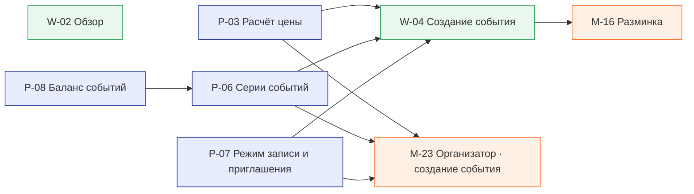

## Состав и запись

Запись игрока и состав у организатора — одни и те же данные и статусы.

- **Платформа:** [P-05](01-platform/P-05-multi-seat-booking.md) Запись на несколько мест, [P-04](01-platform/P-04-event-jobs.md) Фоновые задачи по событию
- **Mini App:** [M-05](02-mini-app/M-05-booking-statuses.md) Статусы записи, [M-06](02-mini-app/M-06-event-booking.md) Событие и запись, [M-09](02-mini-app/M-09-cancel-booking.md) Отмена записи
- **Кабинет организатора:** [W-05](03-organizer-web/W-05-event-card.md) Карточка события

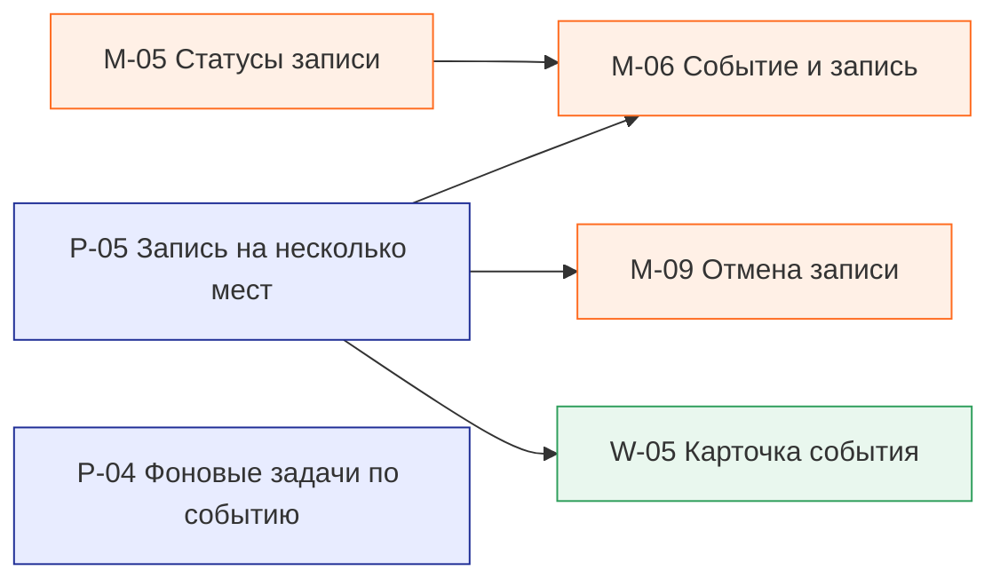

## Сбор суммой

Цена считается в одном месте и одинаково показывается везде.

- **Платформа:** [P-03](01-platform/P-03-pricing.md) Расчёт цены, [P-17](01-platform/P-17-public-event-pages.md) Публичные страницы события, [P-04](01-platform/P-04-event-jobs.md) Фоновые задачи по событию
- **Mini App:** [M-07](02-mini-app/M-07-split-price-event.md) Событие со сбором суммой
- **Кабинет организатора:** [W-04](03-organizer-web/W-04-event-create.md) Создание события, [W-05](03-organizer-web/W-05-event-card.md) Карточка события

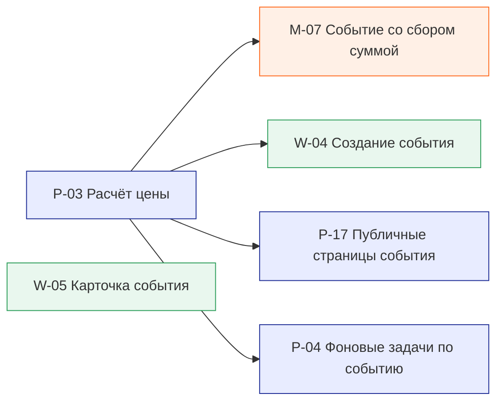

## Режим записи и приглашения

Настройка группы по умолчанию → событие → Mini App и бот.

- **Платформа:** [P-07](01-platform/P-07-join-mode-invites.md) Режим записи и приглашения, [P-16](01-platform/P-16-telegram-bot.md) Telegram-бот
- **Mini App:** [M-23](02-mini-app/M-23-org-event-create.md) Организатор · создание события, [M-08](02-mini-app/M-08-invite-booking.md) Запись по приглашению
- **Кабинет организатора:** [W-11](03-organizer-web/W-11-settings.md) Настройки, [W-04](03-organizer-web/W-04-event-create.md) Создание события, [W-14](03-organizer-web/W-14-group-page-render.md) Страница группы · рендер

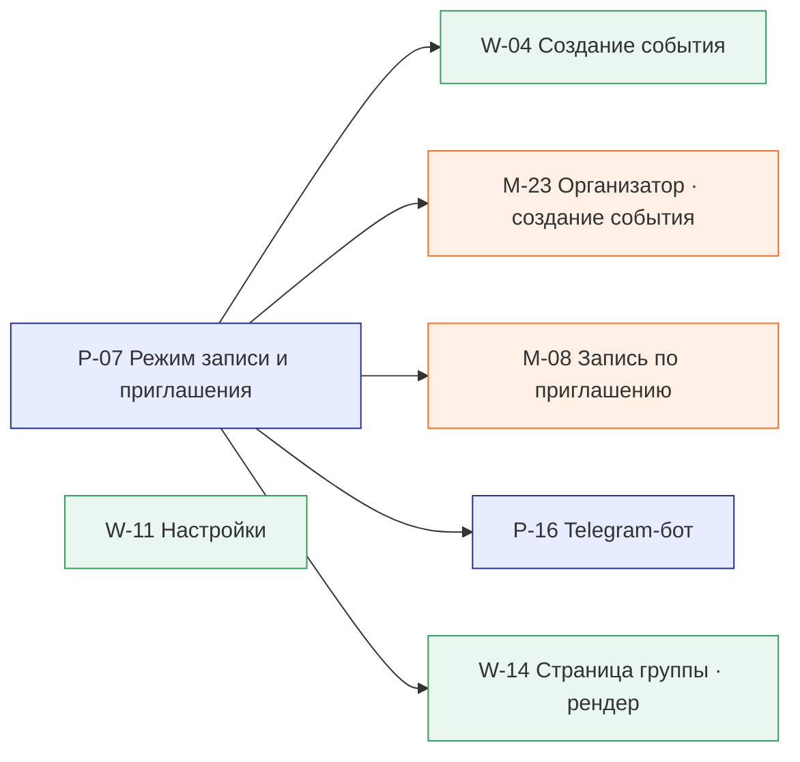

## Баланс событий

Списания организатора и начисления админа — один журнал.

- **Платформа:** [P-08](01-platform/P-08-event-balance.md) Баланс событий, [P-06](01-platform/P-06-event-series.md) Серии событий
- **Кабинет организатора:** [W-01](03-organizer-web/W-01-cabinet-shell.md) Оболочка кабинета, [W-12](03-organizer-web/W-12-balance-billing.md) Баланс и оплата, [W-05](03-organizer-web/W-05-event-card.md) Карточка события
- **Root Admin:** [R-02](04-root-admin/R-02-balance-tariffs.md) Баланс и тарифы, [R-03](04-root-admin/R-03-grant-balance.md) Выдача баланса, [R-04](04-root-admin/R-04-subscriptions-payouts.md) Подписки и выплаты, [R-08](04-root-admin/R-08-rename-credits.md) Переименование credits

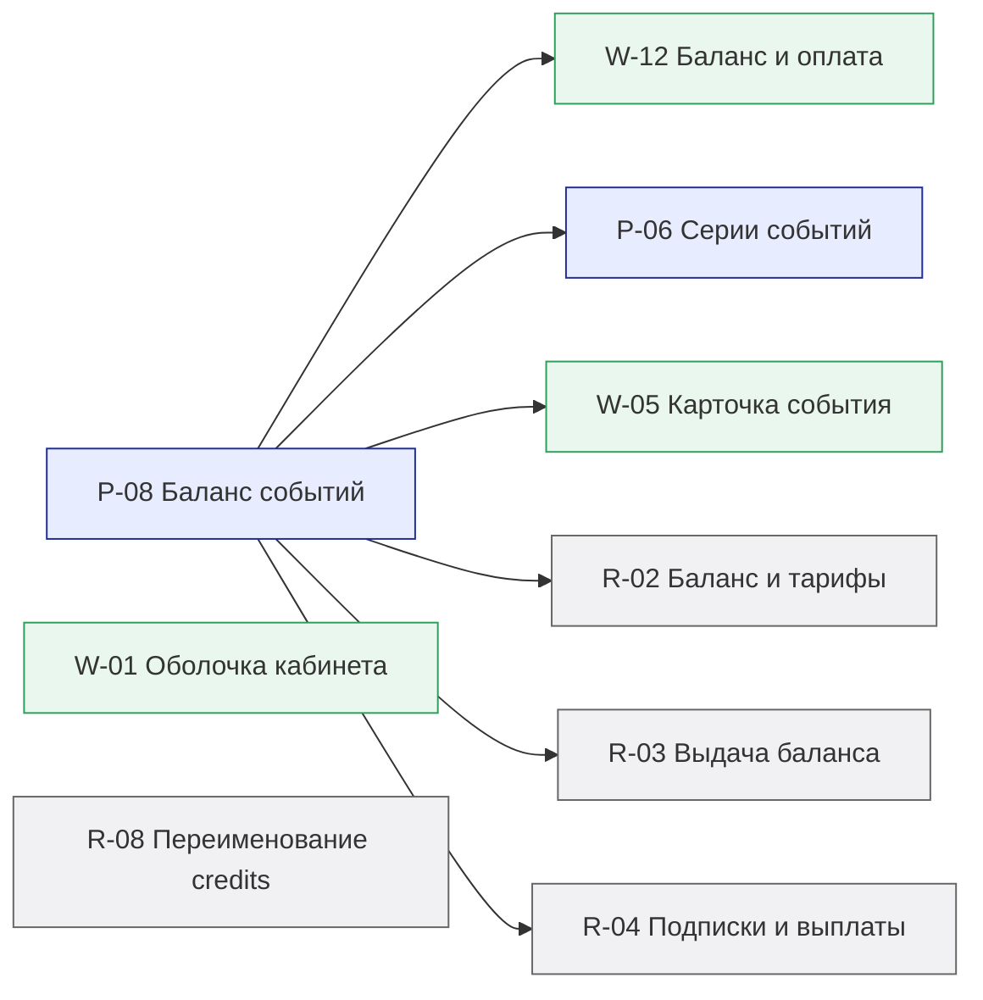

## Уровни В1–В4+

Один справочник для игроков, групп, составов и SEO.

- **Платформа:** [P-10](01-platform/P-10-player-levels.md) Уровни В1–В4+
- **Mini App:** [M-14](02-mini-app/M-14-player-level.md) Уровень игрока, [M-24](02-mini-app/M-24-org-players-report.md) Организатор · игроки и отчёт, [M-18](02-mini-app/M-18-skill-progress.md) Прогресс навыков, [M-19](02-mini-app/M-19-team-balancing.md) Составы на игру, [M-15a](02-mini-app/M-15a-ai-coach-agent.md) AI-тренер · агент
- **Кабинет организатора:** [W-06](03-organizer-web/W-06-players.md) Игроки, [W-13](03-organizer-web/W-13-group-page-builder.md) Страница группы · конструктор

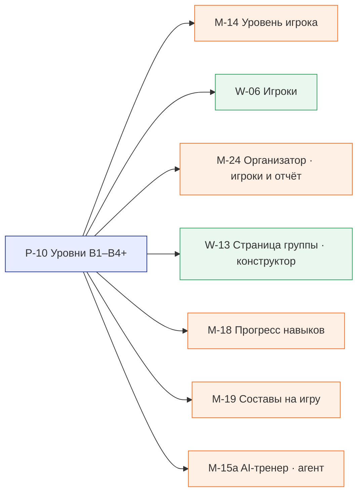

## Настройки группы

Кабинет задаёт поведение Mini App.

- **Платформа:** [P-02](01-platform/P-02-group-settings.md) Настройки группы
- **Mini App:** [M-02](02-mini-app/M-02-tab-bar.md) Таб-бар, [M-06](02-mini-app/M-06-event-booking.md) Событие и запись, [M-09](02-mini-app/M-09-cancel-booking.md) Отмена записи
- **Кабинет организатора:** [W-11](03-organizer-web/W-11-settings.md) Настройки, [W-09](03-organizer-web/W-09-subscriptions.md) Абонементы, [W-04](03-organizer-web/W-04-event-create.md) Создание события

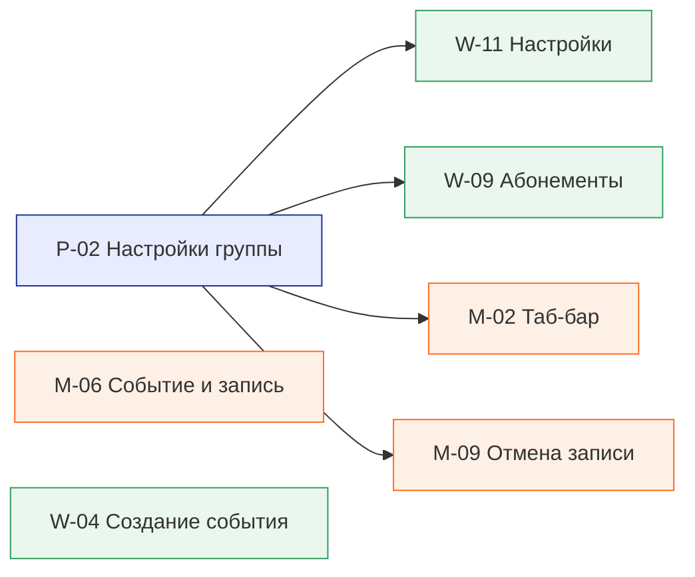

## Абонементы

Выключатель в кабинете скрывает вкладку и продажу в Mini App.

- **Платформа:** [P-02](01-platform/P-02-group-settings.md) Настройки группы, [P-03](01-platform/P-03-pricing.md) Расчёт цены
- **Mini App:** [M-02](02-mini-app/M-02-tab-bar.md) Таб-бар, [M-13](02-mini-app/M-13-player-screens.md) Остальные экраны игрока
- **Кабинет организатора:** [W-09](03-organizer-web/W-09-subscriptions.md) Абонементы

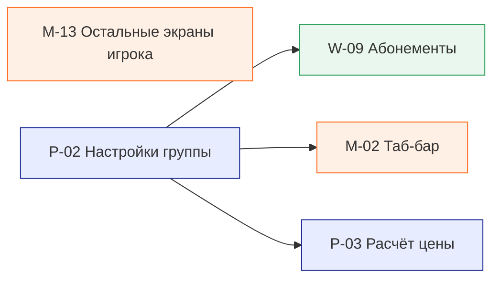

## Личные функции игрока

Флаги управляют главной, таб-баром, уведомлениями и гипотезами.

- **Платформа:** [P-12](01-platform/P-12-player-features.md) Личные функции игрока, [P-09](01-platform/P-09-bot-notifications.md) Уведомления через бота, [P-14](01-platform/P-14-feature-analytics.md) Аналитика гипотез
- **Mini App:** [M-02](02-mini-app/M-02-tab-bar.md) Таб-бар, [M-03](02-mini-app/M-03-home-feed.md) Главная «Лента дня», [M-12](02-mini-app/M-12-profile-features.md) Профиль и «Что показывать», [M-15b](02-mini-app/M-15b-ai-coach-ui.md) AI-тренер · экраны, [M-16](02-mini-app/M-16-warmup.md) Разминка, [M-17](02-mini-app/M-17-self-check.md) Самооценка, [M-18](02-mini-app/M-18-skill-progress.md) Прогресс навыков, [M-19](02-mini-app/M-19-team-balancing.md) Составы на игру, [M-20](02-mini-app/M-20-streaks.md) Серии и челленджи, [M-21](02-mini-app/M-21-mvp-vote.md) MVP игры, [M-22](02-mini-app/M-22-season-wrapped.md) Итоги сезона

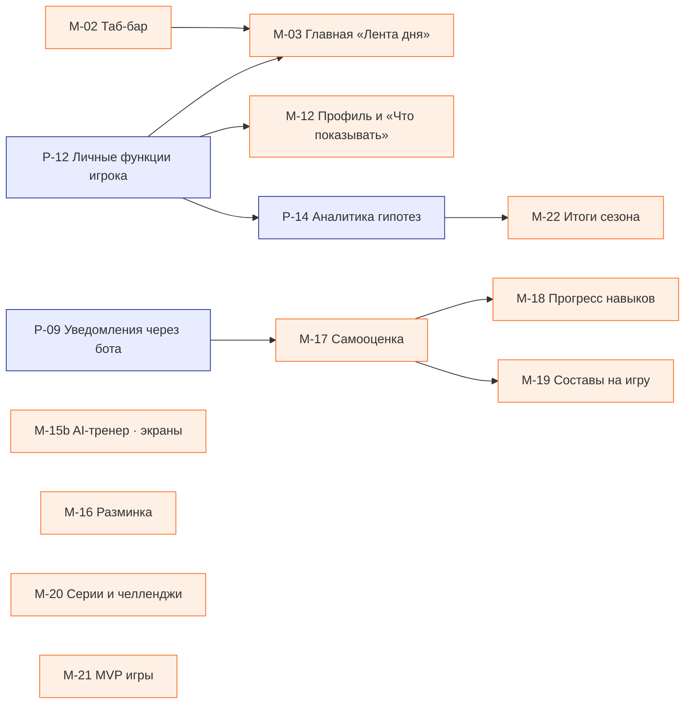

## Календари и расписание

Общий календарь игрока, расписание группы и календарь кабинета читают одни события.

- **Платформа:** [P-06](01-platform/P-06-event-series.md) Серии событий
- **Mini App:** [M-10](02-mini-app/M-10-my-calendar.md) Общий календарь, [M-11](02-mini-app/M-11-group-schedule.md) Расписание группы
- **Кабинет организатора:** [W-03](03-organizer-web/W-03-events.md) События

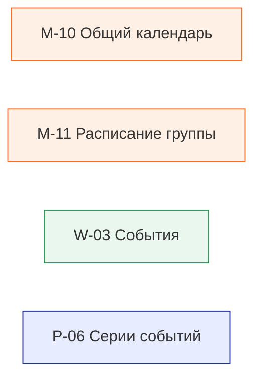

## Уведомления

Бот, лента Mini App и лента кабинета — один источник.

- **Платформа:** [P-09](01-platform/P-09-bot-notifications.md) Уведомления через бота, [P-16](01-platform/P-16-telegram-bot.md) Telegram-бот
- **Mini App:** [M-13](02-mini-app/M-13-player-screens.md) Остальные экраны игрока, [M-17](02-mini-app/M-17-self-check.md) Самооценка
- **Кабинет организатора:** [W-15](03-organizer-web/W-15-notifications.md) Уведомления кабинета

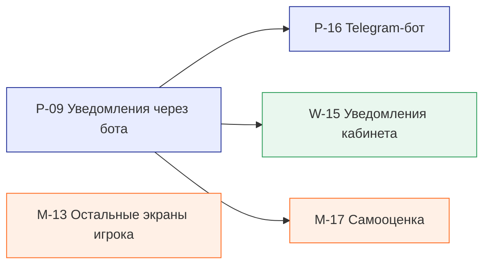

## Игроки и отчёты

Одни цифры в кабинете и в Mini App организатора.

- **Mini App:** [M-24](02-mini-app/M-24-org-players-report.md) Организатор · игроки и отчёт
- **Кабинет организатора:** [W-06](03-organizer-web/W-06-players.md) Игроки, [W-10](03-organizer-web/W-10-reports.md) Отчёты, [W-07](03-organizer-web/W-07-cashbox.md) Касса

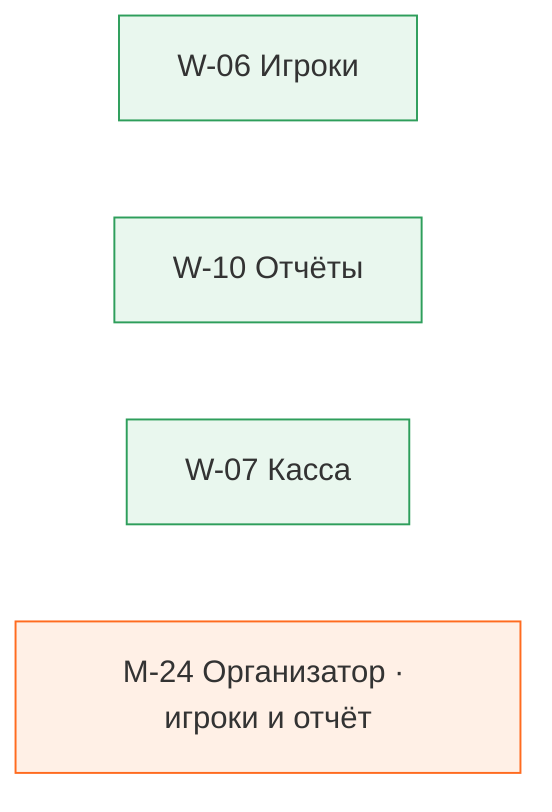

## Страница группы

Конструктор организатора, рендер и модерация root.

- **Платформа:** [P-02](01-platform/P-02-group-settings.md) Настройки группы
- **Кабинет организатора:** [W-13](03-organizer-web/W-13-group-page-builder.md) Страница группы · конструктор, [W-14](03-organizer-web/W-14-group-page-render.md) Страница группы · рендер
- **Root Admin:** [R-06](04-root-admin/R-06-group-page-moderation.md) Модерация страниц групп

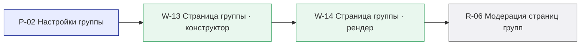

## Доступ и аудит

Права и журнал для всех интерфейсов.

- **Платформа:** [P-11](01-platform/P-11-auth-roles.md) Авторизация и роли
- **Mini App:** [M-01](02-mini-app/M-01-telegram-shell.md) Оболочка Telegram
- **Кабинет организатора:** [W-16](03-organizer-web/W-16-auth.md) Авторизация
- **Root Admin:** [R-05](04-root-admin/R-05-platform-settings.md) Настройки платформы, [R-07](04-root-admin/R-07-audit-log.md) Журнал действий, [R-03](04-root-admin/R-03-grant-balance.md) Выдача баланса

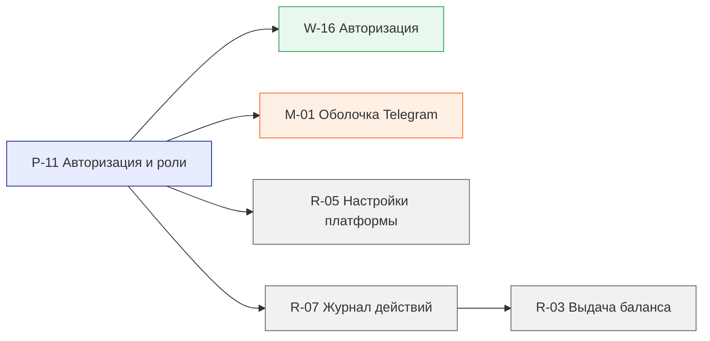

## Самооценка → прогресс → составы → тренер

Данные самооценки питают прогресс, балансировку и план тренера.

- **Mini App:** [M-17](02-mini-app/M-17-self-check.md) Самооценка, [M-18](02-mini-app/M-18-skill-progress.md) Прогресс навыков, [M-19](02-mini-app/M-19-team-balancing.md) Составы на игру, [M-15a](02-mini-app/M-15a-ai-coach-agent.md) AI-тренер · агент

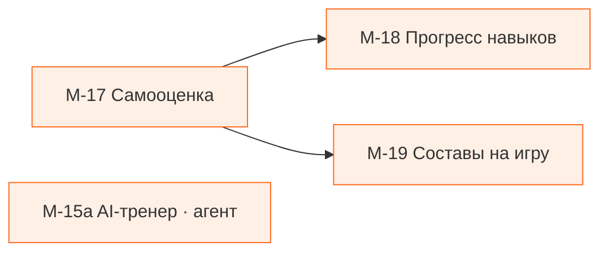

## Разминка в событии

Организатор включает разминку в событие, игрок видит и пропускает её.

- **Mini App:** [M-23](02-mini-app/M-23-org-event-create.md) Организатор · создание события, [M-16](02-mini-app/M-16-warmup.md) Разминка, [M-03](02-mini-app/M-03-home-feed.md) Главная «Лента дня»
- **Кабинет организатора:** [W-04](03-organizer-web/W-04-event-create.md) Создание события

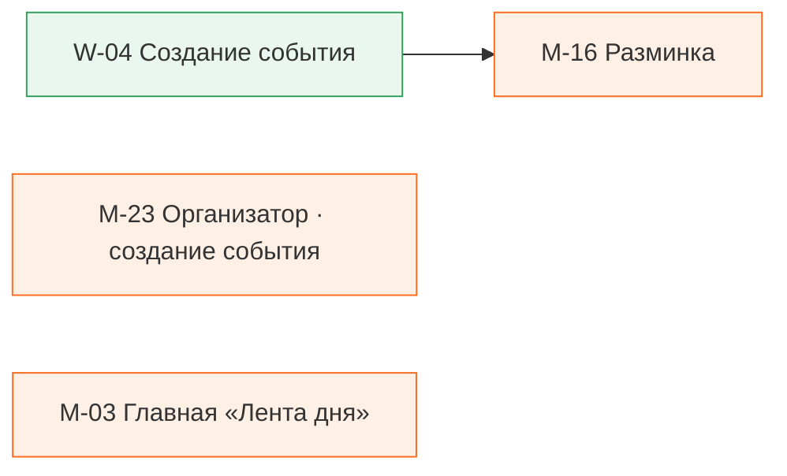

## Поиск

Поиск топбара кабинета.

- **Платформа:** [P-13](01-platform/P-13-cabinet-search.md) Поиск кабинета
- **Кабинет организатора:** [W-01](03-organizer-web/W-01-cabinet-shell.md) Оболочка кабинета

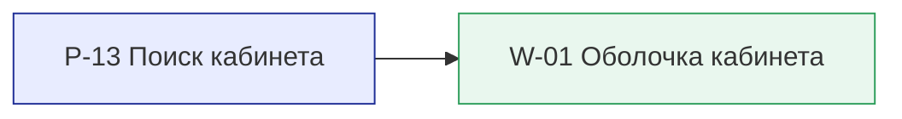

Цвет: синий — платформа, оранжевый — Mini App, зелёный — кабинет, серый — Root Admin.

[← План](README.md) · [Роадмап](roadmap.md)