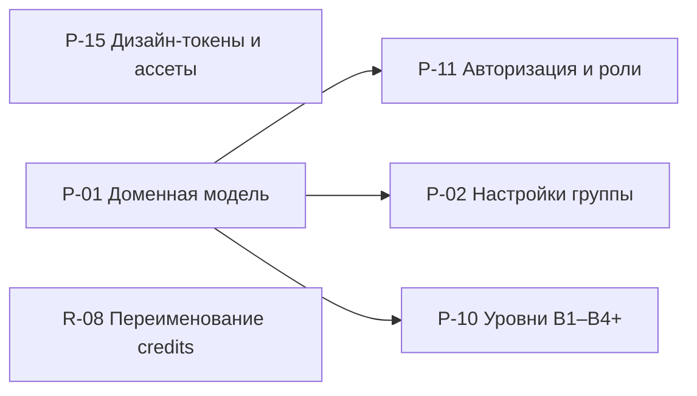
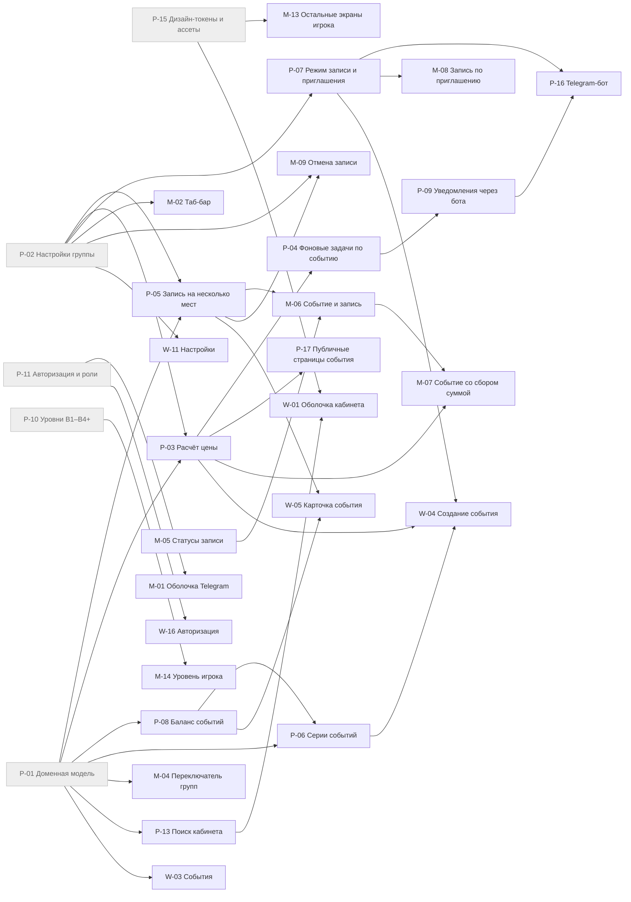
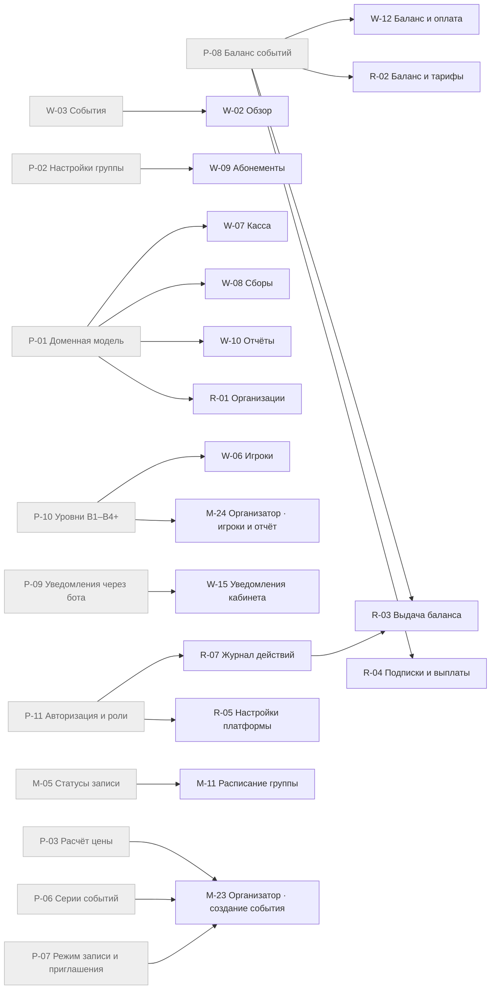
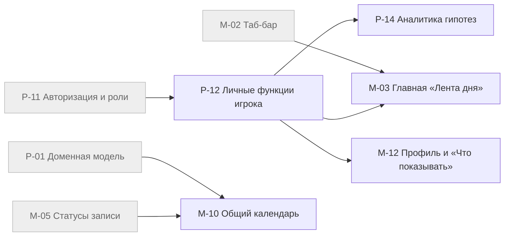
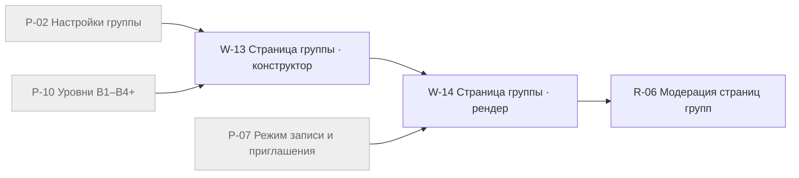
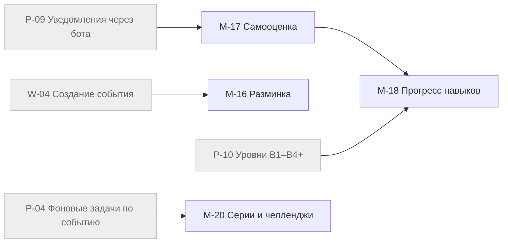
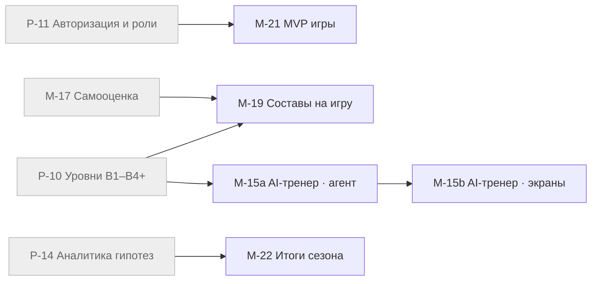

# Роадмап

Фазы идут по порядку; внутри фазы задачи без взаимных зависимостей делаются параллельно. Ф3 и Ф4 можно вести одновременно.

## Ф0 · Фундамент

Схема данных, права, настройки группы, токены. Без этого ни одна задача не начинается.

Задач: 6 · XL 2 · L 0 · M 2 · S 2

**Платформа:** [P-15](01-platform/P-15-design-tokens.md) Дизайн-токены и ассеты (S · Haiku); [P-01](01-platform/P-01-domain-model.md) Доменная модель (XL · Opus); [P-11](01-platform/P-11-auth-roles.md) Авторизация и роли (XL · Opus); [P-02](01-platform/P-02-group-settings.md) Настройки группы (M · Sonnet); [P-10](01-platform/P-10-player-levels.md) Уровни В1–В4+ (M · Sonnet)

**Root Admin:** [R-08](04-root-admin/R-08-rename-credits.md) Переименование credits (S · Haiku)

## Ф1 · Запись и ядро

Игрок записывается и платит в Mini App, организатор создаёт событие и серию в кабинете. Это первый релиз.

Задач: 26 · XL 5 · L 5 · M 12 · S 4

**Платформа:** [P-05](01-platform/P-05-multi-seat-booking.md) Запись на несколько мест (XL · Opus); [P-03](01-platform/P-03-pricing.md) Расчёт цены (XL · Opus); [P-04](01-platform/P-04-event-jobs.md) Фоновые задачи по событию (XL · Opus); [P-07](01-platform/P-07-join-mode-invites.md) Режим записи и приглашения (M · Sonnet); [P-08](01-platform/P-08-event-balance.md) Баланс событий (XL · Opus); [P-06](01-platform/P-06-event-series.md) Серии событий (XL · Opus); [P-09](01-platform/P-09-bot-notifications.md) Уведомления через бота (M · Sonnet); [P-16](01-platform/P-16-telegram-bot.md) Telegram-бот (M · Sonnet); [P-17](01-platform/P-17-public-event-pages.md) Публичные страницы события (M · Sonnet); [P-13](01-platform/P-13-cabinet-search.md) Поиск кабинета (M · Sonnet)

**Mini App:** [M-01](02-mini-app/M-01-telegram-shell.md) Оболочка Telegram (M · Sonnet); [M-02](02-mini-app/M-02-tab-bar.md) Таб-бар (S · Haiku); [M-04](02-mini-app/M-04-group-switcher.md) Переключатель групп (S · Haiku); [M-05](02-mini-app/M-05-booking-statuses.md) Статусы записи (M · Sonnet); [M-06](02-mini-app/M-06-event-booking.md) Событие и запись (L · Sonnet); [M-07](02-mini-app/M-07-split-price-event.md) Событие со сбором суммой (L · Sonnet); [M-08](02-mini-app/M-08-invite-booking.md) Запись по приглашению (M · Sonnet); [M-09](02-mini-app/M-09-cancel-booking.md) Отмена записи (S · Haiku); [M-13](02-mini-app/M-13-player-screens.md) Остальные экраны игрока (M · Sonnet); [M-14](02-mini-app/M-14-player-level.md) Уровень игрока (S · Haiku)

**Кабинет организатора:** [W-16](03-organizer-web/W-16-auth.md) Авторизация (M · Sonnet); [W-01](03-organizer-web/W-01-cabinet-shell.md) Оболочка кабинета (M · Sonnet); [W-03](03-organizer-web/W-03-events.md) События (M · Sonnet); [W-04](03-organizer-web/W-04-event-create.md) Создание события (L · Sonnet); [W-05](03-organizer-web/W-05-event-card.md) Карточка события (L · Sonnet); [W-11](03-organizer-web/W-11-settings.md) Настройки (L · Sonnet)

## Ф2 · Кабинет, Mini App организатора, Root Admin

Все разделы кабинета, режим организатора в Mini App, управление платформой.

Задач: 17 · XL 1 · L 2 · M 12 · S 2

**Mini App:** [M-11](02-mini-app/M-11-group-schedule.md) Расписание группы (M · Sonnet); [M-23](02-mini-app/M-23-org-event-create.md) Организатор · создание события (L · Sonnet); [M-24](02-mini-app/M-24-org-players-report.md) Организатор · игроки и отчёт (M · Sonnet)

**Кабинет организатора:** [W-02](03-organizer-web/W-02-overview.md) Обзор (S · Haiku); [W-06](03-organizer-web/W-06-players.md) Игроки (M · Sonnet); [W-07](03-organizer-web/W-07-cashbox.md) Касса (M · Sonnet); [W-08](03-organizer-web/W-08-collections.md) Сборы (M · Sonnet); [W-09](03-organizer-web/W-09-subscriptions.md) Абонементы (M · Sonnet); [W-10](03-organizer-web/W-10-reports.md) Отчёты (M · Sonnet); [W-12](03-organizer-web/W-12-balance-billing.md) Баланс и оплата (M · Sonnet); [W-15](03-organizer-web/W-15-notifications.md) Уведомления кабинета (S · Haiku)

**Root Admin:** [R-07](04-root-admin/R-07-audit-log.md) Журнал действий (M · Sonnet); [R-01](04-root-admin/R-01-organizations.md) Организации (M · Sonnet); [R-02](04-root-admin/R-02-balance-tariffs.md) Баланс и тарифы (M · Sonnet); [R-03](04-root-admin/R-03-grant-balance.md) Выдача баланса (M · Sonnet); [R-04](04-root-admin/R-04-subscriptions-payouts.md) Подписки и выплаты (XL · Opus); [R-05](04-root-admin/R-05-platform-settings.md) Настройки платформы (L · Sonnet)

## Ф3 · Вариант A: личные функции и календарь

Главная «Лента дня», общий календарь, экран «Что показывать». Готовит место для гипотез.

Задач: 5 · XL 0 · L 2 · M 3 · S 0

**Платформа:** [P-12](01-platform/P-12-player-features.md) Личные функции игрока (M · Sonnet); [P-14](01-platform/P-14-feature-analytics.md) Аналитика гипотез (M · Sonnet)

**Mini App:** [M-03](02-mini-app/M-03-home-feed.md) Главная «Лента дня» (L · Sonnet); [M-10](02-mini-app/M-10-my-calendar.md) Общий календарь (L · Sonnet); [M-12](02-mini-app/M-12-profile-features.md) Профиль и «Что показывать» (M · Sonnet)

## Ф4 · SEO-страницы групп

Конструктор, серверный рендер и модерация. Можно вести параллельно с Ф3.

Задач: 3 · XL 1 · L 1 · M 1 · S 0

**Кабинет организатора:** [W-13](03-organizer-web/W-13-group-page-builder.md) Страница группы · конструктор (L · Sonnet); [W-14](03-organizer-web/W-14-group-page-render.md) Страница группы · рендер (XL · Opus)

**Root Admin:** [R-06](04-root-admin/R-06-group-page-moderation.md) Модерация страниц групп (M · Sonnet)

## Ф5 · Гипотезы · волна 1

Дешёвые гипотезы без LLM. Каждая за флагом, решение по метрикам P-14.

Задач: 4 · XL 0 · L 1 · M 3 · S 0

**Mini App:** [M-16](02-mini-app/M-16-warmup.md) Разминка (L · Sonnet); [M-17](02-mini-app/M-17-self-check.md) Самооценка (M · Sonnet); [M-18](02-mini-app/M-18-skill-progress.md) Прогресс навыков (M · Sonnet); [M-20](02-mini-app/M-20-streaks.md) Серии и челленджи (M · Sonnet)

## Ф6 · Гипотезы · волна 2

Гипотезы с алгоритмами и LLM. Стартуют, когда волна 1 дала данные самооценки.

Задач: 5 · XL 2 · L 1 · M 2 · S 0

**Mini App:** [M-21](02-mini-app/M-21-mvp-vote.md) MVP игры (M · Sonnet); [M-19](02-mini-app/M-19-team-balancing.md) Составы на игру (XL · Opus); [M-15a](02-mini-app/M-15a-ai-coach-agent.md) AI-тренер · агент (XL · Opus); [M-15b](02-mini-app/M-15b-ai-coach-ui.md) AI-тренер · экраны (L · Sonnet); [M-22](02-mini-app/M-22-season-wrapped.md) Итоги сезона (M · Sonnet)

## Критический путь

Самая длинная цепочка зависимостей (вес: S 1, M 2, L 3, XL 5):

P-01 Доменная модель → P-02 Настройки группы → P-03 Расчёт цены → P-04 Фоновые задачи по событию → P-09 Уведомления через бота → M-17 Самооценка → M-19 Составы на игру

Задержка любой задачи на этом пути сдвигает финал.

## Сводка по моделям

| Модель | Задач | Где |
|---|---|---|
| Opus | 11 | P-01, P-03, P-04, P-05, P-06, P-08, P-11, M-15a, M-19, W-14, R-04 |
| Sonnet | 47 | P-02, P-07, P-09, P-10, P-12, P-13, P-14, P-16, P-17, M-01, M-03, M-05, M-06, M-07, M-08, M-10, M-11, M-12, M-13, M-15b, M-16, M-17, M-18, M-20, M-21, M-22, M-23, M-24, W-01, W-03, W-04, W-05, W-06, W-07, W-08, W-09, W-10, W-11, W-12, W-13, W-16, R-01, R-02, R-03, R-05, R-06, R-07 |
| Haiku | 8 | P-15, M-02, M-04, M-09, M-14, W-02, W-15, R-08 |

[← План](README.md) · [Связи](links.md)